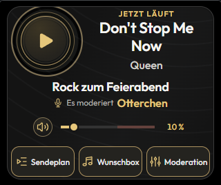
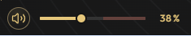
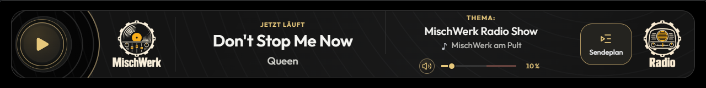
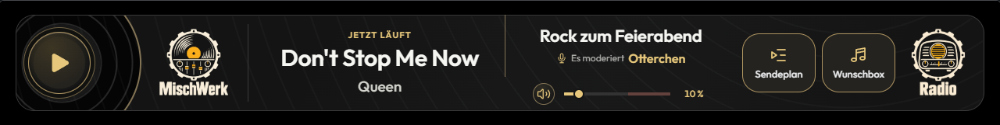
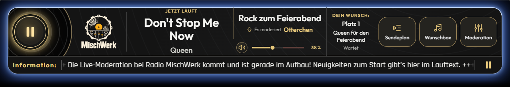
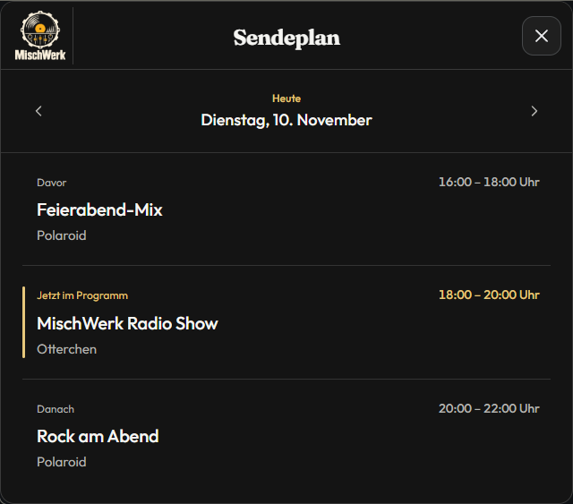
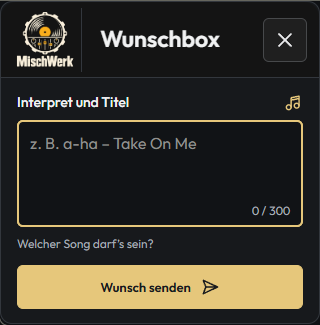
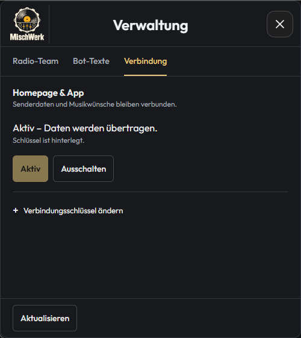

# MischWerk

[](../PROJEKT/package.json)
[](../PROJEKT/package.json)
[](../PROJEKT/website/README.md)
[](../PROJEKT/README.md#lokal-arbeiten)
[](../PROJEKT/docs/architektur/ARCHITEKTUR.md)
[](https://github.com/YvesBerlin1990/MischWerk/commits/main/)

Radio-App für den Knuddels-MyChannel **MischWerk** mit Musikwünschen, Moderation, Sendeplan und eigener Homepage.

**App 0.1.382 · Build 382 · Website 0.2.11** · Stand: 12. November 2026.


- **Radio:** HTTPS-Stream mit Play/Stop und aktuellen Titeln direkt vom SPCast-Streamserver. Der goldene Lautstärkeregler steht auf allen Breiten waagerecht unter Thema und Moderationsname. Vinyl-Player und Original-Logo bleiben erhalten. Ein eigener Wunsch erscheint breit nur bei Bedarf; die übrige Fläche nutzen Musik und Sendungsinfo. Während der Wiedergabe leuchten Playtaste und Außenrand.
- **Wunschbox erst bei Live-Moderation:** Hörer sehen den Button erst, wenn sich die Moderation anmeldet und die Wunschannahme freigegeben ist. Im AutoDJ, nach Abmeldung und bei gesperrter Wunschannahme ist er ausgeblendet. Das Öffnen des Moderationsmenüs allein startet keine Sendung. Ein freies Textfeld nimmt den Wunsch auf; bestätigte offene Wünsche bleiben bei Appupdates und Neustarts gespeichert.
- **Moderation:** Native Anmeldung ohne persönliche PIN, Anmelden und Abmelden ohne Zeitlimit, Sendungsthema, private Wunschregie und bestätigte Übergabe an andere Moderatoren. Das Menü bietet die Bereiche Sendung und Wünsche.
- **Lauftext:** /lauftext TEXT setzt und aktiviert die Laufzeile mit automatisch ergänzten +++; --aus/--an erhält den gespeicherten Text.
- **Sendeplan aus der Homepage:** Die App liest die öffentliche Tagesübersicht von [radio-mischwerk.web.app](https://radio-mischwerk.web.app/) mit Thema, Moderationsname und Uhrzeit. Davor, aktuelle Sendung und Danach sind zugeordnet. Auch AutoDJ-Zeilen stammen aus den gelieferten Homepage-Daten; leere Tage und Abruffehler werden ausdrücklich angezeigt. Für den Lesezugriff sind weder ein Verbindungsschlüssel noch eine aktivierte Statusübertragung nötig. Die redaktionelle Planung wird auf der Homepage gepflegt.
- **Verwaltung:** Radio-Team, Bot-Texte und Verbindungseinstellungen auf einer ruhigen flachen Fläche mit kurzen Texten und direkter Textauswahl. Für den Channelinhaber über `/mw admin` erreichbar.
- **Homepage und Android:** Eigene Website mit geschütztem Arbeitsbereich sowie signierte Senderdaten und Musikwünsche über den bestehenden Android-Rückkanal. Einrichtung und Produktionsabnahme sind separat dokumentiert.
- **Begrüßung und Nickliste:** Private Willkommensgrafik mit aktivem Website-Button sowie öffentliche Begrüßung mit goldener Hervorhebung und Profilverlinkung. Für den ersten Satz wird RobotoBold angefordert. Die neuen Original-Icons kennzeichnen Radio-Team, laufende Wiedergabe mit Ton und bestätigte Moderation.

## Einblicke

| Radio bei schmalem Fenster | Waagerechte Lautstärke |
| --- | --- |
|  |  |

**Wunschbox für Hörer: im AutoDJ ausgeblendet, nach angemeldeter Live-Moderation und Freigabe sichtbar.**







Alle **35 App-Screenshots** und die **drei Websiteaufnahmen** wurden am **12. November 2026** mit **Build 382 / Website 0.2.11** erneuert. Sie zeigen den tatsächlichen lokalen Appcode mit Beispieldaten und ersetzen die früheren Aufnahmen. Native Knuddels-Darstellung, Schrift- und Profilklickwirkung bleiben gesondert abzunehmen. Weitere Bilder und Prüfergebnisse stehen im [App-Prüfbericht](../PROJEKT/docs/pruefung/PRUEFBERICHT.md).



| Wunschbox | Verwaltung und Verbindung |
| --- | --- |
|  |  |

## Lokal starten

Voraussetzungen: Node.js ab 20 und pnpm 11.25.0. Im Repositoryordner:

```powershell
pnpm --dir PROJEKT install --frozen-lockfile
pnpm --dir PROJEKT run emulator
```

Das integrierte Testlabor öffnet unter [127.0.0.1:8776](http://127.0.0.1:8776) den lokalen Appcode mit Testnutzern und getrennten Radio-/Overlayfenstern. Audio beginnt nach Play.

Die eigenständige [Website](../PROJEKT/website/README.md) benötigt Node.js ab 22. Appadapter und Mailversand sind standardmäßig ausgeschaltet. Offene Produktionsfragen und bekannte Websitebefunde stehen im [Website-Prüfbericht](../PROJEKT/website/docs/PRUEFUNG.md).

## Projekt und Dokumentation

| Ablage | Inhalt |
| --- | --- |
| `PROJEKT/src/backend/` | Gepflegte ES5-/Rhino-Backendmodule |
| `PROJEKT/app/` | Erzeugte Backendlaufzeit und gepflegte Browseroberfläche |
| `PROJEKT/website/` | Homepage und eigener Webserver |
| `PROJEKT/tools/` · `PROJEKT/tests/` | Build, Testlabor und Prüfungen |
| `PROJEKT/docs/` | Architektur, API-Nachweise, Betrieb und aktuelle Prüfbilder |
| `PROJEKT/deployment/` | Zielkonfiguration und fünf Auslieferungsmanifeste |

Der lokale Paketbau bündelt die App für Knuddels im Desktop-UPLOAD. Private Konfigurationen, Zugangsdaten, installierte Abhängigkeiten und UPLOAD gehören nicht ins Repository.

[Technischer Einstieg und Prüfungsbefehle](../PROJEKT/README.md) · [Projektregeln](../PROJEKT/AGENTS.md) · [Testlabor-Bedienhilfe](../PROJEKT/tools/emulator/www/help.html) · [Installation und Betrieb](../PROJEKT/docs/betrieb/INBETRIEBNAHME.md) · [Native Abnahme](../PROJEKT/docs/betrieb/LIVE-ABNAHME.md)
