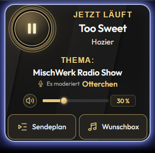
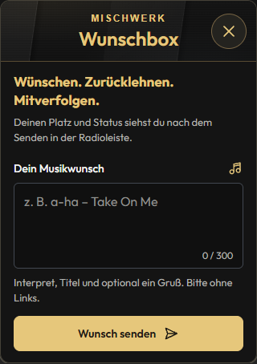
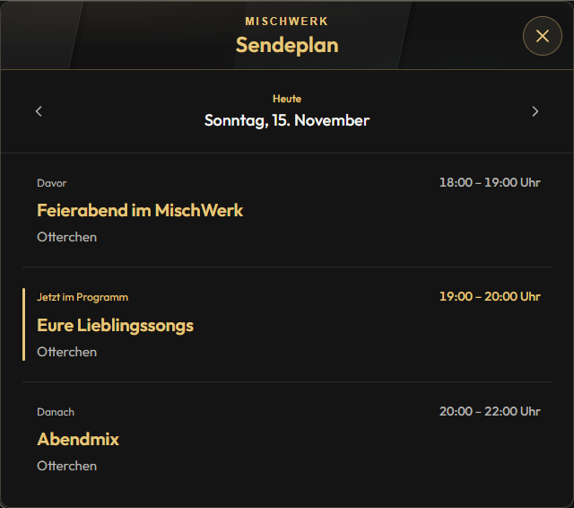

<picture>
  <source media="(max-width: 600px)" srcset="mischwerk-header-schmal.png">
  
</picture>

# MischWerk · Radio & Community

Radio-App für den Knuddels-MyChannel **MischWerk** mit Musikwünschen, Moderation, Sendeplan und eigener Homepage.

[](../PROJEKT/package.json)
[](../PROJEKT/package.json)
[](../PROJEKT/website/README.md)

**App 0.1.448 · Build 448 · Website 0.2.13** · Stand: 17. November 2026.


## Funktionen

- **Radio:** Play/Stop, aktuelle Titel und Lautstärke mit Stummschaltung. Die Radioleiste öffnet automatisch; die Wiedergabe beginnt nach Play.
- **Musikwünsche:** Ein freies Textfeld für den Wunsch. Nach dem Absenden zeigt der persönliche Live-Status den bestätigten Platz und die Schritte der Moderation – auch in schmalen Ansichten. Für Hörer erscheint die Wunschbox bei zentral bestätigter Live-Sendung und freigegebener Wunschannahme. Bestätigte offene Wünsche bleiben über Appupdates und Neustarts gespeichert.
- **Live Studio:** Sendung, Thema, Wunschbox und Regie werden zentral über Firebase geführt. Knuddels zeigt den bestätigten Stand; eine native Moderationsanmeldung gibt es nicht mehr.
- **Sendeplan:** Öffentliche Tagesübersicht aus der Homepage mit Navigation durch vergangene, aktuelle und nächste Kalenderwoche. Die redaktionelle Planung erfolgt auf der Homepage.
- **Verwaltung:** Lauftext, getrennte Team-/Mikrofon-/Kopfhöreranzeige, Sendungsmeldungen, Bot-Texte und Verbindung für den echten Inhaber Otterchen und Polaroid über `/mw admin`; freigegebene Nicks sind rein lesend.
- **Homepage und Android:** Gemeinsamer zentraler Wunschbestand mit individueller Annahmequittung und eigenem Status. Einrichtung und ausstehende gemeinsame Abnahmen stehen in der [Betriebsdokumentation](../PROJEKT/docs/betrieb/LIVE-ABNAHME.md).

## Einblicke

| Schmale Radioleiste | Wunschbox | Verwaltung |
| --- | --- | --- |
|  |  |  |




Die Bilder zeigen lokale Testmodelle mit Beispieldaten. Aufnahme- und Prüfstände sowie offene native Abnahmen sind im [App-Prüfbericht](../PROJEKT/docs/pruefung/PRUEFBERICHT.md) dokumentiert.

## Lokal starten

Voraussetzungen: **Git**, **Node.js 24** und **pnpm 11.25.0**. Im Repositoryordner:

```powershell
pnpm --dir PROJEKT install --frozen-lockfile
pnpm --dir PROJEKT run emulator
```

Der zentral gelieferte UserApp-Emulator ist unter `127.0.0.1:3105` erreichbar. Unter Windows richtet der erste Start den automatischen Abgleich für diese lokale Repositorykopie ein; `pnpm --dir PROJEKT run emulator:setup` erneuert die Einrichtung ausdrücklich. Weitere Rechner verwenden denselben Einstieg und ihre eigene Git-Anmeldung. Bei gesperrten PowerShell-Skripten `pnpm.cmd` verwenden. Die eigenständige [Website](../PROJEKT/website/README.md) benötigt Node.js ab 22.

## Projekt und Dokumentation

Der Projektcode liegt in [`PROJEKT/`](../PROJEKT/). Die [technische Übersicht](../PROJEKT/README.md) erklärt Ordner, Werkzeuge und Prüfungsbefehle. Verbindliche Projektregeln stehen zentral in [AGENTS.md](../AGENTS.md).

[Installation und Betrieb](../PROJEKT/docs/betrieb/INBETRIEBNAHME.md) · [Emulator-Dokumentation](../PROJEKT/tools/userapp-emulator/laufzeit-und-submodul.md) · [App-Prüfbericht](../PROJEKT/docs/pruefung/PRUEFBERICHT.md) · [Website-Prüfbericht](../PROJEKT/website/docs/PRUEFUNG.md) · [Native Abnahme](../PROJEKT/docs/betrieb/LIVE-ABNAHME.md)
