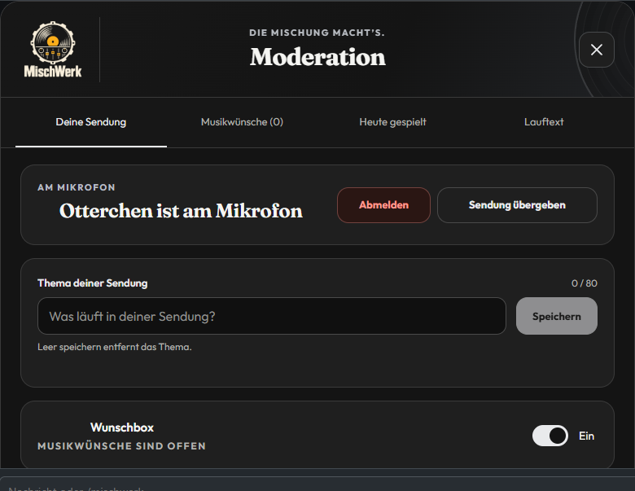
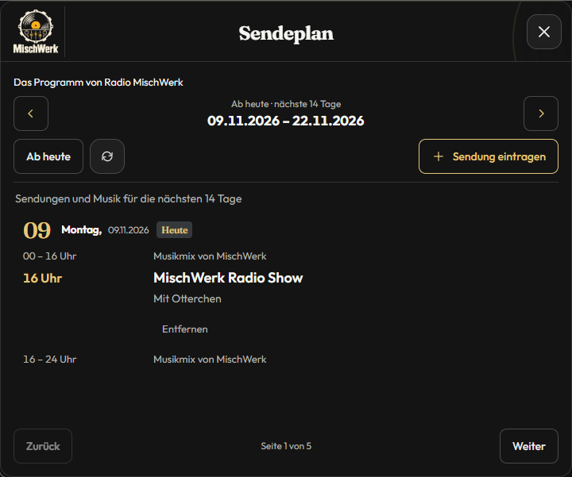

# MischWerk

Radio-App für den Knuddels-MyChannel **MischWerk** mit Musikwünschen, Moderation, Sendeplan und eigener Homepage.

**App 0.1.269 · Build 269 · Website 0.2.1** — Stand: 6. November 2026.


- **Begrüßung:** Einheitlich „Willkommen bei Radio MischWerk, {Nick}. Viel Spaß beim Zuhören.“ für alle User; größere fette Begrüßungszeile in Gold, Nick und Foto als Profillinks, Foto weiterhin am Ende.
- **Lauftext:** Frei einstellbarer Hinweis unter der Appleiste; Text, Tempo, Richtung und Ein/Aus in der Radioregie. Die feste Beschriftung lautet „Information:“.
- **Radio:** HTTPS-Livestream, Play/Stop, Lautstärke und aktuelle Titel. Neue Titel erscheinen unabhängig von der AutoDJ-/Live-Abfrage.
- **Wunschbox:** Musikwünsche senden und den eigenen Platz privat verfolgen. Bestätigte offene Wünsche bleiben bei Updates und Neustarts mit Reihenfolge und Bearbeitungsstatus gespeichert.
- **Moderation:** Anmelden und Abmelden ohne Zeitlimit, Sendungsthema, Wunschregie und bestätigte Übergabe. Keine Verlängerung oder automatische Sechs-Stunden-Abmeldung.
- **Sendeplan:** Wochenübersicht mit Live, AutoDJ und flexiblen Laufzeiten.
- **Verwaltung:** Radio-Team und öffentliche Bot-Texte für den Channelinhaber.

## Einblicke

| Moderation | Sendeplan |
| --- | --- |
|  |  |

*Lokale Vorschau mit Beispieldaten; kein Nachweis eines auf Knuddels veröffentlichten Stands.* Weitere Ansichten und Ergebnisse stehen im [App-Prüfbericht](../PROJEKT/docs/pruefung/PRUEFBERICHT.md).

## Projektablage

Die GitHub-Übersicht liegt unter `.github/README.md`. Der technische Einstieg steht in [PROJEKT/README.md](../PROJEKT/README.md); die verbindlichen Regeln in [PROJEKT/AGENTS.md](../PROJEKT/AGENTS.md).

| Ablage unter PROJEKT | Inhalt |
| --- | --- |
| `src/backend/` · `app/server/` | Backendquellen und daraus erzeugte Laufzeit |
| `app/www/` | Appoberfläche; Styles in Fachordnern unter `css/` |
| `website/public/` · `website/server/` | Homepage und regulärer Webserver |
| `tools/` · `tests/` | Build, Testlabor und Prüfungen |
| `docs/` · `docs/pruefung/oberflaeche/` | Dokumentation und Prüfbilder nach Themen |
| `deployment/` | Zielkonfiguration und fünf Auslieferungsmanifeste |

Das Knuddels-Paket wird lokal im festen Desktop-UPLOAD vorbereitet. Es gehört nicht ins Repository; ebenso bleiben private Konfigurationen und installierte Abhängigkeiten außerhalb des Gitbestands.

## Lokal starten

Im MischWerk-Hauptordner mit Node.js ab 20 und pnpm 11.25.0:

```powershell
pnpm --dir PROJEKT install --frozen-lockfile
pnpm --dir PROJEKT run emulator
```

Das integrierte Testlabor ist unter [127.0.0.1:8776](http://127.0.0.1:8776) erreichbar. Es verwendet den echten lokalen Appcode mit Testnutzern und getrennten Radio-/Overlayfenstern. Audio startet erst nach Play.

[Bedienhilfe](../PROJEKT/tools/emulator/www/help.html) · [Ordner und Prüfungsbefehle](../PROJEKT/README.md) · [Codex-Einstieg](../PROJEKT/AGENTS.md#codex-zugriff-auf-den-integrierten-emulator)

## Homepage und Dokumentation

Die [Homepage](../PROJEKT/website/README.md) besitzt eigene Bereiche für Radio, Sendeplan, Team, Mitmachen und Wunschbox sowie einen geschützten Arbeitsbereich. Sie benötigt Node.js ab 22. Appanschluss und Mailversand sind standardmäßig ausgeschaltet; produktive Anbindung und Hosting bleiben gesondert abzunehmen.

[Projektregeln](../PROJEKT/AGENTS.md) · [Architektur](../PROJEKT/docs/architektur/ARCHITEKTUR.md) · [Installation und Betrieb](../PROJEKT/docs/betrieb/INBETRIEBNAHME.md) · [Native Abnahme](../PROJEKT/docs/betrieb/LIVE-ABNAHME.md) · [Website-Prüfbericht](../PROJEKT/website/docs/PRUEFUNG.md)
