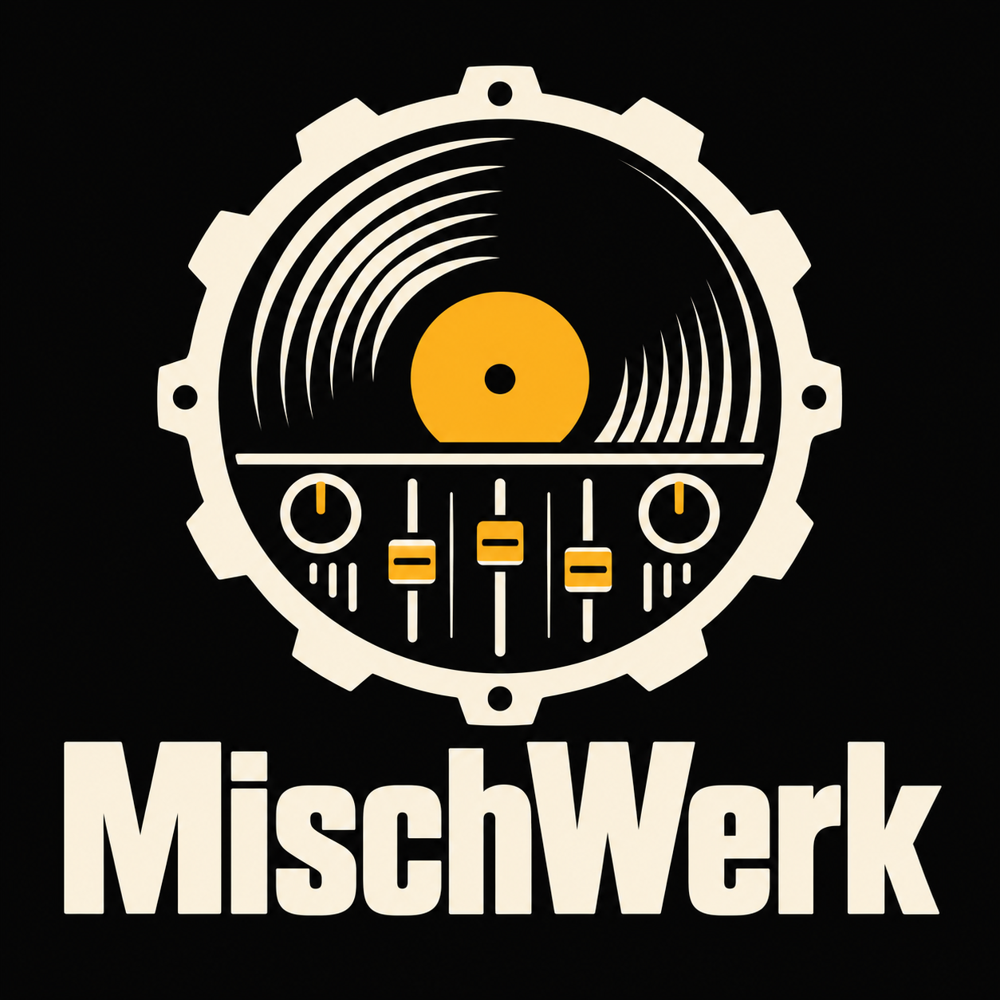
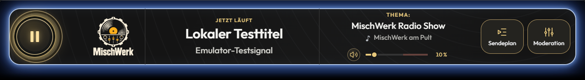
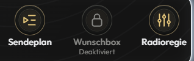
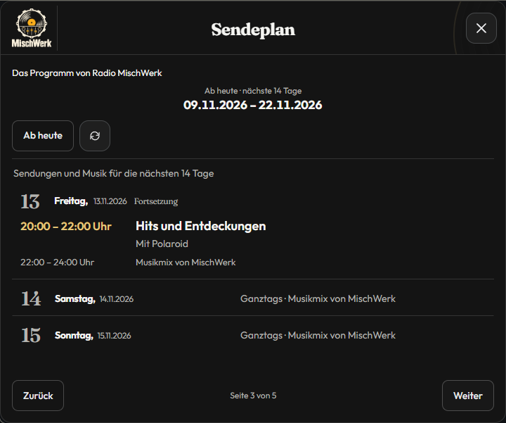

# MischWerk

[](../PROJEKT/package.json)
[](../PROJEKT/package.json)
[](../PROJEKT/website/README.md)
[](../PROJEKT/README.md#lokal-arbeiten)
[](../PROJEKT/docs/architektur/ARCHITEKTUR.md)
[](https://github.com/YvesBerlin1990/MischWerk/commits/main/)

Radio-App für den Knuddels-MyChannel **MischWerk** mit Musikwünschen, Moderation, Sendeplan und eigener Homepage.

**App 0.1.324 · Build 324 · Website 0.2.5** · Stand: 9. November 2026.



- **Radio:** HTTPS-Stream mit Play/Stop und Lautstärke. Titel und Interpret werden alle fünf Sekunden direkt vom SPCast-Streamserver abgefragt, mit Titel oben und Interpret darunter. Während der Wiedergabe leuchten Playtaste und farbiger Außenrand.
- **Wunschbox:** Ein freies Textfeld für Musikwünsche und eine private Anzeige des eigenen Platzes. Bestätigte offene Wünsche bleiben bei Appupdates und Neustarts gespeichert.
- **Moderation:** Anmelden und Abmelden ohne Zeitlimit, Sendungsthema, Wunschregie, „Heute gespielt“, Lauftext und bestätigte Übergabe an andere Moderatoren.
- **Sendeplan:** Programm für 14 Tage ab heute mit Sendungstiteln, Zeiten und Moderation. Der öffentliche Button zeigt vorerst **„In Kürze“**; der anwesende Channelinhaber kann die Ansicht bereits öffnen.
- **Verwaltung:** Radio-Team und Bot-Texte für den Channelinhaber, erreichbar über `/MW Verwaltung`.
- **Homepage und Android:** Eigene Website mit geschütztem Arbeitsbereich sowie signierte Senderdaten und Musikwünsche über den bestehenden Android-Rückkanal. Einrichtung und Produktionsabnahme sind separat dokumentiert.

## Einblicke

| Radio mobil | Aktionen im Detail |
| --- | --- |
|  |  |


| Moderation | Hörer-Sendeplan |
| --- | --- |
|  |  |

Alle Appbilder zeigen lokale Vorschauen von **Build 322** mit Beispieldaten. Der Hörer-Sendeplan ist eine lokale Vorschau der vorbereiteten Ansicht. Weitere Bilder und Prüfergebnisse stehen im [App-Prüfbericht](../PROJEKT/docs/pruefung/PRUEFBERICHT.md).

## Lokal starten

Voraussetzungen: Node.js ab 20 und pnpm 11.25.0. Im Repositoryordner:

```powershell
pnpm --dir PROJEKT install --frozen-lockfile
pnpm --dir PROJEKT run emulator
```

Das integrierte Testlabor öffnet unter [127.0.0.1:8776](http://127.0.0.1:8776) den lokalen Appcode mit Testnutzern und getrennten Radio-/Overlayfenstern. Audio beginnt nach Play.

Die eigenständige [Website](../PROJEKT/website/README.md) benötigt Node.js ab 22. Appadapter und Mailversand sind standardmäßig ausgeschaltet. Offene Produktionsfragen und bekannte Websitebefunde stehen im [Website-Prüfbericht](../PROJEKT/website/docs/PRUEFUNG.md).

## Projekt und Dokumentation

| Ablage | Inhalt |
| --- | --- |
| `PROJEKT/src/backend/` | Gepflegte ES5-/Rhino-Backendmodule |
| `PROJEKT/app/` | Erzeugte Backendlaufzeit und gepflegte Browseroberfläche |
| `PROJEKT/website/` | Homepage und eigener Webserver |
| `PROJEKT/tools/` · `PROJEKT/tests/` | Build, Testlabor und Prüfungen |
| `PROJEKT/docs/` | Architektur, API-Nachweise, Betrieb und aktuelle Prüfbilder |
| `PROJEKT/deployment/` | Zielkonfiguration und fünf Auslieferungsmanifeste |

Der lokale Paketbau bündelt die App für Knuddels im Desktop-UPLOAD. Private Konfigurationen, Zugangsdaten, installierte Abhängigkeiten und UPLOAD gehören nicht ins Repository.

[Technischer Einstieg und Prüfungsbefehle](../PROJEKT/README.md) · [Projektregeln](../PROJEKT/AGENTS.md) · [Testlabor-Bedienhilfe](../PROJEKT/tools/emulator/www/help.html) · [Installation und Betrieb](../PROJEKT/docs/betrieb/INBETRIEBNAHME.md) · [Native Abnahme](../PROJEKT/docs/betrieb/LIVE-ABNAHME.md)
