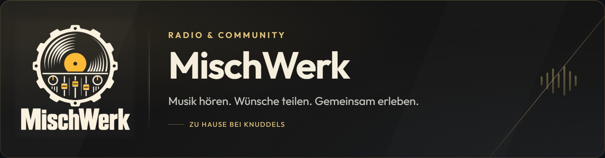
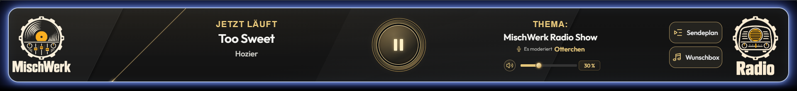
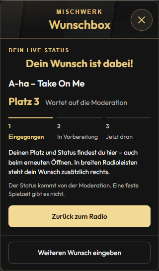
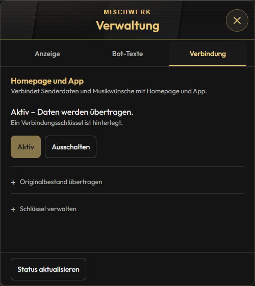

<picture>
  <source media="(max-width: 600px)" srcset="mischwerk-header-schmal.png">
  
</picture>

# MischWerk · Radio & Community

Radio-App für den Knuddels-MyChannel **MischWerk** mit Musikwünschen, Sendungsanzeige und Tagesplan. Den Appstand führt das [App-Paket](../PROJEKT/package.json), den Webstand das [Website-Paket](../PROJEKT/website/package.json).



| Schmale Radioleiste | Wunschbox | Verwaltung |
| --- | --- | --- |
|  |  |  |

Aufnahmestände und weitere Ansichten stehen im [App-Prüfbericht](../PROJEKT/docs/pruefung/PRUEFBERICHT.md#prüfbilder).

## Lokal starten

Mit Git, Node.js 24 und pnpm 11.25.0 aus der Repositorywurzel:

```powershell
pnpm --dir PROJEKT install --frozen-lockfile
pnpm --dir PROJEKT run emulator
```

Der Emulator ist unter `127.0.0.1:3105` erreichbar. Für die Werkzeuge und die Windows-Einrichtung siehe die [technische Übersicht](../PROJEKT/README.md).

## Dokumentation

[Projektregeln](../AGENTS.md) · [Installation und Betrieb](../PROJEKT/docs/betrieb/INBETRIEBNAHME.md) · [Website](../PROJEKT/website/README.md) · [Website-Prüfbericht](../PROJEKT/website/docs/PRUEFUNG.md) · [Native Abnahme](../PROJEKT/docs/betrieb/LIVE-ABNAHME.md)
