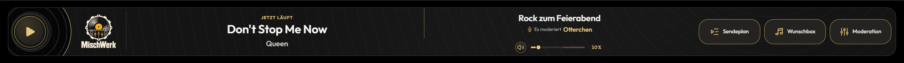

# MischWerk – technische Übersicht

**App 0.1.382 · Build 382 · Website 0.2.11** · Stand: 12.11.2026.

Die Lautstärke steht auf allen Breiten waagerecht und mittig unter Thema und Moderationsname. Vinyl-Player und Original-Logo behalten ihre bisherige Gestaltung und Position. Der goldene Regler bietet eine längere Spur; Prozentanzeige, Stummschaltung, Tastaturbedienung und die rote Markierung über 60 % bleiben erhalten. [Breite Leiste](docs/pruefung/oberflaeche/radio/radio-lautstaerke-desktop.png) · [Live mit eigenem Wunsch](docs/pruefung/oberflaeche/radio/radio-lautstaerke-1280.png).

Die öffentliche Begrüßung fordert den ersten Satz einschließlich des klickbaren Nicks in RobotoBold und Gold an. Vor „Viel Spaß beim Zuhören.“ wird die Formatierung für normale Channelschrift zurückgesetzt. Die native Schriftwirkung beim eigenen und fremden Nick bleibt nach Installation abzunehmen.

Der Wunschboxbutton erscheint für Hörer erst mit angemeldeter Live-Moderation und freigegebener Wunschannahme. Im AutoDJ sowie nach Sperren oder Abmelden ist er ausgeblendet; die übrigen Aktionen nutzen den frei werdenden Platz. [AutoDJ](docs/pruefung/oberflaeche/radio/radio-wunschbox-autodj.png) · [Live-Moderation](docs/pruefung/oberflaeche/radio/radio-wunschbox-live.png).

`/update` prüft vor dem Neustart die benötigten Dateien des neu übertragenen Builds. Fehlende Dateien werden privat mit Pfad gemeldet; auch eine nicht zuverlässig durchführbare Prüfung sperrt den Neustart. Nach dem Nachliefern ist ein erneuter `/update`-Versuch möglich. Die Absicherung gilt nach Installation von Build 370; vollständige Übertragung bleibt erforderlich.

Die native Nickliste erhält das Teamzeichen für berechtigte Radiomoderatoren und den echten Inhaber. Kopfhörer zeigen fortschreitende Wiedergabe mit Ton; das Mikrofon kennzeichnet die bestätigte aktive Moderation und ersetzt dann die Kopfhörer. Die neuen Originalbilder bleiben unverändert: MW-Teamzeichen 32 × 24 Pixel, Kopfhörer und Mikrofon jeweils 24 × 24 Pixel. Die angeforderten Breiten betragen passend 32 beziehungsweise 24 Pixel. Technischer Vertrag und offene native Sichtprüfung: [API-Nachweis](docs/api/API-NACHWEIS.md#native-nicklisten-icons--11112026) und [LIVE-Abnahme](docs/betrieb/LIVE-ABNAHME.md#offene-nicklisten-abnahme).

Beim Channelbeitritt erhält jeder Mensch zuerst eine private Willkommensgrafik mit dem vollständigen Channelthema und iOS-Hinweis. Lieblings-MyChannel und Channelinfo sind als Bildlinks mit den bisherigen Befehlen verknüpft; Der mittlere Button heißt Website und führt nach Klick zu https://radio-mischwerk.web.app/. Die Nachricht fordert für den Absender LEFT und für Banner/Buttons jeweils CENTER auf eigenen, durch °#r° getrennten KCode-Zeilen an. Außerhalb von Banner und Bildbuttons steht kein normaler Text; die große Überschrift ist vollständig gold. Direkt danach folgt die bisherige öffentliche Textbegrüßung. [Gestaltung](medien/mychannel/willkommen-vorschau-v1.png) · [Native Abnahme](docs/betrieb/LIVE-ABNAHME.md#offene-private-willkommensnachricht).

`/mw` zeigt eine kurze Übersicht; `/mw admin` öffnet Radio-Team, Bot-Texte und Verbindungseinstellungen. Der Homepage-Code steht nicht mehr in der allgemeinen Übersicht. `/mw verbindung` samt Unterbefehlen ist entfernt; Verbindungseinstellungen sind über `/mw admin` erreichbar. Die Radioleiste öffnet automatisch. `/settopic` und `/lauftext` behalten ihren bisherigen Vertrag; `/update` erhält die Dateiprüfung.

Die Appleiste nutzt verkleinerte Fenster gleichmäßig: Bei 701–1199 px stehen Logo, Playtaste, Musik und Sendungsinfo nebeneinander; bis 700 px erhält das Thema unter der Musik die volle Breite. Aktionen bleiben in einer gemeinsamen unteren Zeile. Angemeldete Moderation erscheint mittig mit kräftigem Thema, Mikrofon, „Es moderiert“ und goldenem Namen. Lange Themen bleiben vollständig lesbar.

Die Verwaltung verwendet denselben ruhigen flachen Stil wie die neuen Menüs. Radio-Team zeigt eine kompakte Mitgliederliste; Bot-Texte lassen sich einzeln auswählen. Im Reiter Verbindung bleiben der gespeicherte Schlüssel und die laufende Firebase-Verbindung beim Öffnen und Aktualisieren erhalten. Kurze Inhalte passen ohne Scrollleiste. [Radio-Team](docs/pruefung/oberflaeche/verwaltung/verwaltung-560.png) · [Bot-Texte](docs/pruefung/oberflaeche/verwaltung/verwaltung-bottexte-560.png) · [Verbindung](docs/pruefung/oberflaeche/verwaltung/verwaltung-verbindung-560.png).

Das native Moderationsmenü ist neu aufgebaut: Sendung und Wünsche auf einer einfachen flachen Fläche ohne Scrollen. Anmelden startet direkt ohne persönliche PIN. Wunschbox, An-/Abmeldung, Thema, Wunschregie und private Übergabe bleiben erhalten. Bei kleinen Fenstern und langen Texten führen Vor-/Zurück-Tasten durch den Inhalt. Die separate Website und deren PIN bleiben unverändert.

MischWerk verbindet Radio, dauerhafte Musikwünsche, Moderation, Lauftext per /lauftext und Sendeplan in einer Knuddels-UserApp. Die eigenständige Website und der Android-Rückkanal verwenden vorbereitete Appverträge. Funktionen und aktuelle Bilder stehen in der [GitHub-Übersicht](../.github/README.md); fachliche Regeln und Prüfvorgaben zentral in [AGENTS.md](AGENTS.md).

[Mittlere Breite](docs/pruefung/oberflaeche/radio/radio-harmonie-mittel.png) · [Mobilansicht](docs/pruefung/oberflaeche/radio/radio-harmonie-schmal.png) · [Lauftext](docs/pruefung/oberflaeche/radio/lauftext-1280.png) · [Tagesplan](docs/pruefung/oberflaeche/sendeplan/sendeplan-tag-640.png). Alle 35 Appbilder wurden am 12.11.2026 aus Build 382 erneuert, einschließlich Radio, Wunschbox, Verwaltung und Sendeplan. Sie zeigen lokale Emulatormodelle mit Beispieldaten; neue native Moderationsbilder bleiben ausschließlich im System-Tempverzeichnis. Der Sendeplan öffnet für alle verbundenen Hörer ein eigenes, rein lesendes Tagesfenster mit 640 × 320 px Anfangsgröße und dynamischer Höhe bis 600 px. Thema, Moderation und Uhrzeit stehen in einer ruhigen anthrazitfarbenen Liste; die laufende geplante Sendung trägt eine goldene Linie. Davor und danach sind unmittelbar zugeordnet. Pfeile wechseln den Tag, die Datumsmitte führt zu Heute. Die Tagesliste liest direkt das öffentliche Homepage-JSON über den Knuddels-Server, einschließlich dort gelieferter generierter AutoDJ-Zeilen. Sie benötigt keine aktivierte Statusverbindung und keinen Schlüssel. Titel, Namen und Zeitdarstellung folgen der Homepage; ein Abruffehler bleibt sichtbar. [Datenweg und Abnahme](docs/betrieb/SENDEPLAN.md).

`/lauftext` zeigt der Radiomoderation den aktuellen Status und alle Befehle: Text setzen, `--an`, `--aus` und `--tempo langsam|normal|schnell`. [Bedienung](docs/betrieb/INBETRIEBNAHME.md#lauftext-unter-der-appleiste).

## Zuständigkeiten der Ordner

Alle folgenden Pfade liegen innerhalb von `PROJEKT/`.

| Ablage | Inhalt |
| --- | --- |
| [src/backend/](src/backend) | Gepflegte ES5-/Rhino-Backendmodule |
| [app/server/](app/server) und `app/main.js` | Daraus erzeugte Backendlaufzeit und kurzer Einstieg |
| [app/www/](app/www) | Gepflegte Browseroberfläche, lokale Schriften und Appmedien |
| [medien/](medien) | Original-Logos und MyChannel-Hintergrund |
| [tools/build/](tools/build) · [tools/checks/](tools/checks) | Paketbau und Prüfwerkzeuge |
| [tools/lib/](tools/lib) | Gemeinsames Inventar, Ladepläne und Releasekennung |
| [tools/emulator/](tools/emulator) · [tools/preview/](tools/preview) | Integriertes Testlabor und lokale Appvorschau |
| [tests/](tests) | Node-, Browser- und Rhino-Prüfungen mit Fixtures und Support |
| [website/](website/README.md) | Homepage mit eigenem Server, Abhängigkeiten und Prüfungen |
| [docs/](docs) | Architektur, API-Nachweise, Betrieb und Prüfberichte |
| [docs/pruefung/oberflaeche/](docs/pruefung/oberflaeche) | Aktuelle Appbilder in vier Themenordnern |
| [deployment/](deployment) | Zielkonfiguration und fünf Auslieferungsmanifeste |
| [references/api/](references/api) | Zwei unveränderte offizielle Dokumentationsstubs |

`src/backend/` ist die Backendquelle, `app/server/` die erzeugte Laufzeit. Die Browserquellen werden direkt unter `app/www/` gepflegt. Die Website ist ein separates Projekt.

## Lokal arbeiten

Voraussetzungen: **Node.js ab 20**, **pnpm 11.25.0**, Microsoft Edge für Browserprüfungen und **Java 11+** für Rhino. Die Website benötigt Node.js ab 22.

Befehle aus `PROJEKT/` ausführen; von der Repositorywurzel jeweils `pnpm --dir PROJEKT …` verwenden. Bei gesperrten PowerShell-Skripten funktioniert `pnpm.cmd`.

| Befehl | Zweck |
| --- | --- |
| `pnpm install --frozen-lockfile` | Entwicklungsabhängigkeiten installieren |
| `pnpm run emulator` | Interaktives Testlabor auf http://127.0.0.1:8776 |
| `pnpm run preview` | Appvorschau auf http://127.0.0.1:8765 |
| `pnpm run build:backend` | Backendlaufzeit aus den Quellen erzeugen |
| `pnpm run check:backend` | Quell-/Laufzeitgleichheit prüfen |
| `pnpm test` | Vollständige Node-Suite |
| `pnpm run test:browser` | Browser- und Emulatorprüfungen mit Edge |
| `pnpm run test:emulator` | Rhino und integrierte Emulatorprüfungen |
| `pnpm run check` | Struktur, Syntax, API-Signaturen, Komponenten und Inventar |
| `pnpm run check:rhino` | Rhino 1.7.7.2 und 1.9.1 |
| `pnpm run check:lengths` | Textgrenzen der Laufzeitdateien |
| `pnpm run prepare:upload` | Geprüftes Paket im festen Desktop-UPLOAD bauen |
| `pnpm run check:upload` | Paket, Quellen und fünf Manifeste vergleichen |
| `pnpm run check:delivery --base-url URL/` | Gewählte öffentliche Auslieferung lesend per SHA-256 vergleichen |

Rhino-JARs einmalig mit `node tools/checks/rhino.cjs --download` beziehen. `MISCHWERK_JAVA` wählt Java; `MISCHWERK_PLAYWRIGHT` eine externe Playwright-Installation. `build:live` ist ein Alias für `prepare:upload`. `MISCHWERK_TEST_UPLOAD` richtet die unterstützten Prüfwerkzeuge auf das tatsächlich gebündelte Appverzeichnis.

## App im Testlabor prüfen

`pnpm run emulator` startet [127.0.0.1:8776](http://127.0.0.1:8776); alternativ [Start-Testlabor.ps1](tools/emulator/Start-Testlabor.ps1) verwenden. `-Port` bzw. `MISCHWERK_EMULATOR_PORT` wählt einen anderen Port, Strg+C beendet den Server.

Das Labor lädt den lokalen Appcode und bietet Testnutzer, K3-/STAPP-Modelle, Breiten von 320 bis 3840 px, verzögerte oder ausfallende Ressourcen sowie lokale Provider- und Audiofälle. Testdaten liegen im System-Tempordner. Die Modelle ersetzen keine native Knuddels-Abnahme.

[Bedienhilfe](tools/emulator/www/help.html) · [Codex-Zugriff](AGENTS.md#codex-zugriff-auf-den-integrierten-emulator)

## Website und Anbindungen

Aus `website/` startet `pnpm start` den regulären Webserver; `pnpm test` prüft das eigene Projekt. Die öffentliche Navigation und der geschützte Arbeitsbereich verwenden vorbereitete Appadapter. Einrichtung, ausgeschalteter Mailversand und offene Produktionsabnahme stehen in der [Website-Dokumentation](website/README.md) und im [Anbindungsvertrag](website/docs/ANBINDUNG.md).

Der signierte Android-Statusweg überträgt Senderdaten und Lauftext und übernimmt bestätigte Antwortwünsche in dieselbe dauerhafte Wunschqueue. Einrichtung und Aktivierung sind unter [Installation und Betrieb](docs/betrieb/INBETRIEBNAHME.md#regulärer-rückkanal-ab-build-289) beschrieben. Sendeplan und Radioteam nutzen denselben Rückkanal; der [Homepage-/Teamvertrag](docs/api/HOMEPAGE-SENDEPLAN-RUECKANTWORT.md) enthält die abgestimmten Daten und offenen gemeinsamen Nachweise.

## Bereitstellung und Nachweise

`prepare:upload` baut Backend und Auslieferungsbündel und führt Node-, Rhino- und Integritätsprüfungen aus. Beide Rhino-Engines prüfen auch das fertige Paket; die Browserrunde läuft separat. Der App-Arbeitsbestand umfasst **165 Dateien und 79 Backendmodule**, das aktuelle Paket **119 Dateien mit 106 Texten und 48 Serverdateien**. Ganze benachbarte Module werden reproduzierbar gebündelt; Quellen bleiben lesbar erhalten. Der Dateibedarf wird im zugehörigen Server-Ladeplan erzeugt und auf den tatsächlichen Auslieferungsbestand angepasst. Fünf Manifeste belegen die tatsächlichen Auslieferungsbytes. Alle Laufzeittexte und Manifeste bleiben strikt unter 9500 UTF-16-Zeichen.

Die einzige fertige Auslieferung liegt unter **C:/Users/Yves/Desktop/MischWerk/UPLOAD/MischWerk/** und bleibt außerhalb des Gitbestands. Paketbau und GitHub-Push installieren die App nicht auf Knuddels. Den Ablauf beschreibt die [Uploadanleitung](docs/betrieb/INBETRIEBNAHME.md#installation-und-upload).

[App-Prüfbericht und aktuelle Bilder](docs/pruefung/PRUEFBERICHT.md) · [Website-Prüfbericht](website/docs/PRUEFUNG.md) · [API-Nachweis](docs/api/API-NACHWEIS.md) · [Architektur](docs/architektur/ARCHITEKTUR.md) · [Frontend](docs/architektur/ARCHITEKTUR-FRONTEND.md) · [Design](docs/architektur/DESIGN.md) · [Native Abnahme](docs/betrieb/LIVE-ABNAHME.md)
