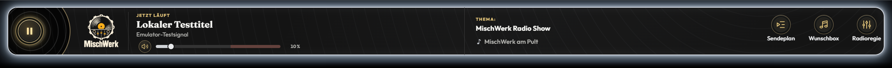

# MischWerk – Design 0.1.288 · Build 288

Aktuelle Gestaltung am 07.11.2026. Die Bilder zeigen lokal gerenderten Appcode mit Beispieldaten. Verbindliche Projektvorgaben stehen in [AGENTS.md](../../AGENTS.md).

## Appleiste

Die Radio-Außenfläche passt mit reinem Schwarz #000000 zum Werkshallen-Channelbild. Die Deckfläche bleibt #141414; ihre statischen Vinylrillen enden an der abgerundeten Leistenkontur. Der bestehende Glow läuft mit und ohne Lauftext weich auf Schwarz aus. Outfit für die Oberfläche und Fraunces für hervorgehobene Titel werden lokal mit OFL-Lizenzen geladen. Original-Logos bleiben unverändert und proportional; ihr dunkler Bildgrund wird ausschließlich per CSS verrechnet.

Musik/Lautstärke, Sendungsthema und eigener Wunsch teilen den verfügbaren Raum. Ohne eigenen Wunsch entsteht keine leere dritte Spalte. Musikangaben sitzen über dem Regler, Thema und Wunsch breit vertikal mittig. Jetzt läuft, Thema und Dein Wunsch sind warmgolden hervorgehoben. Bestätigte Moderation ist rot, AutoDJ neutral. Schmale Ansichten behalten direkt erreichbare Aktionen und native Lesebereiche.

Play ist eine 60-px-Vinylscheibe mit Goldsymbol und feiner Kontur. Bei tatsächlicher Wiedergabe leuchten Symbol und Kontur statisch; Verbinden, Nachladen, Stop und Fehler bleiben dunkel. Der separate RGB-Halo durchläuft einen ruhigen 48-Sekunden-Zyklus mit 16 px weichem Auslauf unter der Leiste. Die native Höhe beträgt ohne Lauftext 176 px und mit normaler Laufzeile 220 px. Unter der Laufleiste bleibt der ursprüngliche Glowraum von 34 px breit bzw. 24 px kompakt; die letzten 16 px blenden weich auf die Canvasfarbe aus. Reduzierte Bewegung verwendet einen statischen Halo.

Sendeplan, Wunschbox und berechtigte Moderation sind gleich große runde Vinyl-Aktionen mit Goldsymbolen und gleichen Abständen. Die mit Radioregie beschriftete Taste samt Regler-Symbol öffnet die Moderationseinstellungen; sie bietet keine Sprachübertragung. Tooltip und zugänglicher Name lauten ebenfalls Radioregie. Größere Scheiben, Symbole und Beschriftungen nutzen die vorhandenen Tastenflächen; die übrigen Positionen und Maße der Appleiste bleiben erhalten. Bei knapper Höhe gilt weiterhin die kompakte Darstellung. Die Wunschbox zeigt bei Sperre Schloss und Deaktiviert, ohne Symbol oder Hauptbeschriftung zu verschieben. Hover, Druck und Tastaturfokus verschieben nichts. Die Lautstärketaste hat eine 32-px-Symbolfläche innerhalb ihres vollständig erreichbaren 44-px-Ziels; Stumm ergänzt ein korallfarbenes Kreuz. Regler und Prozentfeld bleiben zusammengehörig.



[Schmal bereit](../pruefung/oberflaeche/radio/vinyl-pause-mobil.png) · [Schmal bei Wiedergabe](../pruefung/oberflaeche/radio/vinyl-glow-mobil.png) · [Radiotasten](../pruefung/oberflaeche/radio/radio-buttons.png) · [Lautstärke](../pruefung/oberflaeche/radio/lautstaerke-gruppe.png) · [Stumm](../pruefung/oberflaeche/radio/lautstaerke-stumm.png).

Die Appleiste behält ihre ursprüngliche Größe, die #141414-Deckfläche als Mischhintergrund des Original-Logos, ihr Muster und ihren sichtbaren Rahmen. Am Übergang zur eingeschalteten Laufleiste laufen die seitlichen Kanten gerade weiter; nur der gemeinsame Außenrahmen ist oben und unten abgerundet. So entstehen keine innenliegenden Viertelkreise oder Eckkeile. Der eingeschaltete Lauftext beginnt direkt an diesem Rahmen. Er nutzt ausschließlich den bisherigen unteren Außenabstand von 18 bzw. 8 px; kein zusätzlicher Zwischenstreifen und keine Verschiebung der Tasten oder Texte. Die Laufzeile ist vollständig einfarbig #141414 ohne Muster; ihre deckende Grundfläche hält auch den oberen Überlappungsbereich ruhig. Der bestehende RGB-Glow umfasst beide und läuft unter der Laufleiste weich aus; zwischen ihnen liegt kein Lichtsaum. Ohne Lauftext gilt die bisherige Appleistenkontur. Der Lauftext ist passend zur 44-px-Leiste 20 px groß, bis einschließlich 700 px Breite 18 px, mit Zeilenhöhe 1,3 und vertikaler Zentrierung. Der optionale Lauftext sitzt als 44-px-Zeile unmittelbar unter der Appleiste: dieselbe Deckgrundfarbe #141414 wie die Appleiste, neutrale Trennlinie #3a3a3a, heller Text #f5f5f2, Kennzeichnung „Information“ in 16 px (bis 700 px Breite 14 px) und Pausenakzent in #e6c77b. Die örtliche Pause-Taste besitzt 44 × 44 px und zeigt ein 24-px-SVG mit zwei gefüllten senkrechten Balken; beim Anhalten erscheint ein Play-Dreieck im gleichen Goldton. Bei reduzierter Bewegung steht der vollständige Text statisch mit Umbruch. Ohne aktive Anzeige entfällt die Zeile. Die Einstellungen liegen als vollständige Bediengruppe unter Radioregie → Lauftext.

Aktuelle lokale Ansichten: [Lauftext unter der Appleiste](../pruefung/oberflaeche/radio/lauftext-1280.png) · [Moderator-Einstellungen](../pruefung/oberflaeche/moderation/moderation-lauftext.png).

## Menüs

Alle vier nativen Overlays haben mittige Titel, das Original-Logo links und eine frei erreichbare Schließen-Taste rechts. Die Köpfe bleiben vom ersten HTML-Anstrich bis zur fertigen Ansicht 76 px hoch, mit 64-px-Logo und 24-px-Titel. Die dekorative Zusatzzeile entfällt; Reiterwechsel verändern den Kopf nicht. Außenflächen und leere native Ladeabdeckung entsprechen #0f1114. Eingaben haben 16-px-Text; Aktionen bleiben mindestens 44 px groß.

- **Wunschbox:** flaches Formular mit einem Textfeld und Zeichenzähler; nach Abgabe kurze Quittung und Weiteren Wunsch eingeben. Eigener Song, Platz und Status stehen in der Appleiste. [Ansicht](../pruefung/oberflaeche/wunschbox/wunschbox-flach-560.png).
- **Radioregie:** Deine Sendung, Musikwünsche, Heute gespielt und Lauftext. Goldene aktive Reiter und Hauptaktionen auf einer durchgehenden anthrazitfarbenen Fläche; An-/Abmeldung ohne Zeitlimit und private Übergabe; keine Restzeit- oder Studiozeitanzeige. Vollständige Texte bleiben über Inhaltsseiten erreichbar. Der Lauftexteditor passt mit kompakter Beschriftung, Textfeld, Optionen und Aktionen ohne äußere Scrollleiste; niedrige Rahmen verwenden Bereichsseiten. [Breit](../pruefung/oberflaeche/moderation/moderation-780.png) · [Schmal](../pruefung/oberflaeche/moderation/moderation-320.png).
- **Verwaltung:** Radio-Team und Bot-Texte. Bei Bot-Texten bleiben Kopf, Reiter und Aktionen fest; eine Inhaltsfläche scrollt, Textfelder wachsen ohne eigene Scrollleiste. [Bot-Texte](../pruefung/oberflaeche/verwaltung/verwaltung-bottexte-560.png).
- **Sendeplan:** Flache Wochenagenda mit Tag, Zeit, Moderation und Thema. Tatsächliche An-/Abmeldung ist von geplanten Zeiten getrennt. Freie Zeit erscheint als AutoDJ. Live/AutoDJ sowie Feste Zeit/Ganztags/Open End im bestehenden Formular. [Woche](../pruefung/oberflaeche/sendeplan/sendeplan-820.png) · [Editor](../pruefung/oberflaeche/sendeplan/sendeplan-editor-820.png).

## Theatervorhang

Roter Samt mit natürlichen Falten und bordeauxgetönter Inhaltskarte. Zwei rein dekorative CSS-Hälften gleiten nach bestätigter Freigabe zu beiden Seiten; reduzierte Bewegung schaltet unmittelbar. Die logische Freigabe wartet nicht auf eine Animation. Werbung startet nur durch eigenen Klick.

[Geschlossen](../pruefung/oberflaeche/vorhang/vorhang-1920.png) · [Schmal](../pruefung/oberflaeche/vorhang/vorhang-320.png) · [Öffnungsphase](../pruefung/oberflaeche/vorhang/vorhang-oeffnung.png).

## Eigene Samttextur für den Theatervorhang

Mit dem eingebauten Imagegen-Werkzeug erzeugt, keine fremden Bilddateien übernommen. Die unveränderte PNG liegt unter [app/www/img/curtain-velvet.png](../../app/www/img/curtain-velvet.png), 1536 × 1024 px. Die beiden Stoffhälften verwenden dieselbe eigene Textur, rechts gespiegelt; das Original-Logo bleibt unverändert. Reines lokales Radio-Asset, im vorhandenen Inventar und Medienmanifest enthalten.

Gestaltungsreferenz: [ShowTex – Curtain pleats and fullness](https://www.showtex.com/en/knowledge-hub/curtain-pleats-and-fullness), insbesondere voller Theatersamt und natürliche Falten; außerdem [Rose Brand – Stage curtain specifications](https://mcprod.rosebrand.com/blog/post/how-to-specify-a-stage-curtain-to-obtain-a-cost-estimate?postId=5427). Als Orientierung recherchiert, nicht als Bildquelle eingebunden.

Finaler Imagegen-Prompt:

```text
Use case: photorealistic-natural. Asset type: original fabric texture for the two moving halves of a web radio theatre curtain. Primary request: luxurious modern crimson-red velvet theatre/musical curtain, fully closed, realistic soft heavy fabric. Composition: landscape 3:2, straight-on close view, fabric fills the entire image edge to edge; many generous irregularly spaced rounded vertical gathered folds, gentle natural waviness, dense matte short velvet pile. Lighting: soft even theatrical illumination revealing rich folds, restrained broad highlights and deep burgundy shadows, consistent brightness across the image, no white glare. Colors: elegant true theatre red/crimson, dark wine-red in the folds. The middle horizontal band must be usable as a very wide shallow UI banner crop. Constraints: only continuous cloth; no centre opening, no stage, no people, no valance, no swag, no rod, no tassels, no floor, no trim, no border, no text, no logo, no watermark. Avoid corrugated metal, rigid straight ribs, regular stripes, glossy plastic, satin sheen, horizontal scan lines, obvious repeating pattern.
```


## Prüfung

Breiten von 320 bis 3840 px, mehrere Rollen und Pixeldichten, Tastatur, lange Texte, Sperren und Wiedergabezustände werden mit den vorhandenen Browser-/Emulatormodellen geprüft. Die native Größenannahme und verbleibende Erstöffnungsblitze sind separat abzunehmen. [Aktueller Prüfbericht](../pruefung/PRUEFBERICHT.md).
