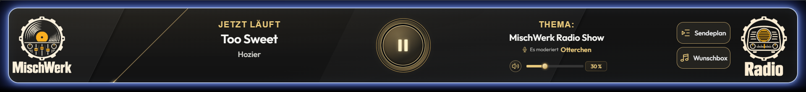

# MischWerk – Design 0.1.449 · Build 449

Build 446 entfernt die native Moderationstaste und das Studiofenster. Die Verwaltung für den echten Inhaber Otterchen und den anwesenden Polaroid enthält Anzeige, Bot-Texte und Verbindung; Teamzeichen, Mikrofon und Kopfhörer sind getrennt schaltbar; zentrale Nickfreigaben sind lesend. Die Radioleiste verwendet für alle Rollen die bisherige Höreranordnung. Neue Abbildungen dieses Stands und frühere unveränderte Gestaltungsbilder sind im aktuellen Prüfbericht getrennt benannt. Beschreibungen früherer Moderationsmenüs weiter unten sind historische Gestaltungsbefunde.

Die breite Leiste nutzt 12 px vertikales Innenpadding und 16 statt 44 px Zusatzreserve unter dem Informationsraster. Rahmeninset und Lauftextanschluss verwenden 6 px. Zusätzlich erhält das breite Deck 12 px oberen Außenabstand, sodass vor der sichtbaren Kontur wieder 18 px für den RGB-Glow frei bleiben. radio/viewport berücksichtigt diesen gemessenen Außenabstand in der vorhandenen Hosthöhe; die innere Leiste bleibt kompakt. Die Höreransicht nutzt symmetrische Logos und eine seitliche 52-px-Tastengruppe; Beschriftungen behalten ihre lesbare Größe. Keine feste Höhenbegrenzung für lange Themen.

Alle Rollen verwenden die bisherige Höreranordnung; sie zeigt die unveränderte Radio-Grafik rechts in exakt derselben Bildgröße und auf derselben Höhe wie das linke Logo (normal 160–220 px, in engen 1200–1599-px-Hörerleisten 144–160 px). Sendeplan und freigegebene Wunschbox bilden eine vertikale, mittig ausgerichtete 128-px-Gruppe zwischen Sendungsinformationen/eigenem Wunsch und rechtem Logo, mit 52-px-Tasten, 15-px-Schrift, 24-px-Symbolen und 8 px Abstand. Ohne Freigabe steht nur der Sendeplan an derselben Position. Symmetrische äußere Rasterspalten reservieren jeweils Logo plus 144 px; das linke Logo bleibt am Außenrand, Play bleibt exakt mittig. Keine zusätzliche Aktionszeile oder Höhenreserve unter den Sendungsinformationen. Ab 1800 px steht der eigene Wunsch rechts neben dem Thema; bei 1200–1799 px bleibt er sichtbar innerhalb der rechten Informationsspalte unter Thema und Lautstärke. Dort maximal zwei Wunschtextzeilen mit 16-px-Schrift, vollständiger DOM-Text und bestehende Wunschoberfläche erhalten; Titel/Thema mit 20/24 px, goldene Überschriften gemeinsam 20 px und gleich hoch, Logos proportional. Unter 1200 px bleibt die bisherige kompakte Anordnung. Zentrale Freigaben, Originalmedien und Audioweg bleiben erhalten.

Die Wunschbox begrüßt mit „Wünschen. Zurücklehnen. Mitverfolgen.“ Nach bestätigter Abgabe erscheint für fünf Sekunden „Dein Wunsch ist dabei!“ samt Weiteren Wunsch eingeben. Beim erneuten Öffnen steht nur diese Eingabeoption bereit; ein vorhandener Entwurf oder laufender/fehlgeschlagener Versand bleibt direkt sichtbar. Eigener Wunsch, Platz und Moderationsstatus stehen ausschließlich in der Radioleiste. Keine doppelte Live-Statusansicht oder Zurück-zum-Radio-Taste; Schließen und Escape erhalten den bestehenden Entwurfsweg.

Die Menütexte sind kurz, direkt und einheitlich formuliert. Klare Kernnamen wie Sendung, Wünsche, Radio-Team und Bot-Texte bleiben erhalten. Outfit ist die Menüschrift: Menütitel 24/28 px, große Bereichstitel 20/26–28 px, Abschnittsüberschriften 16/22 px, Feldbeschriftungen und Haupttasten 14 px, Hinweise 13 px und Eingaben 16 px. Haupt- und Abschnittsüberschriften einschließlich Sendeplanthemen verwenden MischWerk-Gold #e6c77b. Der MischWerk-Systemschriftzug nutzt Arial 12/14 px. Hinweise, Zähler und Fehler behalten ihren eigenen Rang und ihre Zustandsfarben. Kürzere Wunschboxzustände und kompakte Innenabstände im Bot-Text-Reiter erhalten die Geometrie bei 320 px. Radioleiste und Menüköpfe verwenden die Werkhallen-Textur aus der einmaligen CSS-Variable --workshop-material im kritischen Stil von index.html. Unterhalb der Köpfe sind sämtliche Menü-Inhaltsflächen einschließlich Reitern, Listen, Lade-/Fehler-/Leerzuständen und Fußbereichen einheitlich #141414 ohne Hintergrundbild, Diagonalpaneele oder Textur. Der erste HTML-Anstrich verwendet dieselbe ruhige Inhaltsfläche. Sechs Verlaufsebenen bilden versetzte Graphitpaneele, abgeschrägte Kanten, feine matte Linien und sehr zurückhaltendes warmes/kühles Licht. Prozentuale Flächen und Lichtzentren füllen jede tatsächliche Fenstergröße. Die gemeinsame Variable --workshop-angle passt die Neigung der Paneelkanten per Seitenverhältnis von 98 bis 128 Grad an schmale, breite und ultrabreite Hosts an, bereits im ersten HTML-Anstrich; auch veränderte Höhe und Browserzoom werden berücksichtigt. Keine neue Materialanimation, Medienanfrage oder JavaScript-Größenmessung. Alle Menü-Canvasflächen und Header besitzen #141414 als Grundfarbe; Eingaben bleiben neutral #101010 und Trenner #2b2b2b. Transparente Reiterleisten, Tagesnavigation und Bot-Text-Fußleiste lassen die ruhige Graphitfläche durchscheinen. Die goldenen Lichtreflexe und der RGB-Rand bleiben an der Radioleiste. Passt dort kein vollständig freier senkrechter Korridor, prüft radio/workshop im breiten Deck den tatsächlichen 45-Grad-Verlauf zwischen den zweidimensionalen Text-/Bedienrechtecken einschließlich Reflexabstand. So bleiben vollständige Linien bei 1536/1707 px nutzbarer Breite sichtbar; weder Bedienung noch Text werden hinterzeichnet. Sämtliche nativen Menüs verwenden die gemeinsame Studio-Werkhalle unter css/shared/workshop-menus.css: ruhiges Graphit, feine Metallkanten und warme Goldakzente. Die Header tragen einen lesbaren MischWerk-Schriftzug in Arial über dem mittigen Outfit-Titel. Die kleinen Bildlogos sind aus dem Menümarkup entfernt; Radio und Originalmedien bleiben erhalten. Schließen bleibt rund und mindestens 44 × 44 px groß. Bereits der erste HTML-Anstrich entspricht dem fertigen 76-px-Kopf. Sendung und Wünsche sowie Radio-Team, Bot-Texte und Verbindung verwenden gleichmäßige 48-px-Reiter mit goldener Auswahlkante. Wunschbox und Tagesplan teilen Material, Schrift und Aktionsfarben. Bestehende Scroll-, Größen-, Rechte-, Entwurfs- und Audiowege bleiben erhalten.

Ab 1200 px sitzt Play exakt in der horizontalen Mitte: unverändertes Logo und Musik links, Sendung mit Lautstärke rechts, Aktionen als kompakte senkrechte Gruppe am rechten Rand. Ein eigenes Radio-Stylesheet center-layout.css hält Musik und die gesamte rechte Informationsseite gleich breit und die beiden Randspalten symmetrisch bei mindestens 128 px. Bei Moderationsrechten sind rechte Buttons 120 × 44 px groß mit 14 px Radius und 6 px Abstand. Die Zwischenräume des breiten Rasters wachsen mit clamp(16px,1vw,24px) maßvoll mit. Musik und Thema besitzen dieselben 12 px seitlichen Innenabstände. Im breiten Deck ab 1200 px stehen die goldenen Überschriften „THEMA:“ und „JETZT LÄUFT“ mit ihren vertikalen Mitten auf exakt derselben Höhe. Die Musiküberschrift bildet die Bezugslinie. Bei langen Themen wird die gemeinsame Linie innerhalb der Informationsfläche so begrenzt, dass Thema, Moderation und Lautstärke darunter vollständig passen, mit mindestens 8 px Innenabstand. Die Themenüberschrift bleibt auch bei bestätigter Moderation sichtbar. Ein 16-px-Polster innerhalb des Informationsrasters hält Platz für die darunter folgende Lautstärke frei; Musik und eigener Wunsch nutzen weiter die volle Informationshöhe. Das Polster zählt nicht zur dynamischen Logogröße. Lange Inhalte vergrößern die natürliche Fläche; mittlere und mobile Raster behalten ihre natürliche Anordnung. Der vorhandene radio/viewport-Größenweg richtet nach Logogröße und Textumbruch aus, ohne zusätzlichen Timer oder Beobachter. Logo und Play bleiben vertikal zentriert, die horizontale Playmitte bleibt exakt. Das unveränderte proportionale Originallogo folgt der natürlichen metadata-Höhe: ab 1200 px zwischen 160 und 220 px, bei 701–1199 px zwischen 96 und 128 px. In engen breiten Decks begrenzt zusätzlich die verfügbare Breite. radio/viewport gleicht Textumbruch und Bildgröße höchstens viermal im bestehenden Größenweg ab. Das absolut zentrierte Logo bestimmt seine eigene Messhöhe nicht mit und schrumpft bei kurzen Inhalten wieder. Breite Randspalten wachsen symmetrisch und sind jeweils 32 px schmaler als der größere Logo-Bildkasten; er nutzt beidseits 16 px Freifläche. Mit Moderationsrechten bleiben rechte Aktionen 120 px breit; Playmitte und kompakter Weg bis 700 px bleiben erhalten. Lauftext und Glow vergrößern das Logo nicht. Die Mindest-Leistenhöhe beträgt 192 px zuzüglich 16 px Lichtsaum; lange Themen und Wunschtexte vergrößern den Inhalt natürlich. Die persönliche Wunschübersicht steht als eigene Spalte rechts neben Thema und Lautstärke, mit dezenter neutraler Trennkante. Beide ehemaligen Bereichstrenner entfallen breit; 701–1199 px und die mobile Anordnung bleiben erhalten. Bestehende Audioinstanz, Rechte, RGB-Rand, Metallfassung, Schrift und Goldkorridore bleiben erhalten.

Die öffentliche Textbegrüßung fordert den vollständigen ersten Satz mit dem nativen RobotoBold-Schriftschnitt, Größe 16 und Gold #e6c77b an. Die eigene Unterstrich-Bold-Umschaltung entfällt; nach dem ersten Punkt setzt §°r° die Formatierung für den normalen zweiten Satz zurück. Profil- und Fotolinks bleiben erhalten. Die Darstellung mit eigener Nickmarkierung wird nativ gesondert geprüft.

Das vom Nutzer im Channel für alle Nutzer bestätigte Startverhalten von Build 401 bleibt vollständig erhalten: zuerst die Play-Methode aus dem eigenen wiederverwendeten about:blank-iframe, danach die bisherigen Wege im Zyklus 4 → 1 → 2 → 3. Dasselbe Audioelement, Mute-Wiederherstellung, canplay-Warteweg, Drei-Sekunden-Fortsetzungen, Startfrist, Backoff und Browserfreigabe bleiben erhalten. Entfernt sind ausschließlich Nutzer-Wiedergabediagnose, Erholungsberichte, Methoden-/Umgebungsproben, Medienverläufe, Resolve-Nachmessungen und deren Übertragung bzw. App-Log-Ausgabe. Reguläre Backendwarnungen und App-Start-/Stopprotokolle bleiben erhalten.

Die private Willkommensgrafik nutzt das freigegebene Banner mit vollständigem Channelthema und iOS-Hinweis. Die große Überschrift einschließlich des i in MischWerk ist durchgehend gold. Drei separate 170 × 44-PNGs erhalten die lokale Outfit-Typografie, Anthrazit und goldenen Rahmen. Lieblings-MyChannel, Website und Channelinfo werden einzeln verknüpft. Website ersetzt die frühere inaktive Mach-mit!-Fläche, trägt denselben Goldrahmen und dieselbe helle Outfit-Beschriftung wie die Nachbarn und öffnet nach Klick https://radio-mischwerk.web.app/. Außerhalb der vier Grafiken steht kein normaler Text. Der Absenderbereich erhält ausdrücklich LEFT; erst nach einem nativen °#r° beginnt CENTER für das Banner. Die nächste KCode-Zeile setzt CENTER erneut für die Bildbuttons, der Abschluss danach LEFT. Der frühere LF-Versuch blieb nativ wirkungslos. Die freigegebenen Grafikbytes werden unverändert in den Laufzeitbestand übernommen; das Banner fordert über KCode eine proportionale Anzeige mit 534 × 178 an. Tatsächliche native Bildskalierung und Klickwirkung bleiben gesondert abzunehmen.

Die neue native Nicklistenanzeige nutzt ausschließlich die gelieferten transparenten PNGs: [Team](../../app/www/img/nicklist/team.png), [Kopfhörer](../../app/www/img/nicklist/listener.png) und [Mikrofon](../../app/www/img/nicklist/moderator.png). Das MW-Teamzeichen besitzt 32 × 24 Pixel und wird mit Breite 32 angefordert; Kopfhörer und Mikrofon besitzen jeweils 24 × 24 Pixel und werden mit Breite 24 angefordert. Alle Dateien bleiben bytegleich zu den neuen Originalen aus nickliste 24px. Team und Status stehen nebeneinander; Mikrofon hat Vorrang vor Kopfhörern. Keine Animation oder neue Gestaltung der Radiooberfläche. Die tatsächliche Größe und Erkennbarkeit im nativen Client bleiben separat offen.

Beschriebener Gestaltungsstand: 15.11.2026, lokaler Build 445. Alle 37 verlinkten öffentlichen Prüfbilder für Radio, Wunschbox, Verwaltung und Sendeplan wurden am tatsächlichen UPLOAD dieses Builds neu aufgenommen. Bestehende Bildnamen bleiben für stabile Verweise erhalten, auch wenn sie noch vinyl enthalten. Die Bilder zeigen lokal gerenderten Appcode mit Beispieldaten und belegen keine native Abnahme. Aufnahmeumfang im [Prüfbericht](../pruefung/PRUEFBERICHT.md); verbindliche Projektvorgaben in [AGENTS.md](../../../AGENTS.md).

## Appleiste

Auch die breite Radioleiste passt sich jetzt langen Sendungsthemen an. Thema, Moderation und waagerechte Lautstärke bleiben gemeinsam vollständig sichtbar, ohne inneren Scrollbereich. Kurze breite Leisten erhalten 192 px Mindesthöhe; bei kürzeren Themen schrumpft die Leiste wieder. Die Schrift wird nicht verkleinert. Der vorhandene Größenweg berücksichtigt Lauftext und Glow, hält Audio und Fokus und vermeidet wiederholte gleiche Größenaufträge.

Die inneren Bereichstrenner zwischen Logo-/Playgruppe, Musik, Thema und gegebenenfalls eigenem Wunsch verwenden dezentes Dunkelgrau #2b2b2b statt #3a3a3a. Sie bleiben durchgehend 1 px breit, ohne Geometrieänderung. Außenrahmen, Lauftext und die goldenen Metallfugen bleiben unverändert.

Die matte Fläche erhält großzügige versetzte Graphitpaneele mit feinen abgeschrägten Fugen und weichen Schatten. Eine zurückhaltende warme Aufhellung links oben und kühle Lichtstaffelung rechts unten geben Tiefe, ohne helle Flecken hinter den Texten. Diese gesamte Materialschichtung ist statisch; nur die bestehenden Goldreflexe bewegen sich. Grundfarbe #141414 und schwarzer Außenbereich bleiben erhalten.

Logo und Play bilden bei 701–1199 px eine gemeinsame Einstiegsgruppe: unverändertes Original-Logo links, Play samt Metallringen rechts daneben. Beide sind vertikal mittig ausgerichtet. Die gesamte Einfassung hat Luft zum Außenrand und zum neutralen Gruppentrenner. Gemeinsame Spaltenvariablen bestimmen Logo, Player und Kreismittelpunkt; der Trenner bleibt auch bei aktivem Goldlicht sichtbar. Die bisherigen Größen und der schmale Playerweg bis 700 px bleiben erhalten.

Der gewählte Hintergrund Studio-Werkhalle liegt in `css/radio/workshop.css`: matte Graphitfläche, höchstens zwei durchgehende diagonale Goldlinien von Innenrand zu Innenrand mit länglichem Champagnergold-Reflex und weichem Nachlauf im 18-Sekunden-Takt. Die schmale Metallkante bleibt durchgehend; beide Reflexe laufen zeitlich um neun Sekunden versetzt. `js/radio/workshop.js` platziert die vollständigen Diagonalen ausschließlich in ausreichend breiten freien senkrechten Korridoren mit Abstand zu Texten, Logo, Regler und Buttons; Kacheln und angeschnittene Reststücke entfallen. Der vorhandene Viewportweg aktualisiert diese Begrenzung bei Größen-, Inhalts- und Schriftänderungen. Ohne ausreichende Freifläche oder Clip-Unterstützung bleiben die Linien aus; bei reduzierter Bewegung stehen sie still. Die Animation verwendet keine eigenen Timer, Medienabrufe oder Audiowege.

Die Radio-Außenfläche bleibt reines Schwarz #000000, die Deckfläche #141414 mit feiner matter Graphitstruktur und diagonalen Goldlinien samt Lichtpunkt. Die bestätigte Aufteilung „Musik im Fokus“ zentriert die Texte innerhalb der Bereiche und verteilt Musik und Thema nahezu gleich breit. Der vorhandene Lautstärkeknoten steht auf allen Breiten waagerecht und mittig unter Thema und Moderation. Musik nutzt weiterhin die volle Informationshöhe. Original-Logo, Playtaste, Aktionen, Glow und Bedienabläufe bilden weiter denselben Rahmen. Der bestehende Lauftext bleibt direkt unter der Appleiste; eine zusätzliche Bedienzeile entfällt.

### Gemeinsame Hierarchie

| Bereich | Hauptinformation | Ergänzung |
| --- | --- | --- |
| Jetzt läuft | Outfit, 30 px, Gewicht 600 | Interpret 19 px, Gewicht 500, Hellgrau #d2d2cc, 8 px Abstand |
| Thema | Outfit, 20 px, Gewicht 500; aktive Moderation 22/26 px, Gewicht 600 | Moderation darunter, Lautstärke waagerecht unter Thema und Name |
| Dein Wunsch | Platz 16 px, Gewicht 500 | Wunschtext 14 px, Gewicht 400; Status 12 px |

Der aktuelle Musiktitel steht oben größer und fett, der Interpret darunter. Unter 1200 px nutzt der Titel 22/26 px, der Interpret 16/21 px mit 5 px Abstand. Die kräftigere Schrift und das hellere Grau des Interpreten machen die Musik zum Blickfang. Kleine Goldlabels bleiben ruhig; zusätzliche Effekte entfallen. Die breite Titelzeilenhöhe von 1,1, 6 px Abstand nach dem Label und nur im breiten Deck 2 px vertikales Innenpadding lassen auch zwei Titelzeilen samt Interpret in die breite 124-px-Informationsfläche passen. Der breite Abstand zwischen Titel und Interpret bleibt 8 px. Texte werden unabhängig von ihrer Länge nicht automatisch verkleinert. Die kombinierte direkte SPCast-Songzeile wird weiterhin am ersten ` - ` aufgeteilt: „a-ha - Take on Me“ erscheint als „Take on Me“ über „a-ha“. Weitere Bindestriche im Namen oder Titel bleiben erhalten. Ohne vollständige Trennung bleibt die gesamte Zeile als Titel sichtbar.

Die goldenen Überschriften verwenden Arial mit 1,4 px Buchstabenabstand. Ihr Abstand zum folgenden Inhalt beträgt breit 6 px und kompakt 4 px. „Jetzt läuft“ und „Thema:“ folgen gemeinsam der tatsächlichen Deckhöhe: breit 20–24 px, mittel 16–18 px, mobil 14–16 px, mit jeweils vier Pixeln zusätzlicher Zeilenhöhe. Beide nutzen dieselbe CSS-Variable; im breiten Deck liegen ihre Schriftmitten auf derselben Bezugslinie. Übrige kleine Labels bleiben bei 11 px. In kompakten Rahmen verwendet das Thema 18/22 px und die Moderation 14/18 px, ohne Verkleinerung nach Textlänge. Die Moderation verwendet Outfit auch für ihre Titel; Alle Menüüberschriften verwenden ebenfalls Outfit. Rajdhani Medium bleibt dem bewegten Lauftext vorbehalten. Breite Ansichten besitzen gleich breite Informationsseiten beidseits der mittigen Playtaste. Ein eigener Wunsch steht in einer eigenen Spalte rechts neben Thema und Lautstärke, mit dezenter neutraler Trennkante. Musik nutzt mit und ohne Wunsch beide Zeilen. Bei 701–1199 px stehen Play, Logo, Musik und Sendungsinfo nebeneinander. Play, Logo und Musik sind auf denselben vertikalen Mittelpunkt ausgerichtet. Die dezente Logotrennlinie ist unabhängig von der Bildhöhe am Raster verankert; wie die neutrale Musik-/Themenkante in #2b2b2b reicht sie bis unter die Lautstärkezeile. Bis 700 px entfallen Logo und diese Trenner; Play steht neben der Musik, Thema und Lautstärke nutzen darunter die volle Breite. Unter 1200 px entfallen private Wunschplatzierung und innere Informationsscrollfläche. Die gemeinsame Aktionszeile folgt unter dem Inhalt. Die Leiste wächst über radio/viewport mit den vollständigen Inhalten bis höchstens 500 px; ignorierte Hostgrößen nutzen den vorhandenen nativen Seitenscrollweg.

### Themenbuttons im Channel

Die generierte /settopic --buttons-Vorlage zentriert den Sendertext und die darunterliegende eigene Buttonzeile getrennt. Zwei vollständige native Zeilenumbrüche ergeben eine leere Abstandszeile. Lieblings-MyChannel, Homepage und Channelinfo behalten Anthrazit, 170 × 30 px und ihre bisherigen Aktionen beziehungsweise Deaktivierung. Ein bereits gespeichertes Thema braucht nach Installation erneut /settopic --buttons. Lokale Modelle belegen den KCode-Transport, keine echte native Themengeometrie.

Die Titel-/Interpretenanzeige enthält keine Figuren oder Animationen mehr. Die Texte bleiben mittig, mit der maßvoll verstärkten Typografie und der symmetrischen Aufteilung beidseits der Playtaste. Die Bildvorlage unter medien bleibt als Original erhalten und wird nicht ausgeliefert.

### Zurückhaltende Lautstärke

Der Regler sitzt auf allen Breiten waagerecht und mittig unter Thema und Moderationsname. Die Gruppe ist höchstens 240 px breit und 44 px hoch; die Spur nutzt je nach verfügbarem Platz bis 136 px. Stummtaste, Range und stabiles 52-px-Prozentfeld stehen nebeneinander. Normaler Griff, gefüllte Spur und Prozentanzeige verwenden Appleisten-Gold. Die Spur misst 6 px, der Griff 16 px und die sichtbare Lautsprecherscheibe 28 px groß. Lauter liegt rechts, leiser links. Thema und Moderation stehen darüber. Ohne Moderationsanmeldung bleibt die Textfläche mittig. Angemeldete Moderation erscheint als zusammengehöriger mittig ausgerichteter Block: kräftiges Thema, darunter Mikrofon, neutraler Hinweis „Es moderiert“ und goldener Name. Die abgesetzte „Im Studio“-Markierung entfällt vollständig. Mobil hält die gesamte Gruppe Abstand zur Play-/Vinylfläche; ihre kompakte Gesamthöhe bleibt erhalten. Keine zusätzliche Animation oder flächige Karte. Unter 1200 px bleiben die vorhandenen natürlichen Informationszeilen erhalten. Das Prozentfeld zeigt auch 100 % samt Warnhinweis vollständig. Rote Zone über 60 %, Tastatur, Mute und Audioweg bleiben erhalten. Die gemeinsame DOM-Struktur bleibt gleich; die Homepage hält durch ihre eigenen Styles weiterhin die waagerechte Anordnung. Original-Logo und Bedienmaße bleiben erhalten; die tatsächliche Knuddels-Darstellung bleibt separat abzunehmen.

### Kompaktere Aktionen

Die drei Aktionstasten verwenden ruhige flache Anthrazitflächen mit dem bisherigen Goldrahmen. Glanzverläufe und Innenschatten entfallen; Hover und Druck ändern nur dezent die Flächen-/Rahmenfarbe. Ab 1200 px messen die Tasten 120 × 44 px mit 14 px Radius, 20-px-Symbol und 13-px-Schrift. Sie stehen senkrecht mit 6 px Abstand; Symbol und Beschriftung liegen nebeneinander. Natürliche schmale Ansichten und begrenzte Header behalten ihre vorhandenen Umbruchwege; im festen Header bleiben alle Tasten mindestens 44 px hoch. Beschriftungen, Sperren und Fokuswege bleiben vollständig.

Der Sendeplan öffnet für alle verbundenen Rollen. Seine Hinweisfläche bleibt unsichtbar reserviert, sodass die Hauptbeschriftungen der drei Aktionen auf derselben Höhe stehen.

Die sichtbaren Hauptbeschriftungen bleiben mit Symbol und Taste zentriert. Der Wunschboxbutton erscheint nur bei strikt bestätigter Freigabe aus dem bestehenden Serverzustand; sonst ist er bereits ab dem Startmarkup verborgen. Es gibt weder Deaktiviert-Hinweis noch reservierte leere Spalte. Die öffentlichen Aktionen teilen sich ihre tatsächlich sichtbaren Spalten; schmal stehen ohne Wunschbox Sendeplan und gegebenenfalls Moderation gleichmäßig nebeneinander. Breit wird die unbenutzte Wunschboxbreite der Musik-/Themenfläche zurückgegeben. Bestehende Form, Maße, Farben und Fokusmarkierungen bleiben an den sichtbaren Aktionen erhalten. Die persönliche Inhaberfreigabe und vorübergehende Offline-/Pending-Sperren behalten ihren Vertrag.

[Aktuelle drei Aktionstasten](../pruefung/oberflaeche/radio/radio-buttons.png).

Die Playtaste wächst mit der Informationshöhe: breit 96–120 px, mittel 80–96 px und bis 700 px unverändert 72 px. Play-/Pause-Symbole messen 40 Prozent der Taste, mobil 28 px. Der Metallkreis ist breit 128–152 px groß, mittel 108–124 px und mobil 96 px. Die mittlere breite Rasterspalte wächst auf Taste plus 64 px; der Player bleibt genau mittig. Taste und umgebende Kreise bleiben gemeinsam zentriert und vollständig innerhalb der Leiste. Die ruhige Metallfassung besitzt feine Bronze-/Goldkanten und einen dunklen Sitz; wiederholte Vinylrillen entfallen auch an der Taste. Während tatsächlicher Wiedergabe werden Ring und Tastenzentrum wärmer und heller, das Symbol erscheint in Champagnergold. Der auf 10/20 px gebündelte Lichtsaum bleibt nah an der Taste und erlischt bei Stop, Buffering oder Fehler über den bestehenden Status. Die Beleuchtung der übrigen Appleiste folgt weiterhin nur echter Wiedergabe und läuft über unverändert 42 Sekunden mit zwölf Farbstationen und dem bisherigen weichen Rand aus. Die sechs ursprünglichen Stationen bleiben erhalten, dazwischen erscheinen Indigo, Magenta, Koralle, Limettengrün, Mint und Azurblau. Schattenmaße, Deckkräfte und statischer Reduced-Motion-Halo bleiben gleich. Die vorhandenen nativen Größenwege bleiben Grundlage.

[Aktive Playtaste in der aktuellen mittigen Aufteilung](../pruefung/oberflaeche/radio/playbutton-aktiv-1280.png).

[Mittlere Breite](../pruefung/oberflaeche/radio/radio-harmonie-mittel.png) · [Natürliche schmale Ansicht](../pruefung/oberflaeche/radio/radio-harmonie-schmal.png) · [Kompakter nativer Header](../pruefung/oberflaeche/radio/vinyl-glow-mobil.png) · [Aktionen im Detail](../pruefung/oberflaeche/radio/radio-buttons.png).

Die Appleiste behält ihre ursprüngliche Größe, die #141414-Deckfläche als Mischhintergrund des Original-Logos, ihr Muster und ihren sichtbaren Rahmen. Am Übergang zur eingeschalteten Laufleiste laufen die seitlichen Kanten gerade weiter; nur der gemeinsame Außenrahmen ist oben und unten abgerundet. So entstehen keine innenliegenden Viertelkreise oder Eckkeile. Der eingeschaltete Lauftext beginnt direkt an diesem Rahmen. Er nutzt ausschließlich den bisherigen unteren Außenabstand von 18 bzw. 8 px; kein zusätzlicher Zwischenstreifen und keine Verschiebung der Tasten oder Texte. Die Laufzeile ist vollständig einfarbig #141414 ohne Muster; ihre deckende Grundfläche hält auch den oberen Überlappungsbereich ruhig. Der bestehende RGB-Glow umfasst beide und läuft unter der Laufleiste weich aus; zwischen ihnen liegt kein Lichtsaum. Ohne Lauftext gilt die bisherige Appleistenkontur. Der Lauftext ist passend zur 44-px-Leiste 20 px groß, bis einschließlich 700 px Breite 18 px, mit Zeilenhöhe 1,3 und vertikaler Zentrierung. Der optionale Lauftext sitzt als 44-px-Zeile unmittelbar unter der Appleiste: dieselbe Deckgrundfarbe #141414 wie die Appleiste, neutrale Trennlinie #3a3a3a, heller Text #f5f5f2, Kennzeichnung „Information“ in 16 px (bis 700 px Breite 14 px) und Pausenakzent in #e6c77b. Die örtliche Pause-Taste besitzt 44 × 44 px und zeigt ein 24-px-SVG mit zwei gefüllten senkrechten Balken; beim Anhalten erscheint ein Play-Dreieck im gleichen Goldton. Bei reduzierter Bewegung steht der vollständige Text statisch mit Umbruch. Ohne aktive Anzeige entfällt die Zeile. Der Text wird über /lauftext TEXT gesetzt und aktiviert; --aus/--an schaltet die vorhandene Laufzeile.

Beim Überfahren der Laufleiste zeigt der Tooltip den kurzen neutralen Hinweis „Informationen von Radio MischWerk“. Der vollständige Lauftext bleibt in der Laufschrift und für Screenreader verfügbar.

Auch die übrigen Radiofelder verwenden kurze neutrale Hinweise: „Aktueller Titel“, „Interpret“, „Thema der Sendung“, „Aktuelle Moderation“, „Sendung und Moderation“ und „Dein Musikwunsch“. Die Daten selbst bleiben vollständig in ihren bisherigen Text- und Leseflächen. Play, Mute, Wunschbox, Studio- und Verwaltungsaktionen benennen die jeweilige Handlung; notwendige kurze Zustands- und Fehlerhinweise bleiben erhalten. Die Aktualisierungstasten zeigen nach Abschluss wieder ihren Aktionsnamen.

Aktuelle lokale Ansichten: [Lauftext unter der Appleiste](../pruefung/oberflaeche/radio/lauftext-1280.png).

## Menüs

Alle vier nativen Overlays zeigen den lesbaren MischWerk-Schriftzug über dem mittigen Titel und eine frei erreichbare runde Schließen-Taste rechts. Die kleinen Header-Bildlogos sind entfernt. Die Köpfe bleiben vom ersten HTML-Anstrich bis zur fertigen Ansicht mindestens 76 px hoch, mit 12-px-Systemschriftzug und 24-px-Outfit-Titel. Reiterwechsel verändern den Kopf nicht. HTML-Menüaußenflächen verwenden #141414; die leere native Ladeabdeckung bleibt #0f1114. Eingaben haben 16-px-Text; Aktionen bleiben mindestens 44 px groß.

- **Wunschbox:** Flach in Graphit #141414 mit Outfit und goldener Sendetaste. Kleine Radien, ruhiger Kopf, ein 300-Zeichen-Textfeld und Zeichenzähler. Natürliche Höhe ab Öffnen; nach Abgabe eine kurze Bestätigung „Dein Wunsch ist dabei!“ sowie Weiteren Wunsch eingeben. Bei Wiederöffnung nur die weitere Eingabeoption; keine wiederholte Versandquittung oder Wunschverfolgung. Eigener Song, Platz und Status bleiben ausschließlich in der Radioleiste. [Lokale 320-px-Ansicht](../pruefung/oberflaeche/wunschbox/wunschbox-flach-320.png).
- **Moderation:** Sendung und Wünsche auf flachem Graphit #141414 mit Gold #e6c77b, Outfit, einfachen Rahmen und matten Tasten. Sendung enthält An-/Abmeldung ohne PIN, Wunschbox, Thema und private Übergabe. Wünsche zeigt eine einzige scrollbare Liste: echter Nick beziehungsweise externer Anzeigename mit Herkunft, Empfangsuhrzeit und vollständiger goldener Wunschtext. Jeder offene Wunsch zeigt seinen bestätigten Regiestatus und die vorhandenen Aktionen für Vorbereitung, Zurücksetzen, Jetzt dran, Erledigen und Verwerfen; Verwerfen verlangt eine Inline-Bestätigung. Keine Umsortierung oder Textseiten. Aktualisieren und Rückmeldung stehen fest über der Liste. Nur Sendung und Übergabe verwenden bei Platzmangel Vor/Zurück. Alte gespeicherte Moderationsgrafiken sind entfernt; Testbilder bleiben ausschließlich temporär.
- **Verwaltung:** Neu aufgebaut im gleichen flachen Stil wie Moderation und Wunschbox: Outfit, Anthrazit, Goldakzente und kleine Radien. Radio-Team mit kurzer Nickeingabe und kompakten Mitgliederzeilen. Bot-Texte über die direkte Textauswahl bearbeiten; Plus und Entfernen erhalten bis zu sechs Einträge. Kopf, Reiter und Aktionen bleiben fest; nur lange Inhalte scrollen bei Bedarf. Textfelder wachsen ohne eigene Scrollleiste. [Bot-Texte](../pruefung/oberflaeche/verwaltung/verwaltung-bottexte-560.png).
- **Sendeplan:** Ruhige Tagesliste auf #141414 mit dezenten Trennlinien. Thema 20 px, Moderation 15 px und Zeiten 14 px; vollständiger Text bleibt umgebrochen erreichbar. Die aktuelle geplante Sendung trägt eine goldene Linie, Davor und Danach stehen direkt dabei. Anfangsmaß 640 × 320 px, natürliche Inhaltshöhe bis 600 px, darüber scrollt die Liste. Bestätigte Tage aus dem 21-Tage-Fenster erscheinen beim Wechsel sofort; eine unveränderte Prüfung lässt Zeilen, Fokus und Scrollposition erhalten. Hintergrundprüfungen leeren die Liste nicht. Ein Fehler bezeichnet den letzten Stand ausdrücklich als nicht aktuell und bietet Erneut laden. AutoDJ-Zeilen stammen ausschließlich aus dem gelieferten Homepage-JSON; ein erfolgreicher leerer Tag meldet fehlende Sendungen. Die Zeitmarkierungen folgen der Berliner Zeit ohne neue Programmdaten. [640 px](../pruefung/oberflaeche/sendeplan/sendeplan-tag-640.png) · [320 px](../pruefung/oberflaeche/sendeplan/sendeplan-tag-320.png) · [AutoDJ-Beispiel](../pruefung/oberflaeche/sendeplan/sendeplan-autodj.png).

Die Wunschboxsteuerung in „Sendung“ verwendet ihre vorhandene Statuszeile für offene/geschlossene Wünsche, laufendes Speichern und Fehler. Schalter und sichtbares Ein/Aus folgen ausschließlich dem bestätigten Serverzustand. Fehler werden unmittelbar dort hervorgehoben und bleiben bis zur passenden erfolgreichen Korrektur sichtbar. Erfolgreiche An-/Abmeldung einschließlich automatischer Freigabe erzeugt keine zusätzliche Meldungsbox. Die normalen Bediengruppen bleiben dadurch auch unmittelbar nach der direkten Anmeldung auf ihrer Seite; nach sechs Sekunden fällt kein Meldungsplatz mehr weg. Der Wunschboxschalter behält während der Speicherung seinen Fokus und seine Maße.

Ab 320 px Breite stehen Anmeldung, Wunschbox und Thema gemeinsam in der normalen 580-px-Ausgangsfläche. Eingaben verwenden 16 px und Tasten mindestens 44 × 44 px. Bei geringer Höhe blättert man in Sendung und Übergabe durch vollständige Bediengruppen; lange Übergabenotizen besitzen eigene Textseiten. Die Wunschansicht folgt dem vollständigen Listeninhalt zwischen 320 und 580 px Höhe. Darüber scrollt ausschließlich ihre Liste, ohne Aufteilung in Wunsch-, Bereichs- oder Textseiten. Refresh erhält Scrollposition und Fokus; Empfangsquittungen werden nur für sichtbare Wunschtexte ausgelöst.

Die Wunschfernregie aus Build 392 verwendet dieselbe Queue über den signierten Rückkanal zum geschützten Live Studio. Native Regie und Fernregie verwenden dieselben bestehenden Backendaktionen, ohne zusätzliche Sortierbedienung; die tatsächliche Eingangsreihenfolge bleibt bestehen. Der externe Bedienweg und die native Liste sind im [Architekturablauf](ARCHITEKTUR.md#wunschfernregie-ohne-umsortieren) beschrieben. Produktive Gegenseitenbereitstellung und gemeinsame native Abnahme bleiben offen.

Die Moderationsansicht verwendet Outfit auch für den Fenstertitel und den Moderationsnamen. Der Kopf verwendet einen ruhigen Graphitverlauf ohne dekorative Ringe; Gold markiert weiterhin die aktive Auswahl und Hauptaktion. Matte Tasten mit kleineren Radien und dezenten Rahmen beruhigen die Fläche. Abmelden behält eine erkennbare Warnschrift auf neutralem Hintergrund. Dünne Trennlinien stehen ausschließlich zwischen sichtbaren Bediengruppen. Unter der Wunschbox oder der zuletzt sichtbaren Übergabenotiz bleibt keine zusätzliche Abschlusslinie. Die kompakte 320-px-Anordnung und die vorhandenen Fokus-, Entwurfs- und Rückmeldungswege bleiben erhalten.

## Prüfung

Breiten von 320 bis 3840 px, mehrere Rollen und Pixeldichten, Tastatur, lange Texte, Sperren und Wiedergabezustände werden mit den vorhandenen Browser-/Emulatormodellen geprüft. Die native Größenannahme und verbleibende Erstöffnungsblitze sind separat abzunehmen. [Aktueller Prüfbericht](../pruefung/PRUEFBERICHT.md).

Die goldenen Radioüberschriften „Jetzt läuft“ und „Thema“ verwenden gemeinsam Arial, Helvetica, sans-serif mit Gewicht 700 und 1,4 px Buchstabenabstand. Ihre Größe folgt der Informationshöhe: breit 20–24 px, mittel 16–18 px und schmal 14–16 px; in Hörerleisten von 1200–1799 px gemeinsam 20 px. Breit liegen ihre vertikalen Mitten auf derselben Höhe, auch mit Moderation und langen Themen. Die Themenüberschrift bleibt sichtbar. Titel, Interpret, Sendung und Moderation behalten Outfit.
