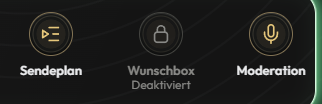

# MischWerk – Prüfbericht 0.1.269 / Build 269

GitHub-Abschluss: Die Übersicht bleibt in .github/README.md; der technische Einstieg in PROJEKT/README.md. Beide beschreiben Build 269 mit dauerhaften offenen Wünschen, Information:-Lauftext, unabhängiger Titelabfrage und Radioregie ohne Zeitlimit. Ordner- und Bildverweise sind auf die bestehende neue Ablage geprüft. Keine Rückkehr zu den alten flachen CSS-/Website-/Bildordnern und keine zusätzlichen Rootdateien. Laufzeit, Desktop-UPLOAD und fünf Manifeste bleiben durch diese Dokumentationspflege bytegleich.

Textkorrektur im bestehenden Build 269: Die feste Lauftextbeschriftung lautet jetzt „Information:“. Ausschließlich ein Doppelpunkt im sichtbaren Text ergänzt; Schrift, Farben, Höhe, Abstand, Glow und Verhalten unverändert. Vollständiger Paketbau einschließlich 403 Nodefällen und beiden Rhino-Engines sowie beide bestehenden K3-/STAPP-Lauftextfälle am fertigen Paket bestanden.

## Studio ohne Verlängerung oder Zeitlimit · Build 269 · 06.11.2026

Die automatische Sechs-Stunden-Abmeldung und die gesamte Verlängerungsfunktion sind entfernt. Anmelden erzeugt eine Sitzung ohne Ablaufdatum. Bei aktiver Anmeldung ist die Anmeldetaste ausgeblendet; Abmelden und bestätigte Übergabe bleiben erhalten. Endzeit/Open End, Restzeit, Beginn und Studiozeit werden nicht mehr angezeigt. Das eigenständige studio/session-Modul samt Registrierung, Verdrahtung, Dialog, Entwurfsbehandlung, Formatierung und Stilen ist aus Quellen und UPLOAD entfernt. Der Website-Arbeitsbereich 0.2.1 bietet dieselben Kernaktionen ohne Zeitdialog.

radio/moderation prüft tatsächliche Channelanwesenheit und Rechte ohne Uhrzeitgrenze. Wiederholtes eigenes Anmelden bleibt idempotent: kein Commit, neuer Beginn, Schlüsselwechsel, Übergabeverlust oder weitere öffentliche Beginnmeldung. Alte gespeicherte expiresAt/openEnd-Felder werden im bestehenden Bereinigungspfad entfernt, ohne eine anwesende berechtigte Moderation wegen des alten Datums abzumelden. Ansichtsmodelle veröffentlichen diese Felder nicht mehr. Verlassen, Rechteentzug, Nutzerlöschung, echte Abmeldung und bestätigte Übergabe behalten ihre bisherigen Schutzprüfungen. Sendeplanzeiten, Sicherheits-/Kopplungssitzungen, Audio, Anbieterabfragen und Wunschpersistenz bleiben unabhängig.

Gegenfälle am unveränderten Desktop-Build 268: Die Moderationsprojektion enthält noch Endzeitfelder; nach sieben Stunden Testzeitsprung ist die Moderation automatisch abgemeldet. Vier neue Backendfälle prüfen 48 Stunden ohne Abmeldung, fehlende Zeitfelder, idempotente Wiederholung einschließlich alter Zeitdaten bei offener Übergabe, Bereinigung gespeicherter Altstände ohne neue Beginnmeldung sowie atomare An-/Abmeldung bei Speicherfehlern. Bestehende Endzeit-/Ablauferwartungen wurden entsprechend dem ausdrücklichen Entfernungsauftrag ersetzt. Kalender-/Sommerzeit-, Rechte-, Notiz-, Wiederholungs-, Fehler- und Privatsphärentests bleiben bestehen.

Vollständiger Paketbau bestanden: 403/403 Node-Prüfungen und je 1068 Prüfungen mit den verifizierten echten Rhino-Engines 1.7.7.2 und 1.9.1. Architektur, API-Signaturen, Quellen-/Laufzeitgleichheit, Syntax und Zeichenlimits bestanden. Zusätzlich fünf betroffene Frontendfälle für knappe Größen, Anmeldung, Fokus und Verbindungsverlust, alle elf Übergabe-Browserfälle einschließlich Antwortverlust und privaten Notizen sowie alle 22 Website-Node-/Browserfälle erfolgreich. Ein bestehender Übergabe-Geometrietest verwendet stabile Elementreferenzen statt positionsabhängiger Sichtbarkeitsselektoren während asynchroner Darstellung; die Prüfung erreichbarer sichtbarer Tasten bleibt erhalten.

Am endgültigen Desktop-UPLOAD bestehen sechs integrierte Browserfälle in 31,5 Sekunden: K3/STAPP bei 320 und 780 px, 48 Stunden beschleunigte Testzeit ohne Abmeldung, erneutes Öffnen, keine Zeitfelder, erreichbare Kernaktionen und laufendes echtes lokales HTML-Audio ohne zusätzlichen loadstart. Dazu beide Übergaben bei 320 × 360 px und verlorener Annahmequittung. Keine Browserfehler oder fremden Netzaufrufe. Die aktuellen breiten/schmalen Moderationsbilder wurden am geprüften Paket aufgenommen. Dies sind lokale Plattformmodelle, keine native Knuddels-Langzeitabnahme.

Paket: 140 Laufzeitdateien, darunter 133 Texte, 53 Backendmodule und 50 Frontendkomponenten; maximal 9458 UTF-16-Zeichen pro Laufzeittext. Fünf Manifeste bleiben unter 9500 Zeichen. Originalmedien, Fonts, beide offiziellen API-Stubs, bestehender Radio-/Titel-/Audioweg, Begrüßung, Wunschmodule und Android-Anschluss bleiben unverändert. Website-Abhängigkeiten ausschließlich mit eingefrorenem Lockfile lokal ergänzt. Keine Veröffentlichung, echte Knuddels-Update-/Neustart-/Nachrichtenaktion, Mail oder Änderung produktiver Anschlussfreigaben. Native Installation und Abnahme bleiben getrennt offen.

## Offene Musikwünsche dauerhaft sichern · Build 268 · 06.11.2026

Offene Wünsche werden vor der erfolgreichen Annahme über die dokumentierte Knuddels-AppPersistence gespeichert. Updates und neue Appinstanzen erhalten Texte, Reihenfolge, IDs, authentifizierte Zuordnung, Empfang und manuelle Regiestufe. Channel-, Website- und Androidwünsche bleiben in derselben Queue. Neue Ansichts-Generationen verwerfen alte Pakete. Der private Updatehinweis lautet jetzt „Offene Musikwünsche bleiben beim Neustart erhalten.“

wishes/storage schreibt vollständige Snapshots in wechselnde Seitensätze unter mischwerk.wishes.v3, jeweils höchstens 10000 UTF-16-Zeichen und unter 90000 JSON-Bytes pro Objekt. Erst der abschließende einzelne Indexcommit veröffentlicht den Satz. Schreibfehler erhalten RAM und bisherigen bestätigten Speicher; ungültige oder fehlende bestätigte Seiten werden niemals leer überschrieben oder aus alten Seiten wiederbelebt. Nicht referenzierte Seiten werden gezielt bereinigt. Keine feste Wunschanzahlgrenze. Die dokumentierten Methoden und die 100-kB-Objektgrenze wurden mit beiden unveränderten Stubs und der [offiziellen Persistence-Referenz](https://developer.knuddels.de/docs/classes/Persistence.html#method_setObject) abgeglichen; keine Mehrschlüsseltransaktion behauptet.

Abschluss und Verwerfen entfernen Wunschtexte dauerhaft. Höchstens 256 technische Abschlusskennungen ohne Texte/Nicks sichern jüngste Wiederholungen. Nutzerlöschung entfernt eigene Wünsche und Marker sowie den personenbezogenen Empfangsnick in fremden offenen Wünschen. Die nötige primitive Empfangszuordnung bleibt ausschließlich serverintern. Ein Wunsch-Purgefehler verhindert keine übrige Nutzerbereinigung. Android gleicht technische Annahme-/Statusbelege beim Neustart mit der Queue ab: Ein nachgelagerter Belegfehler nimmt keinen dauerhaft angenommenen Wunsch zurück; eine Reservierung vor fehlgeschlagenem Queuecommit verhindert keinen neuen Versuch.

Gegenfall am unveränderten Desktop-Build 267: Zwei bestätigte Wünsche fehlen nach Shutdown und neuer App (0 statt 2). Acht neue Speicherprüfungen decken Wiederherstellung einschließlich Empfang/Status, Wiederholung nach Neustart, Seiten-/Index-Schreibabbrüche, 260 Unicodewünsche über insgesamt 100 kB, endgültigen Abschluss/Verwerfen/Nutzerpurge, gescheiterte Regieaktionen, defekten Speicher, verwaiste Seiten und gelöschte Empfangsnicks ab. Die Fälle sind im normalen Testskript und im Paketbau registriert. Zusätzliche Android-/Websitefälle prüfen gemeinsame Speicherung und Wiederholung nach Fehlern. Frühere Erwartungen an flüchtige Wünsche wurden entsprechend dem neuen Auftrag ersetzt.

Vollständiger Paketbau: 406/406 Node-Prüfungen, je 1074 Prüfungen in den verifizierten echten Rhino-Engines 1.7.7.2 und 1.9.1 sowie Architektur-, API-, Quellen-/Laufzeit-, Syntax- und Längenprüfung bestanden. Die bestehende Rhino-Prüfung erzeugt nach beiden Shutdown-Hooks eine neue App und liest alle 125 Wünsche wieder. Am endgültigen Desktop-UPLOAD bestehen drei integrierte Browserfälle in 14,8 Sekunden: Speicherfehler mit erhaltenem Entwurf und derselben Kennung, laufendes echtes lokales HTML-Audio ohne neuen loadstart beim Speichern, Wiederherstellung samt Status nach Testneustart in K3 und STAPP sowie native Wunschlisten-Auswahl/Empfang. Keine Browserfehler oder fremden Netzaufrufe. Zuvor bestanden zusätzlich die beiden kompakten Wunschbestätigungen und der bestehende Drei-Nutzer-Wunschregie-/Übergabefall.

Quellen, erzeugte Laufzeit und vollständiger fester Desktop-UPLOAD enthalten 141 Laufzeitdateien, darunter 134 Texte und 53 Backendmodule; maximal 9475 UTF-16-Zeichen pro Laufzeittext. Fünf Manifeste dokumentieren die tatsächlichen Bytes und bleiben strikt unter 9500 Zeichen.

Sämtliche Browsermodule, Stylesheets, Originalmedien, Fonts und offiziellen API-Stubs bleiben bytegleich. Audio-, Fenster-, Rollen-, Provider-, Hosting- und Freigabeverträge unverändert. Der neue Speicher ist serverseitig; kein zusätzliches UI oder Timer. Ausschließlich lokal vorbereitet. Native Knuddels-Installation und echter Neustart bleiben gesondert abzunehmen. Das erste Update von Build 267 oder älter kann dessen bereits im RAM liegende Wünsche nicht nachträglich sichern; vorher abarbeiten. Keine FTP-/GitHub-Veröffentlichung, produktive Anschlussänderung, echte Knuddels-Update-/Neustart- oder Nachrichtenaktion.

## Profillinks und deutlichere öffentliche Begrüßung · Build 267 · 06.11.2026

Der Wortlaut bleibt für alle menschlichen Rollen gleich. Die vollständige erste Zeile Willkommen bei Radio MischWerk, {Nick}. erhält KCode 16, Fettschrift und das Appleisten-Gold #e6c77b. Nach geschlossenem Fettabschnitt und Reset folgt ein Zeilenumbruch; Viel Spaß beim Zuhören. steht in normaler Channelschrift darunter. Das Foto bleibt nach dem letzten Punkt mit einem Leerzeichen am Ende. Keine Smileys, Zufallstexte, Rollenansagen, neuen Schriftdateien oder Appflächen.

Nick und Foto verwenden User.getProfileLink(displayText) desselben authentifizierten Userobjekts. Der Nick wird mit escapeKCode und zusätzlich genau einmal maskiertem Linktrenner als wörtliche Anzeige eingesetzt. Für das Foto wird ausschließlich die unveränderte geprüfte Plattformadresse aus getProfilePhoto(24,24) samt Bild-Linktrenner <>--<> übergeben. Das Linkziel erzeugt die native User-API; keine selbst konstruierte Profiladresse, kein eigener Slashbefehl, keine verschachtelten Linktags oder Nutzer-ID in der Anzeige. Leere, überlange oder fehlgeschlagene Profillinks erhalten lesbaren Nick bzw. unverlinktes Bild als Rückfallebene; fehlende/unsichere Fotos lassen den Text bestehen.

Offizielle Dokumentation und unveränderte Referenzstubs geprüft: [User.getProfileLink](https://developer.knuddels.de/docs/classes/User.html#method_getProfileLink) unterstützt eigenen Anzeigetext; [User.getProfilePhoto](https://developer.knuddels.de/docs/classes/User.html#method_getProfilePhoto) liefert die Fotoadresse und garantiert keine exakte Zielgröße. Das [PrivateMessage.getRawText-Beispiel](https://developer.knuddels.de/docs/classes/PrivateMessage.html#method_getRawText) belegt den verwendeten Bild-Linktrenner; die Kombination mit der nativen Profilfunktion ist die hier umgesetzte Ableitung. Das vom offiziellen Entwicklerportal verlinkte [KCode-Wiki](https://github.com/knuddelsgmbh/UserApps/wiki/KCode) erläutert Fettschrift und Bildklicks, enthält aber abweichende allgemeine Link-/Resetbeispiele. Deshalb werden Profilziele weiterhin durch die konkrete User-API erzeugt. Keine kopierte Drittbibliothek oder erfundene Plattformmethode.

Der neue Gegenfall scheiterte vor Umsetzung: Die native Profilfunktion wurde weder für Nick noch Foto aufgerufen. Jetzt bestehen 18 Begrüßungs-Nodefälle einschließlich aller Rollen, neutralem Wortlaut, genau einer Nachricht, Foto am Ende, 24er-Größenwunsch, Sonderzeichen/Dollarzeichen/Vorlagenmarkern, Linktrennern neben Backslashes, Link-/Fotofehlern, Wiederbeitritt, Start/Shutdown und Botfehlern. Die bestehenden Usermodelle bilden die dokumentierte Profilfunktion nach; die native interne Linkserialisierung wird dadurch nicht als empirisch verifiziert ausgegeben. Beide Rhino-Engines prüfen zusätzlich Java-String-Rückgaben der Profilfunktion, kontrollierte Anzeigeparameter und den lesbaren Rückfall bei Linkfehlern.

Vollständiger Paketbau bestanden: 396/396 Node-Prüfungen sowie je 1066 Prüfungen mit den verifizierten echten Rhino-Engines 1.7.7.2 und 1.9.1. Am endgültigen Desktop-UPLOAD bestehen vier integrierte K3-/STAPP-Emulatorfälle in 6,9 Sekunden: öffentliche Begrüßungen für vier Rollen, native Profilfunktionsausgaben und Fotowunsch, keine Doppel-/Startmeldungen, bestehende Bot-Texte/Rechte und weiterlaufendes echtes lokales HTML-Audio. Keine Browser-/Runtimefehler oder fremden Netzaufrufe. Der Emulator zeigt Chatnachrichten als rohe Protokolltexte; er ist kein nativer Knuddels-KCode-Renderer.

Sämtliche 86 Browser-/Mediendateien inklusive der unabhängigen Titel-/AutoDJ-/Live-Abfragen aus Build 266 sowie alle 20 Stylesheets sind bytegleich zum Ausgangsstand. Außer Releasekonfiguration und users/greetings bleiben die übrigen 50 Backendmodule bytegleich. Originalmedien, Fonts und beide API-Stubs unverändert. Quellen, Laufzeit, fester Desktop-UPLOAD und fünf Manifeste konsistent: 140 Laufzeitdateien, 133 Texte, maximal 9475 Zeichen; Manifeste strikt unter 9500 Zeichen.

Native Abnahme bleibt erforderlich: tatsächliche Schrift-/Linkdarstellung, Klick auf Nick und Foto zum richtigen Profil und reales Fotoformat im jeweiligen Knuddels-Client. 24 × 24 bleibt ausschließlich der dokumentierte Größenwunsch; keine Garantie kleinerer nativer Pixelmaße. Ausschließlich lokal vorbereitet und geprüft; keine echte Begrüßung, Profilöffnung, FTP-Übertragung oder Knuddels-Installation ausgeführt.

## Titel sofort anzeigen, Sendemodus unabhängig lesen · Build 266 · 06.11.2026

Neue Titel werden unmittelbar nach der gültigen Titelantwort dargestellt. radio/api.fetchMetadata wartet nicht mehr auf die separate AutoDJ-/Live-Antwort; fetchBroadcastMode liest dieselbe bereits konfigurierte Modusadresse getrennt. radio/provider verwaltet Titel, Modus und Übertragungsstatus unabhängig: Titel/Modus jeweils fünf Sekunden nach ihrem eigenen Abschluss, Status weiterhin 30 Sekunden; Fehler pausieren nur die betroffene Quelle für 30 Sekunden. Höchstens ein Modusabruf gleichzeitig, bestehende HTTPS-/Hostprüfungen, no-store/omit, XHR-Fallback und Zehnsekunden-Timeout erhalten. Keine neue Anbieteradresse, Knuddels-Signatur oder Speicherstruktur.

Der Modus besitzt eigene Revisionen und Prüfzeiten. Neue Titel erneuern keinen alten Modus-Prüfzeitpunkt; vorhandene strikt boolesche Angaben direkt aus Titelmetadaten behalten ihren bisherigen Vorrang. Quellenwechsel, Sendepause, Ausblenden und pagehide verwerfen alte Antworten. Ein noch laufender alter Modusabruf wird bis zu seinem begrenzten Abschluss gehalten; danach beginnt bei wieder sichtbarer aktiver Ansicht ein frischer Abruf. So wird weder derselbe Request dupliziert noch sein altes Ergebnis einer neuen Sitzung zugeordnet. Der vorhandene Sichtbarkeitslistener setzt nur den Provider aus; laufendes Audio und Wiedergabe-Heartbeat bleiben unabhängig. pagehide reaktiviert nachträglich keine Timer; pageshow stellt die Datenprüfung wieder her.

Drei Laufzeitdateien geändert: radio/api.js, radio/provider.js und der Providerteil des vorhandenen Sichtbarkeitshooks in transport/lifecycle.js. radio/connection.js, radio/player.js, radio/volume.js, Markup und alle 20 Stylesheets sind gegenüber dem erhaltenen Desktop-Build 265 bytegleich. Keine Änderung an Oberfläche, Radioregie, Lauftext, Glow, Audioquelle, Lautstärkeregeln oder Rechten. Der bestehende lesende Anschlussprüfer meldet Titel und Modus nun getrennt; er wurde hier nicht für einen weiteren echten Streamabruf ausgeführt.

Vor Umsetzung scheiterten die neuen K3-/STAPP-Gegenfälle an einer gehaltenen Modusantwort: der bereits gelieferte neue Titel blieb aus. Nach Umsetzung zeigen dieselben Fälle Titel 1 und den nächsten Fünfsekundentitel während genau einer ausstehenden Modusabfrage. Getestet mit echtem lokalem HTML-Audio: identisches Audioelement und dieselbe Quelle, kein zusätzlicher loadstart, weiterhin laufend bei 37 Prozent und erhaltener Stummschaltung. Der STAPP-Gegenfall verwendet zusätzlich den bisherigen XHR-Fallback. Der neue Nodefall prüft getrennte Aufrufe und gemeinsam deduplizierte parallele Modusleser.

Sechs neue Browserfälle in den bestehenden K3-/STAPP-Gruppen decken zusätzlich gegenseitige Timeouts, unabhängige Fehlerrücknahmen, Refresh ohne Doppelfetch, Quellenwechsel, Rückkehr vor einer alten Antwort, Hintergrund, Sendepause sowie pagehide/pageshow ab. Der alte Modus darf auch nicht kurzzeitig als aktuelles LIVE erscheinen. Die bestehenden Titel-/Anbieter-/Studiostatus-/Heartbeat-Fälle bleiben erhalten; nur die bisher gekoppelte interne API-Erwartung wurde auf die zwei getrennten Leser angepasst.

Vollständiger Paketbau bestanden: 393/393 Node-Prüfungen und je 1064 Prüfungen in den verifizierten echten Rhino-Engines 1.7.7.2 und 1.9.1. Am endgültigen Desktop-UPLOAD bestehen 20 gezielte Frontend-Browserfälle in 62,9 Sekunden einschließlich Audio- und Channel-Heartbeat in beiden Clientmodellen. Zusätzlich bestehen sechs integrierte Emulatorfälle in 10,8 Sekunden: lokale echte HTML-Audiowiedergabe, Stopp/HTTP-Fehler/ungültige Anbieterantworten sowie sämtliche nativen Overlaywechsel mit weiterlaufendem Radio in K3 und STAPP. Keine fremden Netzaufrufe oder Browserfehler.

Der Desktop-Ausgangsstand enthielt bereits die separate native Auth-Diagnose aus Build 265. Dessen Backendmodule, Prüfungen, Brückenstand und Befunde wurden vor dieser Änderung unverändert in die zuvor ältere Arbeitskopie übernommen und erhalten; keine neue Auth-Änderung durch diese Arbeit. Alle 51 Backend-Fachmodule außerhalb der Releasekonfiguration bleiben bytegleich zu diesem Ausgangsstand. Originalmedien, Fonts und API-Stubs unverändert.

Quellen, Laufzeit, fester Desktop-UPLOAD und fünf Manifeste konsistent: 140 Laufzeitdateien, 133 Texte, maximal 9475 Zeichen; alle Manifeste strikt unter 9500 Zeichen. Die technische Machbarkeit ist mit den bestandenen Gegenfällen belegt, daher bleibt die Umsetzung bestehen; die vorbereitete Rücknahme war nicht erforderlich. Die vorher gemessene Verzögerung der Anbieter-Titelquelle wird dadurch nicht beseitigt: sofort bedeutet nach Eingang einer aktuellen gültigen Antwort. Keine Zusage einer sekundengenauen Tonsynchronität im nativen Client. Ausschließlich lokal vorbereitet und geprüft; keine Veröffentlichung, FTP-Übertragung, echte Knuddels-Aktion oder weitere Senderprobe.

## Vereinbarter Probeheader und ausschließlicher Statuszugriff · Build 265 · 06.11.2026

Revision 21 meldet das bereitgestellte boolesche Firebase-Feld probeHeaderPresent und dessen erfolgreichen wertfreien Kontrollnachweis. Build 265 erweitert den ausdrücklichen Inhaberbefehl auth-pruefen um genau den vereinbarten harmlosen Zusatzheader im dokumentierten header-Objekt. Weiterhin ausschließlich leeres Objekt als payload-String, bestehender Sync-Schlüssel im Authorization-Header und feste Hosting-Adresse. Keine Änderungen an Statustest, Produktionsauthentisierung, Wünschen, Schlüsseln oder Freigabeflags.

Der Diagnosecallback verwendet gemäß Abstimmung ausschließlich getResponseCode. Weder Antwortbody-Umwandlung noch JSON.parse oder getURLString in diesem Modus. HTTP 400 bei unveränderter Konfiguration und rechtzeitiger Antwort gilt nach dem festen Gegenstellenvertrag als Auth-Statusnachweis; Bodyinhalt und Antwortadressvergleich bleiben unbekannt. Der Bericht unterscheidet native-header-probe-post, meldet bodyRead/jsonParsed=false und nicht durchgeführte Vergleiche null. Keine Headerwerte, Antworttexte oder Secrets, kein automatischer Folgetest. Gemeinsamer Port, Timeout, Wiederholungsabstand und Lifecycle-Cleanup bleiben erhalten.

Zwei Gegenfälle scheiterten vor Umsetzung: vereinbarter Zusatzheader fehlt, und bisheriger Code greift auf die Antwortadresse zu. Nach Umsetzung bestehen alle 18 Verifikationsfälle. Ein neuer Gegenfall versieht in beiden Callbacks Body und URL-Getter mit fehlschlagenden Zugriffswächtern und zählt genau einen Statuszugriff; beide Wächter bleiben unberührt. Bestehende Statusprüfung verlangt weiterhin ihre vollständige Antwortprüfung und erhält keinen Probeheader. Rhino prüft Zusatzheader, Java-Integer-Status, unterbliebenen Body-/URL-Zugriff, wahrheitsgemäßen Bericht und abgewiesenen 401.

Vollständiger Paketbau: 392/392 Node-Prüfungen, je 1064 Prüfungen mit den verifizierten echten Rhino-Engines 1.7.7.2 und 1.9.1 sowie Architektur-/API-/Längen-/UPLOAD-Abgleich bestanden. 140 Laufzeitdateien, 133 Texte, 52 Backendmodule und fünf Manifeste; Maximum 9475 Zeichen. Alle 88 Browser-/Medien-/API-Referenzdateien bytegleich zum erfassten Build-264-Ausgangsstand; keine neue Browserrunde für die unveränderte Oberfläche. Adapter-SHA-256 in Quelle, Runtime und UPLOAD identisch: 468f7bad82b95cf0a8d2bb177d1c4893d745d3a4bf895dd5abd22364fe09ec1d.

Der Betreiber hat Build 265 installiert und genau einen Vergleich ausgeführt. Vollständiger privater Bericht: checkedAt=1793996865399, entsprechend 20:27:45.399 UTC / 21:27:45.399 MEZ, HTTP 401, failure, bodyRead/jsonParsed=false, Antwortadress-/Fehlerinhaltprüfung null, authenticationAccepted=false und unveränderte Freigabeflags. Keine Senderdaten, Wünsche oder Folgeanforderung.

In der authentifizierten Cloud-Console schreibgeschützt geprüft: Requestlog 20:27:45.523 UTC und Function-Auth-Log 20:27:47.244240 UTC haben dieselbe Trace 186a837e183049b76f251ed80de5ee2f. Authorization=false, Bearer=false, Tokenlänge 0 und Probeheader=false. Beide getesteten eigenen Header kommen nicht am Function-Eingang an. Konkreter postURL-Aufruf und lokale Übergabeobjekte wurden geprüft: dokumentierter header-Parameter, Stringwerte, beide Einträge gesetzt und identische Quell-/Runtime-/UPLOAD-Bytes. Kein belegter korrigierbarer Parameterfehler; die tatsächliche Headerunterstützung des AppServers ist mit der Plattform zu klären. Keine weitere Formatvariante oder identische Test-/FTP-Runde auf Verdacht.

Revision 22 enthält Vorbereitung, Paketprüfungen, tatsächlichen Nutzerbericht und sichere Logzuordnung bei unverändertem Firebase-Abschnitt. Installation und echter Aufruf stammen vom Betreiber; kein FTP/Neustart/echter Knuddels-Aufruf, Secretwechsel oder Firebase-Deployment durch diesen Codex. Kein Status-POST oder unabhängiger Firestore-Erfolgsnachweis; Freigabeflags bleiben false.

## Titelanzeige: lesende Verzögerungsprüfung · 06.11.2026

Anlass: Betreiber beobachtet 10–30 Sekunden Nachlauf bei sichtbar bleibender Appleiste. Geprüft wurde der unveränderte Frontendstand aus Build 264. Währenddessen wird im Desktop-Projekt parallel Build 265 für eine andere Arbeit vorbereitet; radio/api.js und radio/provider.js sind dort nachweislich bytegleich. Keine dieser parallelen Änderungen wurde übernommen oder überschrieben. Diese Prüfung umfasst nur öffentliche HTTP-GETs, Codeanalyse und vier vorhandene lokale Browserfälle; kein Sender-/Encoder-/Knuddels-Eingriff, keine Audiowiedergabe oder Aufnahme.

Live-Fenster 21:18:31–21:22:26 MEZ (20:18:31–20:22:26 UTC). Die konfigurierte [Titelquelle](https://scripts.streampanel.net/spcast/player/default/api.php?url=mischwerk.spcast.eu&userid=8884&historic=true) lieferte HTTP 200, CORS * und Cache-Control no-cache, no-store, must-revalidate. In 36 Vergleichspaaren im Fünfsekundenraster betrugen ihre Antwortzeiten 153–226 ms, die der [Streamstatistik](https://mischwerk.sp.radio.fm/statistics?json=1) 569–799 ms. Die anfängliche Einzelprüfung lieferte Heavy Cross / Gossip gegenüber Komet in der Statistik. Ein einmaliger lesender Abruf des Hörerstreams bestätigte anschließend ICY StreamTitle Udo Lindenberg & Apache 207 - Komet. Binärdaten nur bis zum ersten Metadatenblock durchlaufen, weder gespeichert noch abgespielt; Verbindung danach beendet.

Beim vollständig beobachteten Vergleichswechsel Komet → Can't Get You Out of My Head / Kylie Minogue enthielt die Statistik im Paar um 21:21:08,477 MEZ bereits den neuen Titel. Die Titelquelle lieferte weiterhin Komet, auch noch im Paar um 21:21:13,313. Im Paar um 21:21:18,290 war auch die Titelquelle umgestellt: rund zehn Sekunden Differenz zwischen den ersten beobachteten neuen Werten. Die Stichprobenauflösung beträgt fünf Sekunden; getrennte Antwortzeiten und nicht beobachtete genaue Umschaltpunkte erlauben keine millisekundengenaue Differenz. Eine Abweichung zwischen zwei Anbieterwegen ist belegt. Der hörbare Liedanfang und der individuelle Audiopuffer im nativen Knuddels-Client wurden nicht gleichzeitig gemessen; daraus folgt keine feste Verzögerung für jedes Lied.

Der [eigene öffentliche Player](https://mischwerk.sp.radio.fm/) verwendet das [Anbieterskript](https://scripts.streampanel.net/spcast/player/default/js/scripts.min.js) mit zehn Sekunden Titeltakt und aktuellem t-Queryparameter. 32 zusätzliche parallele Vergleichspaare zwischen fester URL und dieser offiziellen Zeitstempelvariante ergaben einschließlich Wechsel keinen unterschiedlichen Titelstand. Die App schaltet Browsercache bereits ab; ein zusätzlicher Zeitstempel ist hier nicht als Lösung belegt. Interne Datenaktualisierung und Caches des Anbieters sind aus den Antwortheadern nicht abschließend bestimmbar.

Apppfad: radio/provider.js:9 und :48 planen regulär fünf Sekunden nach Abschluss der vorherigen Metadatenanfrage, Fehler erst nach 30 Sekunden. radio/api.js:43 verwendet fetch mit no-store und credentials omit. Über Promise.all in api.js:115 wird jedoch auch die separate AutoDJ-/Live-Antwort abgewartet. Synthetische Ausführung des unveränderten Moduls: Titelantwort nach 1 ms vorhanden, künstlich langsame Modusantwort nach neun Sekunden; Titel erst nach 9006 ms ausgeliefert. Dieser zusätzliche Wartepfad ist reproduziert, aber kein Nachweis einer real neun Sekunden langsamen Modusantwort. Der einmalige echte Modusabruf betrug 802 ms. Der Zehnsekunden-HTTP-Timeout begrenzt diesen einzelnen Wartepfad; erst danach wird der erfolgreiche Folgetakt geplant.

Vier bestehende Browserfälle bestanden in 5,0 Sekunden: Fünfsekundentakt ohne Browsercache, unabhängig langsamer Senderstatus, Metadatenfehler mit letztem Titel und erhaltenem Audio sowie Timeout/Sendepause. Diese Fälle verwenden synthetische Providerdaten. Der verzögerte separate Modusdienst ist der zusätzliche obige Diagnosefall und wird nicht mit dem bereits getesteten Übertragungsstatus verwechselt.

Ergebnis: Nachgewiesene Abweichung zwischen Anbieter-Titelquelle und Streamstatistik plus regulärer App-Abfragetakt; bei trägem Modusdienst kommt vermeidbare App-Wartezeit hinzu. Passende nächste Codekorrektur: gelieferte Titel sofort anzeigen und den bestätigten Sendemodus unabhängig aktualisieren. Schnellere Abfragen allein beseitigen eine noch alte Anbieterantwort nicht. Im Rahmen dieser Prüfung wurden ausschließlich die bestehenden Prüfberichte ergänzt; keine Runtime-, UPLOAD-, Manifest- oder Versionsänderung. Die parallele Desktop-Arbeit bleibt davon getrennt.
## Beschriftung Radioregie bei unveränderten Maßen · Build 264 · 06.11.2026

Die bisherige Taste Moderation heißt jetzt Radioregie. Sichtbare Beschriftung, Tooltip und zugänglicher Name wurden gemeinsam geändert; das vorhandene Regler-Symbol bleibt erhalten. Rückersetzung dieser drei Wörter ergibt exakt den Ausgangsstand von radio/markup.js. Alle 20 Stylesheets, übrigen Frontendskripte und 41 Prüfdateien bleiben bytegleich. Schriftgrößen, Tastenmaße, Positionen, Lauftext, Glow und Rechte unverändert. Das bestehende Moderator-Menü und dessen Funktionen werden weiter über denselben Button geöffnet.

Vier vorhandene Browserfälle bestehen am endgültigen Desktop-UPLOAD in 83,5 Sekunden: volle Vinylmatrix, rollenabhängige Zugänge, gesperrte/reaktivierte Wunschbox mit erhaltenem Audio und Tastaturbedienung. Die Inhaltsprüfung verlangt bei allen sichtbaren Aktionen vollständige Beschriftungen ohne Überlagerung oder Abschneiden. 456 Kombinationen aus 32 Breiten von 320 bis 3840 px, zusätzlichen natürlichen Höhen, drei Rollen und vier Pixeldichten stimmen bei Schriftgröße und sämtlichen erfassten Flächen, Positionen und Aufteilungen exakt mit dem unveränderten Layoutstand aus Build 262 überein. Keine Verkleinerung, Verschiebung oder Testabschächung nötig.

Zwei bestehende K3-/STAPP-Lauftext-/Audiopfade bestehen an den Quellen in 9,9 Sekunden; vier entsprechende Geometrie-/Langtextfälle bestehen am fertigen Paket in 12,8 Sekunden, einschließlich engen Hosts, Reduced Motion und laufendem Audio. Die aktuellen [Radiotasten](oberflaeche/radio/radio-buttons.png) und die [Gesamtansicht](oberflaeche/radio/lauftext-1280.png) wurden visuell geprüft. Keine neuen Tests für die reine Beschriftungsänderung.

Vollständiger Paketbau bestanden: 391/391 Node-Prüfungen und je 1063 Prüfungen mit Rhino 1.7.7.2 und 1.9.1. Quellen, Laufzeit, fester Desktop-UPLOAD und fünf Manifeste konsistent: 140 Laufzeitdateien, 133 Texte, maximal 9475 Zeichen; Manifeste strikt unter 9500 Zeichen. Originalmedien, Fonts, API-Stubs und native Auth-Diagnose unverändert erhalten. Ausschließlich lokal vorbereitet und geprüft; keine Veröffentlichung oder echte Knuddels-Aktion.

## Regler-Symbol für das Moderator-Menü · Build 263 · 06.11.2026

Das Mikrofon in der Appleiste wurde durch drei senkrechte Schieberegler ersetzt. Damit steht das Symbol für die vorhandenen Moderationseinstellungen. Die Taste heißt weiterhin Moderation und öffnet dasselbe berechtigte Menü; keine Sprachfunktion. Ausschließlich der SVG-Inhalt in radio/markup.js ist geändert. Herausnahme dieses SVG-Inhalts ergibt exakt den Ausgangsstand. Alle 20 Stylesheets und sämtliche übrigen Frontendskripte bleiben bytegleich. Größe, Goldton, Positionen, Beschriftungen, 24-px-Lauftextpause und Glow erhalten.

Die zwei vorhandenen K3-/STAPP-Lauftext-/Audiopfade bestehen am Quellstand in 8,1 Sekunden. Am endgültigen Desktop-UPLOAD bestehen drei vorhandene Rollen-/Sperr-/Tastaturfälle in 4,5 Sekunden sowie vier K3-/STAPP-Lauftext-/Geometrie-/Langtextfälle in 11,8 Sekunden. Sie prüfen das bestehende Menü, Berechtigungen, vollständige Bedienflächen bei 320–3840 px, Reduced Motion, begrenzte Hosts und erhaltenes Audio. Keine neuen Tests für die reine Zeichnungsänderung. Die aktuellen [Aktionstasten](oberflaeche/radio/radio-buttons.png) und die [Gesamtansicht](oberflaeche/radio/lauftext-1280.png) wurden visuell geprüft. Der vollständige 456-fache Geometrie-/Pixeldichtenvergleich und der Glow-Pixelnachweis gehören zum unveränderten CSS des vorangehenden Builds 262.

Vollständiger Paketbau: 391/391 Node-Prüfungen und je 1063 Prüfungen mit Rhino 1.7.7.2 und 1.9.1 bestanden. Quellen, Laufzeit, fester Desktop-UPLOAD und fünf Manifeste konsistent: 140 Laufzeitdateien, 133 Texte, maximal 9475 Zeichen; Manifeste strikt unter 9500 Zeichen. Originalmedien, Fonts, API-Stubs und native Auth-Diagnose unverändert. Ausschließlich lokal vorbereitet und geprüft; keine Veröffentlichung oder echte Knuddels-Aktion.

## Größere Aktionstasten und Beschriftungen innerhalb der Appleiste · Build 262 · 06.11.2026

Sendeplan, Wunschbox und Moderation nutzen dieselben vergrößerten Vinyl-Scheiben, Symbole und Haupttexte: breit 50/26 px und 15-px-Schrift statt 44/22 px und 13 px; natürlich schmal 40/22 px und 14-px-Schrift statt 36/20 px und 13 px. Kleinere innere Abstände bringen die Inhalte in den unveränderten 92-/84-px-Tastenflächen unter. Bei knappem Rahmen bleiben die bisherigen kompakten Maße erhalten. Zusatzzeile Deaktiviert, Schloss, Fokus, echte Klicksperre und alle Rechte unverändert.

Nur zwei bestehende CSS-Regeln für die gemeinsamen Tasteninhalte wurden angepasst. Rücknahme dieser Werte ergibt den normalisierten Ausgangsstand exakt. Alle 54 Frontendskripte und die übrigen 18 Stylesheets einschließlich Lauftext, Ecken, Grundflächen und RGB-Glow sind bytegleich zu Build 261. Kein neuer Größen-, Audio-, Lade- oder Datenweg. Die vorhandene Tastaturprüfung erwartet die neue Beschriftungsgröße; ihr Gegenfall scheitert am alten 13-px-Stand.

Die bestehende Vinylmatrix erfasst jetzt zusätzlich die Geometrie der Leiste, Musikfläche, Wiedergabe, Lautstärke und aller Aktionstasten. Vorher-/Nachher-Vergleich an 456 Kombinationen von 32 Breiten zwischen 320 und 3840 px, zusätzlichen natürlichen Höhen, drei Rollen und vier Pixeldichten: sämtliche gemessenen Flächen, Positionen und Aufteilungen exakt gleich. Derselbe Vergleich besteht erneut am endgültigen Desktop-UPLOAD. Die vorhandenen Inhaltsprüfungen verlangen vollständig passende Beschriftungen, Symbole, gleiche Tastenmaße, Höhen und Zwischenräume; keine Testabschächung.

Drei gezielte Quellen-Browserfälle bestehen in 41,5 Sekunden. Vier Fälle am fertigen Paket bestehen in 46,3 Sekunden: volle Vinylmatrix, gesperrte/reaktivierte Wunschbox mit erhaltenem Audio, Glowauslauf in K3/STAPP und Tastaturbedienung. Zusätzlich bestehen vier bestehende K3-/STAPP-Lauftext-/Geometrie-/Langtextfälle am Paket in 10,7 Sekunden, einschließlich 44-px-Laufzeile, 24-px-Pausesymbol, engen Hosts, Reduced Motion und laufendem Audio. Die aktuellen [Aktionstasten](oberflaeche/radio/radio-buttons.png) und die [gesamte Appleiste mit Lauftext](oberflaeche/radio/lauftext-1280.png) wurden visuell geprüft.

Vollständiger Paketbau bestanden: 391/391 Node-Prüfungen und je 1063 Prüfungen mit Rhino 1.7.7.2 und 1.9.1. Quellen, Laufzeit, fester Desktop-UPLOAD und fünf Manifeste konsistent: 140 Laufzeitdateien, 133 Texte, maximal 9475 Zeichen; alle Manifeste strikt unter 9500 Zeichen. Originalmedien, Fonts, API-Stubs und vorhandene native Auth-Diagnose unverändert erhalten. Ausschließlich lokal vorbereitet und geprüft; keine Veröffentlichung oder echte Knuddels-Aktion.

## Größeres echtes Pause-Symbol im Lauftext · Build 261 · 06.11.2026

Das bisherige Schriftzeichen wird durch ein 24 × 24 px großes SVG ersetzt: zwei gefüllte senkrechte Balken im vorhandenen Goldton #e6c77b. Nach lokalem Anhalten erscheint ein Play-Dreieck; Fortsetzen funktioniert per Klick und Tastatur. Die vorhandenen aria-Beschriftungen und der bestätigte lokale Tastenstatus steuern auch die Symbolanzeige. Keine neue Zustandsquelle, Schrift oder Bilddatei.

In der Lauftext-CSS wurden ausschließlich symbolbezogene Regeln ergänzt; deren Rücknahme ergibt den normalisierten Ausgangsstand bytegleich. Bedienfläche 44 × 44 px, Leistenhöhe, Textgrößen, Abstände, Ecken, Hintergrund und Glow bleiben erhalten. Alle anderen Frontendcontroller und alle Backend-Fachmodule sind gegenüber dem erfassten Build 260 bytegleich. Der bestehende Browserfall wurde um Darstellung, Zustandswechsel und Tastaturfortsetzung ergänzt; am alten ausgelieferten Stand scheitert er gezielt am fehlenden SVG.

Vollständiger Paketbau bestanden: 391/391 Node-Prüfungen und je 1063 Prüfungen mit Rhino 1.7.7.2 und 1.9.1. Vier bestehende K3-/STAPP-Lauftext-/Geometrie-/Langtextfälle bestehen an den Quellen in 10,3 Sekunden und am endgültigen Desktop-UPLOAD in 10,7 Sekunden: 320–3840 px, erhaltene Audiowiedergabe, sichtbarer Symbolwechsel, Goldfarbe, 24-px-Symbol, Reduced Motion und begrenzte Hosts. Der unveränderte pixelgeprüfte Glowauslauf besteht in 6,1 Sekunden (1/1 Fall). Die [aktuelle Gesamtansicht](oberflaeche/radio/lauftext-1280.png) wurde visuell geprüft (1280 × 221 px).

Quellen, Laufzeit, fester Desktop-UPLOAD und fünf Manifeste konsistent: 140 Laufzeitdateien, 133 Texte, maximal 9475 Zeichen; alle Manifeste strikt unter 9500 Zeichen. Originalmedien, Fonts, API-Stubs und vorhandene native Auth-Diagnose bleiben erhalten. Private Website-Umgebungsdateien wurden nicht gelesen oder übertragen. Ausschließlich lokal vorbereitet und geprüft; keine Veröffentlichung oder echte Knuddels-Aktion.

## Saubere Ecken zwischen Appleiste und Laufleiste · Build 260 · 06.11.2026

Die unteren Innenradien der Appleiste entfallen ausschließlich bei eingeschaltetem Lauftext. Dadurch laufen die seitlichen Kanten am Übergang gerade durch; die doppelten Viertelkreise und sichtbaren Eckkeile aus den Nutzerbildern verschwinden. Die gemeinsame Außenkontur bleibt oben und unten gerundet. Ohne Lauftext gelten wieder die ursprünglichen unteren Appleistenrundungen. Deckfläche, Muster, Logo-Einblendung und sichtbare Trennung bleiben erhalten.

In radio/ticker.css wurden nur diese beiden Radiuswerte samt erklärendem Kommentar verändert; Rückersetzung ergibt exakt den SHA-256 des UI-Ausgangsstands. Höhe, Abstände, Schriftgrößen, Goldakzente, Halo und sämtliche Frontendcontroller bleiben bytegleich. Der Gegenfall scheitert am vorherigen Stand mit zwei 24-px-Innenradien. Die bestehenden Browserfälle prüfen jetzt den geraden Anschluss bei 320–3840 px und die ursprünglichen Rundungen nach Ausschalten, zusätzlich zur bisherigen Geometrie-/Text-/Audioprüfung.

Der feste Desktop-Projektstand enthielt bereits vor Beginn dieser UI-Arbeit Build 259 mit der vorhandenen Auth-Prüfung. Dessen drei Backendmodule, Laufzeitkopien, zugehörige Node-/Rhino-Prüfdateien und Anbindungshinweise wurden unverändert in die Arbeitskopie übernommen (zehn Dateien mit identischen Ausgangshashes). Die zugehörigen Fachregeln, API-/Betriebs-/Architekturhinweise und der nachfolgende native Prüfbericht bleiben erhalten. Deshalb erhält das gemeinsame Paket die nächste freie Kennung 260. Keine neue Auth-Implementierung und keine echte Probe durch diese UI-Arbeit.

Vollständiger Paketbau am zusammengeführten Stand: 391/391 Node-Prüfungen und je 1063 Prüfungen mit Rhino 1.7.7.2 und 1.9.1 bestanden. Am endgültigen Desktop-UPLOAD bestehen vier K3-/STAPP-Lauftext-/Geometrie-/Langtextfälle in 11,4 Sekunden. Der bestehende pixelgeprüfte Glowauslauf besteht in 6,1 Sekunden (1/1 Fall; RGB-Phasen mit und ohne Lauftext, K3/STAPP, normale und doppelte Pixeldichte). Die [aktuelle Gesamtansicht](oberflaeche/radio/lauftext-1280.png) wurde visuell kontrolliert (1280 × 221 px).

Beide Projektstände, Laufzeit, Desktop-UPLOAD und fünf Manifeste konsistent: 140 Laufzeitdateien, 133 Texte, maximal 9475 Zeichen; alle Manifeste strikt unter 9500 Zeichen. Originalmedien, Fonts und API-Stubs unverändert. Frühere SDK-/Vinylnachweise bleiben ihren jeweiligen Builds zugeordnet. Build 260 wurde ausschließlich lokal vorbereitet und geprüft; keine eigene Veröffentlichung, FTP-Übertragung oder echte Knuddels-Aktion.

## Schreibfreie native Auth-Probe · Build 259 · 06.11.2026

Gemeinsame Revision 18 bestätigt die Headerweiterleitung auf Firebase-Seite. Der lokale Ausgangsstand Build 258 enthält exakt den bei der früheren Build-240-Diagnose erfassten postURL-Adapter (SHA-256 b3f5b7a492119489597f41ccd51c8b9eba68d97aa315bd0ae5b63dc72fe57a68). Offizielle API und Entwickler-Wiki erneut geprüft: `header` ist dokumentiert; `headers` wird im Wiki ausdrücklich als nicht unterstützt bezeichnet. Keine unbewiesene Transportkorrektur und keine Authentisierungslockerung.

Build 259 ergänzt ausschließlich `/mischwerk-relay auth-pruefen` im vorhandenen Prüfmodul. Leere Nutzlast `{}`, bestehender Sync-Schlüssel ausschließlich in header.Authorization, gleiche feste Zieladresse und Schutzmechanismen wie der Einmal-Statustest. Keine Senderprojektion, Wünsche, zusätzliche Timer oder Freigabeschreibvorgänge. Nur 400 mit boolesch bestätigtem invalid_payload-Vertrag, richtiger Zieladresse, unveränderter Konfiguration und rechtzeitiger Antwort bestätigt Authentisierung; der Statuskanal bleibt getrennt. Begrenzte 400-Antwort im Fehlercallback nur für diesen Test parsen; keine Rohtexte oder Secrets ausgeben.

Sechs neue Nodefälle prüfen leere Nutzlast ohne Aufruf der Senderprojektion, 400 im Fehlercallback, 401/200/ungültige oder fremde Antworten, gemeinsamen Port/Timeout/Abstand, Rollen/Konfiguration/Befehlsvarianten, Rechte-/Konfigurationswechsel und Ablehnung nichtleerer Auth-Nutzlasten. Drei erste Gegenfälle scheiterten vor Umsetzung; bestehende Sperrfälle bestanden bereits. Alle 17 gezielten Verifikationsfälle bestehen. Der bestehende integrierte Emulatortest prüft beide Befehle und meldet fehlende HTTP-API ehrlich als Modellgrenze. Neun zusätzliche Rhino-Prüfungen decken Auth-Projektion, Java-Rückgaben, Fehlercallback, Bericht, Sperrflags und 401 ab.

Vollständiger Paketbau: 391/391 Node-Prüfungen sowie je 1063 Prüfungen in den verifizierten echten Rhino-Engines 1.7.7.2 und 1.9.1 bestanden. Quellen-/Laufzeit-/UPLOAD-Abgleich und fünf Manifeste bestehen: 140 Dateien, 133 Texte, 52 Backendmodule, maximal 9475 Zeichen. Alle 88 Browser-/Medien-/API-Referenzdateien bytegleich zum vor Änderungen erfassten Stand; keine neue Browserrunde für die unveränderte Oberfläche. Der neue connection.js-Hash ist in Quelle, app/server und UPLOAD identisch: 2b6538298dd5287761d9674848597cce9b85a6bda5478bb962fb88c188f143a4.

Build 259 ist vollständig lokal vorbereitet und anschließend durch den Betreiber installiert. Sein neuer privater Auth-Bericht nennt Build 259 und checkedAt=1793988380017, entsprechend 18:06:20.017 UTC / 19:06:20.017 MEZ: HTTP 401, failure, richtige Antwortadresse, authenticationAccepted=false, invalidPayloadConfirmed=false und unveränderte Freigabeflags. Ausschließlich {} gesendet, keine Senderprojektion. In der authentifizierten Cloud-Console schreibgeschützt geprüft: Requestlog 18:06:20.140 UTC und Auth-Log 18:06:22.413474 UTC haben dieselbe Trace af6b7bed9242c169a8550e5ade31764a; Header=false, Bearer=false, Tokenlänge 0. Der aktuelle Build reproduziert den fehlenden Authorization-Wert damit auch unabhängig von Statusdaten.

Keine FTP-/Neustart-/native HTTP-Aktion durch diesen Codex; die echte Installation und Probe führte der Betreiber aus. Keine Schlüssel- oder Firebase-Änderung. Kein weiterer Status-POST, Auth-Erfolg oder unabhängiger Firestore-Nachweis. Als nächster abgestimmter Vergleich ist ausschließlich eine boolesche Präsenzdiagnose für einen festen harmlosen Zusatzheader vorgeschlagen; so lassen sich allgemeine Headerübertragung und spezielle Authorization-Behandlung trennen. Dieser Zusatztest ist noch nicht implementiert oder ausgeführt. Revision 19 enthält Quellzuordnung, Paketprüfung und echtes Ergebnis; Firebase-Abschnitt unverändert. enabled/runtimeVerified bleiben false.

## Größere Kennzeichnung „Information“ · Build 258 · 06.11.2026

Die goldene Kennzeichnung „Information“ beträgt jetzt 16 px statt 11 px, bei Ansichten bis einschließlich 700 px Breite 14 px. In radio/ticker.css wurden ausschließlich diese Schriftmaße angepasst; Rückersetzung der beiden Regeln ergibt exakt den SHA-256 des Ausgangsstands. Lauftext 20/18 px, 44-px-Leistenhöhe, Abstände, Zeichenabstand, vertikale Zentrierung, einfarbiger Hintergrund und Glow bleiben erhalten. Sämtliche Frontendcontroller und Tests bytegleich, keine neue Funktion oder API.

Vollständiger Paketbau: 385/385 Node-Prüfungen und je 1054 Prüfungen mit Rhino 1.7.7.2 und 1.9.1 bestanden. Am endgültigen Desktop-UPLOAD bestehen die vier vorhandenen K3-/STAPP-Lauftext-/Geometrie-/Langtextfälle in 10,4 Sekunden: 320–3840 px, unveränderte Leistenhöhe, Textzentrierung, lange Texte, Reduced Motion, begrenzte Hosts und erhaltenes Audio. Die [aktuelle Gesamtansicht](oberflaeche/radio/lauftext-1280.png) mit größerer Kennzeichnung wurde visuell kontrolliert (1280 × 221 px).

Quellen, Laufzeit, fester Desktop-UPLOAD und fünf Manifeste konsistent: 140 Laufzeitdateien, 133 Texte, maximal 9475 Zeichen; alle Manifeste strikt unter 9500 Zeichen. Originalmedien, Fonts, API-Stubs und Backend-Fachcode unverändert. Frühere Pixel-/SDK-/Vinylnachweise gehören zu den nachfolgend genannten Builds. Ausschließlich lokal vorbereitet und geprüft; keine Veröffentlichung, FTP-Übertragung oder echte Knuddels-Aktion.

## Kennzeichnung „Information“ · Build 257 · 06.11.2026

Die sichtbare Kennzeichnung am Anfang der Laufleiste lautet auf Nutzerwunsch „Information“ statt „INFO“. In radio/ticker.js ist nachweislich nur dieses Markupwort geändert: Rückersetzung ergibt exakt den SHA-256 des Ausgangsstands. Alle CSS-Dateien, Lauftextlogik, Schriftmaße, Höhe, Anschluss, Abstände und Glow bleiben bytegleich. Keine neue Funktion, Einstellung oder API.

Vollständiger Paketbau: 385/385 Node-Prüfungen und je 1054 Prüfungen mit Rhino 1.7.7.2 und 1.9.1 bestanden. Am endgültigen Desktop-UPLOAD bestehen die vier betroffenen K3-/STAPP-Lauftext-/Geometrie-/Langtextfälle in 11,1 Sekunden: 320–3840 px, unveränderte 44-px-Zeile, Textzentrierung, reduzierter Bewegungsmodus, begrenzte Hosts und erhaltenes Audio. Keine neue Testdatei oder zusätzliche Prüfung nur für den Wortlaut. Die [aktuelle Gesamtansicht](oberflaeche/radio/lauftext-1280.png) wurde visuell kontrolliert (1280 × 221 px).

Quellen, Laufzeit, fester Desktop-UPLOAD und fünf Manifeste konsistent: 140 Laufzeitdateien, 133 Texte, maximal 9475 Zeichen; alle Manifeste strikt unter 9500 Zeichen. Originalmedien, Fonts, API-Stubs und Backend-Fachcode unverändert. Frühere Pixel-/SDK-/Vinylprüfungen gehören zu den nachfolgend genannten Builds. Ausschließlich lokal vorbereitet und geprüft; keine Veröffentlichung, FTP-Übertragung oder echte Knuddels-Aktion.

## Lauftext nochmals vergrößert · Build 256 · 06.11.2026

Auf Nutzerwunsch die Laufschrift um jeweils 2 px erhöht: regulär 20 px, bis einschließlich 700 px Breite 18 px. In radio/ticker.css sind nachweislich ausschließlich diese beiden Schriftwerte verändert; Rückersetzung ergibt exakt den SHA-256 des Ausgangsstands. Leistenhöhe 44 px, Zeilenhöhe 1,3, Anschluss, Abstände, einfarbiger Hintergrund und Glow bleiben erhalten. Frontendcontroller und native Größenberechnung sind bytegleich.

Der Gegenfall scheitert am vorherigen 18-px-Schriftmaß. Die vorhandenen K3-/STAPP-Fälle bestätigen 20/18 px, unveränderte Leistenhöhe, vollständige vertikal zentrierte Texte und unveränderte Tasten-/Glowgeometrie bei 320–3840 px. Lange ungetrennte Texte und vollständiger statischer Umbruch bei Reduced Motion bleiben geprüft. Die bestehende Pixelprüfung bestätigt weiterhin den weichen Glow in allen RGB-Phasen mit und ohne Laufleiste.

| Prüfung an Build 256 | Ergebnis |
| --- | --- |
| Vollständiger Paketbau / Node | 385/385 bestanden |
| Echte Rhino-Engines 1.7.7.2 und 1.9.1 | Je 1054 Prüfungen bestanden |
| Betroffene Lauftext-/Geometrie-/Langtextfälle am endgültigen Desktop-UPLOAD | 4/4 bestanden, 11,5 Sekunden; beide Clientmodelle und erhaltenes Audio |
| Pixelgeprüfter Glowauslauf am UPLOAD | 1/1 bestanden, 5,6 Sekunden; alle RGB-Phasen, K3/STAPP, normale und doppelte Pixeldichte |
| Architektur, API, Quellen-/Laufzeit-/UPLOAD-Abgleich und fünf Manifeste | 140 Laufzeitdateien, 133 Texte; maximal 9475 Zeichen, alle Manifeste strikt unter 9500 Zeichen |

Die [aktuelle Gesamtansicht](oberflaeche/radio/lauftext-1280.png) wurde aus dem endgültigen UPLOAD aufgenommen und visuell geprüft (1280 × 221 px). Die vollständigen acht Lauftext-/SDK-Fälle gehören weiterhin zu Build 255, die frühere Vinylmatrix zu Build 254. Originalmedien, Fonts, offizielle API-Stubs, Frontendcontroller und Backend-Fachcode unverändert. Nur lokal vorbereitet; keine Veröffentlichung, FTP-Übertragung oder echte Knuddels-Aktion.

## Lesbare Schrift passend zur Laufleiste · Build 255 · 06.11.2026

Die Laufschrift beträgt jetzt 18 px statt 14 px, bei Ansichten bis einschließlich 700 px Breite 16 px. Zeilenhöhe 1,3 und die bestehende vertikale Zentrierung passen den Text an die unveränderte 44-px-Laufzeile an. INFO und Pause behalten ihre bisherigen Größen. Einfarbiger Hintergrund, direkter Anschluss, Glowraum, Appleiste und alle Frontendcontroller bleiben erhalten. Ausschließlich radio/ticker.css und Releasekennungen geändert; keine neue API oder Einstellung.

Der passende Gegenfall scheitert am vorherigen 14-px-Schriftmaß. Die erweiterten vorhandenen Browserfälle prüfen 18/16 px, unveränderte 44 px Leistenhöhe, vollständige und vertikal zentrierte Textrechtecke, erhaltene Tastenpositionen und Glowabstände bei 320/390/780/1280/2290/3840 px. Lange und ungetrennte Texte sowie statischer vollständiger Umbruch bei Reduced Motion sind in beiden Clientmodellen geprüft. Die Pixelprüfung wartet vor der Messung auf die tatsächliche Hostantwort einschließlich des kompakten STAPP-Zwischenstands; ihre bestehenden Farb-/Auslaufanforderungen bleiben erhalten.

| Prüfung an Build 255 | Ergebnis |
| --- | --- |
| Vollständiger Paketbau / Node | 385/385 bestanden |
| Echte Rhino-Engines 1.7.7.2 und 1.9.1 | Je 1054 Prüfungen bestanden |
| Lauftext und SDK-Ladeübergabe am endgültigen Desktop-UPLOAD | 8/8 bestanden, 45,1 Sekunden; einschließlich Größe, Zentrierung, langen Texten, Rollen, Entwürfen und erhaltenem Audio |
| Erweiterter pixelgeprüfter Glowauslauf am UPLOAD | 1/1 bestanden, 7,0 Sekunden; alle RGB-Phasen mit und ohne Laufleiste, K3/STAPP, normale und doppelte Pixeldichte |
| Architektur, API, Quellen-/Laufzeit-/UPLOAD-Abgleich und fünf Manifeste | 140 Laufzeitdateien, 133 Texte; maximal 9475 Zeichen, alle Manifeste strikt unter 9500 Zeichen |

Die [aktuelle Gesamtansicht](oberflaeche/radio/lauftext-1280.png) aus dem endgültigen Desktop-UPLOAD zeigt die größere Laufschrift (1280 × 221 px), visuell geprüft. Die vollständige Vinylmatrix/RGB-Runde gehört weiterhin zu Build 254. Originalmedien, Fonts, API-Stubs, Frontendcontroller, native Größenberechnung und Backend-Fachcode bleiben gegenüber dem Beginn dieser Anpassung bytegleich. Lokale Vorbereitung und Emulatorprüfung; keine eigene Veröffentlichung, FTP-Übertragung oder echte Knuddels-Aktion.

## Früherer unterer Glow und einfarbige Laufleiste · Build 254 · 06.11.2026

Der untere Halo besitzt wieder denselben Auslauf wie die ursprüngliche Appleiste: 34 px breit bzw. 24 px kompakt, davon die letzten 16 px mit dem bisherigen weichen Schlussfade auf die Canvasfarbe. Der in Build 253 verkürzte Auslauf von 16 px wird nicht mehr direkt an der Lichtkante abgedunkelt. Ausschließlich der benötigte untere Glowraum wird wiederhergestellt; oberer Anschluss, sichtbare Rahmenposition, Logo, Texte und Tasten bleiben unverändert. Mit normaler Laufzeile beträgt die Gesamthöhe wieder 220 px. Keine neuen Schattenfarben, Animationen, Timer oder Plattformmethoden.

Auf den weiteren Nutzerwunsch ist die Laufleiste vollständig einfarbig #141414. Das gemeinsame Pseudoelement enthält keine Hintergrundmuster mehr; die deckende Grundfläche der Laufzeile verhindert auch im oberen Überlappungsbereich das Durchscheinen der Appleistendekoration. Die Appleiste behält ihr eigenes Muster, ihre Deckfläche und die wiederhergestellte Logo-Einblendung. INFO-/Pausenakzent und Lauftext bleiben erhalten.

Zwei passende Gegenfälle scheitern am vorherigen Stand: unterer Auslauf 16 statt 34 px sowie weiterhin vorhandene Hintergrundverläufe unter der Laufleiste. Die endgültigen K3-/STAPP-Fälle bestätigen wieder den früheren Glowraum, unveränderten lückenlosen Anschluss und unveränderte Appleisten-/Tastenrechtecke bei 320–3840 px. Die vorhandene Pixelprüfung wurde auf die aktivierte Laufleiste erweitert: alle sechs RGB-Phasen breit und schmal, K3/STAPP, normale und doppelte Pixeldichte; letzter Rand auf Canvasfarbe, weicher Übergang und davor sichtbarer Halo. Insgesamt 38 Pixelstichproben für die unterschiedlichen Phasen und Ansichten. Reduced Motion, begrenzte Hosts und erhaltenes Audio sind weiterhin geprüft.

| Prüfung an Build 254 | Ergebnis |
| --- | --- |
| Vollständiger Paketbau / Node | 385/385 bestanden |
| Echte Rhino-Engines 1.7.7.2 und 1.9.1 | Je 1054 Prüfungen bestanden |
| Lauftext und SDK-Ladeübergabe am endgültigen Desktop-UPLOAD | 8/8 bestanden, 48,7 Sekunden |
| Vinylmatrix, RGB-Verlauf und erweiterter pixelgeprüfter Glowauslauf am UPLOAD | 3/3 bestanden, 48,7 Sekunden |
| Architektur, API, Quellen-/Laufzeit-/UPLOAD-Abgleich und fünf Manifeste | 140 Laufzeitdateien, 133 Texte; maximal 9475 Zeichen, alle Manifeste strikt unter 9500 Zeichen |

Die [aktuelle Gesamtansicht](oberflaeche/radio/lauftext-1280.png) aus dem endgültigen UPLOAD zeigt die einfarbige Laufzeile und den vollständigen Glow (1280 × 221 px), visuell kontrolliert. Originalmedien, Fonts, offizielle API-Stubs, Backend-Fachcode, Begrüßungen, Rechte und Lauftextwerte bleiben erhalten. Frühere Browsernachweise gehören zu den nachfolgend genannten Builds. Lokale Bereitstellung und Emulatorprüfung; keine eigene FTP-/Knuddels-/Veröffentlichungsaktion, native Bestätigung nach Übertragung bleibt separat.

## Ursprüngliche Appleiste mit direkt anschließender Laufzeile · Build 253 · 06.11.2026

Das vom Nutzer gezeigte Vorher-Bild ist die Gestaltungsvorgabe: eigene dunkle Deckfläche, darin eingeblendetes Original-Logo, eigenes Rillenmuster und abgerundeter unterer Appleistenrahmen. Die bisherige Lauftextregel hatte diese Fläche und den Rahmen transparent gesetzt und die Dekoration unterdrückt. Das ist korrigiert. Die Deckfläche bildet wieder den Hintergrund für mix-blend-mode:lighten; das unveränderte Logo erscheint ohne schwarzen Kasten. Die eigene Rahmenanimation erhält die ursprüngliche Kontur, während ausschließlich der gemeinsame äußere Halo unter beiden Flächen liegt.

Die Hauptbreite wurde nicht geändert. radio.css, radio-actions.css, radio-responsive.css und metadata-layout.css entsprechen inhaltlich dem Gitstand vor dem Lauftexteinbau; die Dateien sind gegenüber dem Beginn dieser Korrektur bytegleich. Der bestehende Browserfall vergleicht zusätzlich die vollständigen Rechtecke von Appleiste, Player, Metadaten und Haupttasten vor und nach dem Einschalten: keine Größen- oder Positionsänderung.

Die Laufzeile beginnt jetzt am sichtbaren unteren Rahmen. Ihr negativer oberer Rand nutzt ausschließlich den bisherigen unteren Außenabstand von 18 px bzw. 8 px im kompakten Layout; kein Zwischenstreifen und keine Überdeckung von Texten oder Tasten. radio/viewport berücksichtigt diesen bereits genutzten Abstand bei der Gesamthöhe: breit normal 202 px, kompakt 212 px einschließlich 44-px-Laufzeile und 16-px-Glowauslauf. Die nativen Erzeugungswerte 176/220 px, derselbe dokumentierte Größenweg und die 500-px-Grenze bleiben erhalten. Kein neuer Timer, Audioweg oder Controller.

Der ergänzte Gegenfall scheitert am vorherigen CSS mit transparenter Deckfläche. Der endgültige Stand bestätigt wiederhergestellte Deckfarbe, sichtbaren unteren Rahmen, ursprüngliche Dekoration sowie unveränderte Appleistengeometrie. In K3 und STAPP bei 320/390/780/1280/2290/3840 px sind sichtbarer Rahmen und Laufzeile lückenlos verbunden, die Tasten vollständig darüber und die gesamte Fläche innerhalb der tatsächlich angenommenen Hosthöhe. Ignorierte Hostgrößen und langer statisch umgebrochener Lauftext bleiben erreichbar.

| Prüfung an Build 253 | Ergebnis |
| --- | --- |
| Vollständiger Paketbau / Node | 385/385 bestanden |
| Echte Rhino-Engines 1.7.7.2 und 1.9.1 | Je 1054 Prüfungen bestanden |
| Lauftext und SDK-Ladeübergabe im K3-/STAPP-Emulator am UPLOAD | 8/8 bestanden, 46,7 Sekunden; einschließlich Geometrie, Rechte, Konflikte, Entwürfe, lange Texte, Reduced Motion und erhaltenes Audio |
| Bestehende Vinylmatrix, RGB-Verlauf und Glowauslauf am UPLOAD | 3/3 bestanden, 45,3 Sekunden; 320–3840 px, drei Rollen und vier Pixeldichten |
| Architektur, API, Quellen-/Laufzeit-/UPLOAD-Abgleich und fünf Manifeste | 140 Laufzeitdateien, 133 Texte; maximal 9475 Zeichen und alle Manifeste strikt unter 9500 Zeichen |

Die [neue Gesamtansicht](oberflaeche/radio/lauftext-1280.png) wurde aus dem endgültigen Desktop-UPLOAD aufgenommen und visuell geprüft (1280 × 203 px einschließlich Rahmen). Originalmedien, Fonts, API-Stubs, Begrüßungen, Berechtigungen, Lauftextwerte und Backend-Fachcode unverändert. Die folgenden Browsernachweise gehören jeweils zu den dort genannten älteren Builds. Lokale Vorbereitung und Emulatormessung; die native Knuddels-Anzeige ist nach vollständiger Übertragung erneut zu bestätigen. Keine eigene Veröffentlichung, FTP-Übertragung oder echte Knuddels-Aktion.

## Versions- und Buildnummer · Build 252 · 06.11.2026

Auf Nutzerwunsch Appversion von 0.1.251 auf 0.1.252 und Buildnummer von 251 auf 252 erhöht. Paketdatei, Backendkonfiguration, app.config, erzeugter Einstieg, Laufzeitkopie, Dokumentationsköpfe und alle fünf Manifeste führen dieselbe neue Kennung. Funktionscode, Darstellung und Medien bleiben unverändert.

Der vollständige lokale Paketbau besteht 385/385 Node-Prüfungen und jeweils 1054 Prüfungen mit den echten Rhino-Engines 1.7.7.2 und 1.9.1. Architektur-, API-, Quellen-/Laufzeit- und Längenprüfungen bestanden. Der feste Desktop-UPLOAD enthält 140 Laufzeitdateien, davon 133 Texte; maximale Textlänge 9475 Zeichen, alle fünf Manifeste ebenfalls strikt unter 9500 Zeichen. Kein erneuter Browserlauf für die reine Kennungsänderung; die folgenden Browsernachweise gehören zu Build 251 bzw. den dort genannten älteren Builds.

Ausschließlich lokal vorbereitet und geprüft. Bestehende native Abnahmen bleiben erhalten.

## Durchgehender Hintergrund und vollständige Vorschau · Build 251 · 06.11.2026

Die vorhandenen konzentrischen Rillen und diagonalen Lichtflächen liegen bei aktivem Lauftext auf derselben gemeinsamen Deckfläche. Appleiste und Laufleiste verwenden einen einzigen Musterursprung; transparente Teilflächen verdecken ihn nicht. Die linke Schallplatte bleibt erhalten. Ohne Lauftext gelten die bisherigen Dekorationsflächen, Deckfarbe und Halo. Der gemeinsame RGB-Glow bleibt an tatsächliche Wiedergabe gebunden.

Der Nutzer bestätigt, dass ausschließlich das Vorschaubild hier im Chat abgeschnitten war. Die Aufnahme scrollt jetzt zuerst den Headerrahmen vollständig in den sichtbaren Bereich und prüft dessen obere/untere Grenzen sowie die PNG-Höhe gegen den Rahmen. Die [vollständige Aufnahme](oberflaeche/radio/lauftext-1280.png) aus dem endgültigen Desktop-UPLOAD zeigt 1280 × 221 Pixel einschließlich Appleiste, Laufleiste und Glowauslauf. Visuell kontrolliert. Native Headerhöhen und Größenpfad wurden nicht geändert.

Der passende Gegenfall scheitert am vorherigen CSS mit backgroundImage=none; nach der Korrektur bestätigt derselbe vorhandene Browserfall das gemeinsame Rillenmuster und den durchsichtigen Lauftextuntergrund. Keine neue Testdatei, Steuerung oder API.

| Prüfung an Build 251 | Ergebnis |
| --- | --- |
| Vollständiger Paketbau / Node | 385/385 bestanden |
| Echte Rhino-Engines 1.7.7.2 und 1.9.1 | Je 1054 Prüfungen bestanden |
| Lauftext und SDK-Ladeübergabe im K3-/STAPP-Emulator am UPLOAD | 8/8 bestanden, 42,3 Sekunden; einschließlich Rechte, Entwürfe, Konflikte, lange Texte, begrenzte Hosthöhe, Reduced Motion und erhaltenes Audio |
| Bestehende Vinylmatrix, RGB-Verlauf und Glowauslauf am UPLOAD | 3/3 bestanden, 45,1 Sekunden; 320–3840 px, drei Rollen und vier Pixeldichten |
| Architektur, API, Quellen-/Laufzeit-/UPLOAD-Abgleich und fünf Manifeste | 140 Laufzeitdateien, 133 Texte; alle ausgelieferten Texte und Manifeste strikt unter 9500 Zeichen |

Die vollständige Runde mit 302 Browserfällen gehört weiterhin zu Build 248. Originalmedien, Schriften, offizielle API-Stubs, Begrüßungen, Lauftextcontroller und native Größenberechnung sind gegenüber dem Beginn dieser Korrektur unverändert. Ausschließlich lokale Bereitstellung, keine Veröffentlichung, FTP-Übertragung oder echte Knuddels-Ausführung.

## Farblich angeglichene Laufleiste · Build 250 · 06.11.2026

Die Laufleiste verwendet jetzt dieselbe Deckgrundfarbe #141414 wie die Appleiste über das vorhandene --bg. Der bisherige grüngraue Untergrund #191a18 entfällt. Die Trennung verwendet das vorhandene neutrale --line (#3a3a3a) anstelle des goldenen Trennstrichs; normaler heller Text #f5f5f2 und Goldakzente #e6c77b entsprechen weiterhin der Radioleiste. Kein zusätzlicher unterer dunkler Farbstreifen.

Ausschließlich radio/ticker.css farblich angepasst; Geometrie, gemeinsamer Glow, Wiedergabebindung, Lauftextsteuerung und Berechtigungen bleiben erhalten. Keine neue Testdatei oder API. Bestehende K3-/STAPP-Abläufe am endgültigen Desktop-UPLOAD erneut ausgeführt und die [aktuelle Radioansicht](oberflaeche/radio/lauftext-1280.png) visuell kontrolliert.

| Prüfung an Build 250 | Ergebnis |
| --- | --- |
| Vollständiger Paketbau / Node | 385/385 bestanden |
| Echte Rhino-Engines 1.7.7.2 und 1.9.1 | Je 1054 Prüfungen bestanden |
| Bestehende Lauftextabläufe mit echter lokaler Wiedergabe im K3-/STAPP-Emulator | 2/2 bestanden, 7,2 Sekunden; gemeinsame Glowfläche, reduzierte Bewegung, Text, Richtung, Anhalten, Ein/Aus und erhaltenes Audio |
| Architektur, API, Quell-/Laufzeit-/UPLOAD-Abgleich und fünf Manifeste | 140 Laufzeitdateien, 133 Texte; weiterhin alle Texte und Manifeste unter 9500 Zeichen |

Die früheren vollständigen Browser- und Glowprüfungen sind nachfolgend ihrem jeweiligen Build zugeordnet. Originalmedien, offizielle API-Stubs und bestehende Nutzerdaten bleiben erhalten. Ausschließlich lokale Bereitstellung, keine Veröffentlichung, FTP-Übertragung oder echte Knuddels-Ausführung.

## Verbundene Appleiste und Laufleiste · Build 249 · 06.11.2026

Appleiste und eingeschalteter Lauftext bilden jetzt eine direkt verbundene sichtbare Einheit mit übereinstimmenden seitlichen Kanten und gemeinsam gerundetem Abschluss. Der vorhandene 48-Sekunden-RGB-Halo umschließt diese Einheit und läuft unter der Laufleiste weich auf die Canvasfarbe aus. Die bisherige einzelne Glowfläche der Radioleiste ist währenddessen abgeschaltet; zwischen Radio und Lauftext liegt kein zweiter Lichtsaum. Ohne Lauftext bleibt der ursprüngliche Halo erhalten.

Ein kleiner gemeinsamer Markuprahmen radio-deck trägt die Kontur und erbt dieselben bestehenden Lichtfarben. Farbzyklus, Schattenmaße und echte Wiedergabebindung werden wiederverwendet. Keine neue Zustandsquelle, Animationsteuerung, Timer oder zusätzliche native Größenanforderung. Reduced Motion zeigt weiterhin einen statischen Halo. Lauftextwerte, Berechtigungen, Entwürfe, Headerhöhen, Audioknoten und persistente Nutzerdaten bleiben erhalten.

Der ergänzte Gegenfall scheitert am vorherigen Stand ohne gemeinsame Glowfläche. Die endgültigen Browserprüfungen bestätigen den aktiven gemeinsamen Halo, abgeschalteten Zwischen-Glow, statischen Reduced-Motion-Halo und Rückkehr zum alten Halo nach Ausschalten. Gemessene Ober-/Seiten-/Unterkanten stimmen in K3 und STAPP bei 320/390/780/1280/3840 px überein, einschließlich ignorierter Hostgrößen. Die aktuelle [Radioansicht mit Lauftext](oberflaeche/radio/lauftext-1280.png) wurde aus dem endgültigen UPLOAD im vorhandenen Emulator aufgenommen und visuell geprüft.

| Prüfung an Build 249 | Ergebnis |
| --- | --- |
| Vollständiger Paketbau / Node | 385/385 bestanden |
| Rhino 1.7.7.2 und 1.9.1 | Je 1054 Prüfungen bestanden |
| Lauftext und SDK-Ladeübergabe im K3-/STAPP-Emulator am UPLOAD | 8/8 bestanden, 42,9 Sekunden |
| Bestehende Vinylmatrix, RGB-Farbverlauf und pixelgeprüfter Glowauslauf am UPLOAD | 3/3 bestanden, 46,1 Sekunden; 320–3840 px, drei Rollen und vier Pixeldichten |
| Architektur, API, Quellen-/Laufzeitgleichheit, UPLOAD und fünf Manifeste | 140 Laufzeitdateien, 133 Texte; alle Texte und Manifeste unter 9500 Zeichen |

Die vollständige Runde mit 302 Browserfällen und die abschließenden 18 Lauftext-/Overlayfälle gehören zu Build 248 und stehen nachfolgend als Nachweis des Funktionsaufbaus. Für diese Darstellungskorrektur wurden die betroffenen Radio-, Glow-, Lauftext- und Startabläufe erneut geprüft. Originalmedien und API-Stubs unverändert. Ausschließlich lokale Bereitstellung; keine Veröffentlichung, FTP-Übertragung oder echte Knuddels-Ausführung.

## Lauftext unter der Appleiste · Build 248 · 06.11.2026

Senderweiter Lauftext mit eigenem Reiter **Moderation → Lauftext**. Bestehende authentifizierte Radiomoderation einschließlich automatischer Inhaberrechte kann Text bis 300 Zeichen, Tempo Langsam/Normal/Zügig (32/48/72 px pro Sekunde), Laufrichtung und Ein/Aus speichern. Normale User, MCM, Appmanager, fremde/veraltete Sitzungen und behauptete Clientrollen werden abgewiesen. Standard leer und aus; ein aktiver Lauftext benötigt Text. Ausschalten erhält die Einstellungen, Neustart erhält den bestätigten Stand.

Speichern erfolgt atomar im bestehenden Appzustand mit eigener erwarteter Lauftextrevision. Gleichzeitige Änderungen erhalten den eigenen Entwurf und verlangen ausdrücklich Aktuellen Stand laden; Fehler werden nicht als Erfolg gemerkt. Höchstens 32 erfolgreiche flüchtige Aufträge werden dedupliziert, mit erneuter Berechtigungsprüfung. Entwürfe bleiben im bestehenden Overlaycache; Lauftexteingaben werden während des Tippens über dessen vorhandenen Timer nach 400 ms gebündelt, Schließen/Wechsel übernehmen den aktuellen Wert unmittelbar. Text erreicht die öffentliche Leiste erst nach erfolgreichem Speichern.

Die 44-px-Zeile erscheint direkt unter dem Radio mit Goldakzent, normalem Text, lokalem Anhalten und statischem vollständigem Umbruch bei reduzierter Bewegung. TextContent verhindert HTML-/KCode-Auswertung. CSS übernimmt die Bewegung; es gibt keinen zusätzlichen Servertimer, Provider- oder Audioweg. Das ursprüngliche Audioelement, Quelle, Hörwunsch, Lautstärke und bestehende Begrüßungen bleiben erhalten. Das native Anfangsmaß beträgt ohne Lauftext 176 px, mit normaler Zeile 220 px. Nur der vorhandene Radio-Größenpfad verwendet die dokumentierte Headerbar-Anpassung auch für K3-Lauftextänderungen; ignorierte oder begrenzte Hosts bleiben scrollbar erreichbar.

Der eigene Lauftextreiter erhält die bisherige kompakte Startansicht und SDK-Ladeübergabe. Der Ein/Aus-Schalter wurde gegen allgemeine Formstile abgegrenzt. Der bestehende native Erzeugungs-/Versandweg liegt jetzt lesbar in ui/content, die Lebenszyklen bleiben in ui/sessions; jede ausgelieferte Datei bleibt unter der Zeichengrenze. Schriftlizenzen sind zusammen mit den unveränderten Schriftdateien dem Medienmanifest zugeordnet; weiterhin genau fünf Manifeste.

| Prüfung | Ergebnis |
| --- | --- |
| Endgültiger vollständiger Paketbau / Node | 385/385 bestanden, davon sieben neue Lauftextfälle |
| Echte Rhino-Engines 1.7.7.2 und 1.9.1 | Je 1054 Prüfungen bestanden |
| Vollständige Browserrunde am Desktop-UPLOAD | 302/302 bestanden, keine übersprungenen Fälle; 523,0 Sekunden |
| Nach abschließender Schalterkorrektur und Eingabebündelung | 18/18 betroffene Browserfälle erneut am endgültigen UPLOAD bestanden; 89,0 Sekunden |
| Öffentliche Anzeige, Rechte und Fehler | K3/STAPP, gemeinsamer Text, beide Richtungen, alle Tempi, lokales Anhalten, Ein/Aus, Rollenentzug, Konflikte, Speicherfehler und Schließen/Wiederöffnen |
| Eingabebündelung | Mehrere getippte Zeichen erzeugen genau einen privaten Entwurfsabgleich nach der Eingabepause |
| Layout, Start und Audio | 320–3840 px, lange ungetrennte Texte, reduzierte Bewegung, ignorierte Hostmaße, erhaltene kompakte Moderation/SDK-Übergabe/Overlayentwürfe und laufendes echtes lokales Audio |
| Architektur, API, Quell-/Laufzeit-/UPLOAD-Abgleich und fünf Manifeste | 140 Laufzeitdateien, 133 Texte, 52 Backendmodule, 51 Frontendkomponenten, 20 Stylesheets; maximal 9475 Zeichen |

Aktuelle lokale Prüfbilder: [Radio mit Lauftext](oberflaeche/radio/lauftext-1280.png) · [Lauftext-Einstellungen](oberflaeche/moderation/moderation-lauftext.png). Originalmedien, Schriften und offizielle API-Stubs sind unverändert. Ausschließlich lokale Implementierung und Bereitstellung: keine Veröffentlichung, kein FTP, keine echte Knuddels-Nachricht, kein natives Update oder Neustart. Tatsächliche native Größen-/Lauftextdarstellung bleibt nach Installation abzunehmen. Die bestehenden nativen Android-Nachweise folgen unverändert.

## Native Abnahme: Authentisierung abgewiesen · 06.11.2026

Der Betreiber bestätigt Build 240 mit App-RUNNING-Log und dem echten privaten Einmaltest. Am 06.11.2026 um 12:28:05.671 UTC und nach erneuter Speicherung derselben verglichenen Sync-Eingabe um 12:38:46.385 UTC antwortet die feste Hosting-Zieladresse mit HTTP 401, callback=failure und passender Antwortadresse. Beide Aufrufe setzen nativeResponseAccepted=false und verändern keine Freigabeflags. Der generische ANDROID_HTTP_RESPONSE-Warntext ist kein Nachweis eines Speicherfehlers. jsonParsed=false folgt in Build 240 aus dem Fehlerpfad vor JSON.parse und belegt keine fehlerhafte JSON- oder HTML-Antwort.

Die lokale DPAPI-Sicherung und die aktive Cloud-Secret-Version 1 wurden nur im Speicher verglichen: beide 64 Zeichen, exakt gleich, kein Schlüsselwert ausgegeben. Der verglichene Wert wurde über die private Knuddels-Einrichtung erneut gespeichert; erfolgreiche Speicherung und Sync ja/Relay nein/Verbindung aus beobachtet. Der geheime persistierte Serverwert wird absichtlich nicht an den Client zurückgegeben und wurde daher nicht direkt ausgelesen.

Zusätzliche Kontroll-POSTs vom Entwickler-PC an dieselbe Hosting-Adresse verwenden ausschließlich die ungültige Nutzlast {}: ohne Authentisierung 401 unauthorized, mit demselben vorhandenen Schlüssel 400 invalid_payload. Der bereitgestellte Function-Quelltext wurde über die schreibgeschützte Cloud-Console-Quellansicht gelesen: Auth-Prüfung vor Nutzlastvalidierung, Validierungsende vor db.batch()/station/current. Damit ist die Schlüsselannahme auf Firebase-Seite belegt; keine gültigen Senderdaten oder Wünsche wurden vom PC gesendet. Dies ist ausdrücklich kein erfolgreicher nativer AppServer-POST oder unabhängiger Firestore-Nachweis.

Nach Revision 16 führt der Betreiber den nativen Test erneut aus: checkedAt=1793970160346, entsprechend 06.11.2026 13:02:40.346 UTC / 14:02:40.346 MEZ. Erneut HTTP 401, callback=failure, passende Zieladresse und ausgeschaltete Freigabeflags. In der authentifizierten Cloud-Console schreibgeschützt zugeordnet: Requestlog 13:02:40.428 UTC, POST 401, Java 17.0.8, 32 ms; Function-Auth-Log 13:02:40.450410 UTC, `authorizationHeaderPresent=false`, `bearerPrefixPresent=false`, `deliveredTokenLength=0`. Damit fehlt der Authorization-Wert am Function-Eingang. Wo er zwischen nativem Aufruf und Function nicht übernommen oder entfernt wird, bleibt offen; kein SDK-, Hosting- oder Speicherfehler als Ursache bewiesen.

Die offizielle postURL-Dokumentation erneut geprüft: `header` im Singular und Stringwerte sind dokumentiert; der vorhandene Adapter entspricht dieser Form. Nächster gemeinsamer Schritt ist die Prüfung des Headerpfads und tatsächlicher AppServer-Unterstützung anhand belegter Schnittstellen. Auth-Prüfung und öffentliche Fehlerantwort erhalten; keine erneute identische Probe, Appversion oder Rotation auf Verdacht. Revision 17 enthält Nutzerbericht und sichere Logwerte bei unverändertem Firebase-Abschnitt. Durch diese Diagnosearbeit ausschließlich Nachweise/Dokumentation geändert; keine eigenen Runtime-, UPLOAD- oder Manifeständerungen. Keine erneuten App-/Rhino-/Browserläufe für reine Dokumentation.

Dokumentationskontrolle dieser Phase: `git diff --check` und Backend-Quellen-/Laufzeitabgleich bestehen. Ein erster SHA-256-Abgleich bestätigt alle 340 vor Änderungen erfassten Quell-/Runtime-/Deployment-/UPLOAD-Dateien unverändert. Der zusätzliche UPLOAD-Abgleich scheitert zunächst an 19 bereits vorhandenen Zusatzdateien (152 statt 133). Während dieser Kontrolle werden UPLOAD und fünf Manifeste außerhalb dieser Diagnosearbeit erneut geschrieben: um 13:11 UTC enthält UPLOAD 134 Dateien und Kennung Build 241, während die hier bearbeiteten Quellen und app/ weiterhin Build 240 sind. Der zweite Hashabgleich erkennt diese parallelen Änderungen ausschließlich unter deployment/ und UPLOAD/. Keine fremden Paketänderungen zurückgesetzt, keine Zusatzdateien gelöscht und kein Paket als geprüft freigegeben. Vor einer künftigen Bereitstellung die zuständige Build-241-Arbeit und Paketgleichheit klären. Die bisherigen erfolgreichen Build-240-Paketprüfungen sind historische Ergebnisse.

## Einmalige Android-Statusprüfung · 06.11.2026

Revision 13 des gemeinsamen Brückenstands meldet die Firebase-Function publishKnuddelsState als bereitgestellt. Im vorhandenen Appcode fehlt der Einzeltest vor Freigabe: der Daueradapter benötigt runtimeVerified=true und bisher zusätzlich den Relay-Schlüssel; Einrichtung und lesende Diagnose führen keinen HTTP-Aufruf aus. Build 240 ergänzt daher ausschließlich `/mischwerk-relay http-pruefen` für den anwesenden tatsächlichen Inhaber. Einmal aktuelle Senderprojektion an die feste Hosting-Adresse, leere wishUpdates, bestehender Sync-Schlüssel und beide Freigabeflags ausdrücklich false. Keine Aktivierung, Hookregistrierung oder Konfigurationsschreibvorgänge.

Sieben der neun ursprünglichen Gegenfälle waren vor der Implementierung rot; Rollen-/Konfigurationssperren ohne neuen Testpfad bestanden bereits. Nach Umsetzung bestehen elf gezielte Fälle. Sie prüfen echte Projektion ohne Themeninhalt im Bericht, dokumentierte Header-/payload-Form, Rollen/Anwesenheit/Syntax, fehlende API und falsche Konfiguration, HTTP-/JSON-/Ziel-/Zeitfehler, einmaligen Timeout, physisch hängenden Port, parallele/wiederholte Aufrufe, Rechte-/Konfigurationswechsel, Speichern, Verlassen und Shutdown. Der bestehende Architektur-Inventartest wurde von 48 auf tatsächlich 49 Module fortgeschrieben. Der neue einmalige Prüf-Timeout ist neben den zwei vorhandenen wiederkehrenden Servertimern ausdrücklich abgegrenzt.

| Prüfung am endgültigen Stand | Ergebnis |
| --- | --- |
| Vollständiger Paketbau / Node | 363/363 bestanden |
| Rhino 1.7.7.2 und 1.9.1 | Je 1023 Prüfungen bestanden, einschließlich elf neuer ES5-/Java-Rückgabeprüfungen |
| Vorhandener integrierter Emulator | Neue Prüfung meldet fehlende HTTP-API als Modellgrenze statt erfundenen Erfolg; keine externen Requests |
| Private Einrichtung im Browser am Desktop-UPLOAD | 7/7 bestanden |
| Architektur, Plattformsignaturen, Quellen-/Laufzeitgleichheit, fünf Manifeste und UPLOAD | 133 Dateien, 126 Texte, 49 Backendmodule, maximal 9492 Zeichen |
| Bestehende Browser-/Medienquellen und API-Stubs | Vollständig bytegleich zu HEAD/Build 239; keine neue vollständige Browserrunde erforderlich |
| Echte AppServer-/HTTP-/Firestore-Abnahme | Offen; kein FTP, natives Update, echter POST oder Secretwechsel durch diesen Auftrag |

Der private Bericht trennt HTTP-/JSON-Annahme und unabhängige Firestore-Folgeprüfung. firestoreWriteConfirmed bleibt null; enabled/runtimeVerified werden nie automatisch gesetzt. Build 240 ist inzwischen installiert und nativ ausgeführt; die drei 401-Ergebnisse und sichere Empfangsdiagnose stehen oben. Die erste native Einrichtung bleibt Build 230, der letzte vollständige lesende Serverdiagnosebericht Build 229. Frühere lokale und native Befunde folgen unverändert.

## Dokumentation gestrafft · 06.11.2026

Auf Nutzerauftrag die GitHub-Übersicht von 10234 auf 2567 Bytes und die technische README von 16599 auf 5755 Bytes gekürzt. Einstieg, aktuelle Bilder, Ordnerzuständigkeiten und gebräuchliche Befehle bleiben erreichbar; wiederholte Versionsbeschreibungen und Prüflisten entfallen aus der allgemeinen Übersicht.

Die zentrale AGENTS.md ist von 322902 auf 39579 Bytes reduziert. Aktuelle Vorgaben stehen einmal nach Themen geordnet; überholte Versionsaufträge bleiben in Git nachvollziehbar. Insbesondere automatische Inhaberrechte aus 239, der aktuelle Audioverbindungsweg, wieder aufgenommene Websiteentwicklung, native Overlaywege und tatsächliche Ordnerablage ersetzen die widersprechenden Altstände. Künftige Pflege aktualisiert die jeweilige Regel statt weitere Versionsabsätze anzuhängen. Vorhandene Prüfberichte und technische Nachweise bleiben erhalten. Architektur-/Designübersichten beschreiben jetzt ebenfalls automatische Inhaberrechte, 48 Backendmodule und den 16-px-Glowauslauf.

Verifikation gegen den vorab erfassten lokalen SHA-256-Bestand: ausschließlich sieben Markdown-Dateien geändert, keine Datei hinzugefügt oder entfernt; alle übrigen 480 Dateien unverändert. Darunter alle 132 tatsächlichen UPLOAD-Dateien, Quellen, Originalmedien und fünf Manifeste. Alle 156 relativen Markdown-/HTML-Verweise und elf darin verwendete Abschnittsanker sind erreichbar. Der bestehende Uploadabgleich besteht: App 0.1.239 / Build 239, 132 Laufzeitdateien, 125 Texte, maximal 9492 Zeichen. Keine erneuten App-/Browser-/Rhino-/Emulatorläufe für diese reine Textpflege und keine neue native Abnahme behauptet. Keine Funktions-, Versions- oder Bereitstellungsänderung.

## Ordnergruppierung ohne Versionswechsel · 06.11.2026

Auf Nutzerauftrag in drei Schritten geordnet: 28 aktuelle Prüfbilder in sechs Themenordnern, Website mit 16 Browserdateien unter public/, acht Servermodulen unter server/ und vier Diagnosedateien unter tools/preview/, anschließend 18 App-Stylesheets in sieben Fachordnern. Dokumentation, Imports, Ladepfade, optionale Aufnahmeziele und Manifestzuordnung sind angepasst. Alle 351 Projektdateien bleiben erhalten; keine Datei entsorgt, kein Archiv oder zweiter Upload angelegt. App 0.1.239 / Build 239 und Website 0.2.0 bleiben bestehen.

SHA-256 bestätigt unveränderte Prüfbilder, Originalmedien, API-Referenzen, Website-Browserdateien, Backendquellen, erzeugte Backendmodule und sämtliche App-JavaScriptmodule. CSS-Regeln sind nach Rückabbildung der ausschließlich um eine Ordnerebene angepassten Bild-/Schriftpfade bytegleich. Die geordnete Stylesheetliste bleibt explizit; ihre Ansichtszuordnung verwendet die Fachordner und die bisherigen gemeinsamen Dialogausnahmen. Ein Vergleich mit dem Git-Ausgangsstand bestätigt für alle fünf Ansichten dieselbe Auswahl und Reihenfolge. Damit bleibt auch die HTML-Hülle ohne Minifizierung unter der Textgrenze. 154 relative Markdown-Dateiverweise sind erreichbar; ein bereits vorher ins Leere führender Verweis auf API-WIKI-ABGLEICH.md verweist jetzt auf den vorhandenen aktuellen Prüfbericht.

Der lokale Website-Diagnosetest erwartete noch den seit Build 231 entfernten Verwaltungsbutton. Er verwendet jetzt den bestehenden authentifizierten /MW-Verwaltung-Befehl über den eng begrenzten lokalen Diagnoseadapter. Die Anwendung selbst erhält keinen neuen Verwaltungsweg. Alle 22 Websitefälle bestehen nach der finalen CSS-Umstellung (7,4 Sekunden), einschließlich Browser, Player, geschütztem Arbeitsbereich und nicht ausgelieferten Server-/Konfigurationsdateien.

Vollständiger Paketbau: 351/351 Nodefälle, je 1012 Prüfungen in Rhino 1.7.7.2 und 1.9.1, Architektur, Plattformsignaturen und Quellen-/Laufzeitgleichheit bestanden. Der feste Desktop-UPLOAD enthält weiterhin exakt 132 Laufzeitdateien und 125 Texte, maximal 9492 Zeichen. Alle fünf Manifeste sind vollständig und passen zu den tatsächlichen neuen Pfaden und Auslieferungsbytes; die beiden inhaltlich unveränderten Server-/Medienmanifeste bleiben bytegleich. Die vollständige Browser-/Emulatorrunde am endgültigen Desktop-UPLOAD besteht mit 294/294 Fällen, ohne Fehler, Abbruch oder übersprungenen Fall (482,2 Sekunden). Ausschließlich lokale Bereitstellung; keine Veröffentlichung oder echte Channelaktion.

Die ergänzend gewünschte Ablage der Wurzeldateien ist tatsächlich umgesetzt: Die allgemeine Projektübersicht wurde nach .github/README.md verschoben; ihre Markdown-/HTML-Bildpfade und der Rückverweis aus PROJEKT/README.md sind angepasst. Die Git-Steuerdateien und der kurze AGENTS.md-Einstieg bleiben für ihre vorhandene Funktion in der Wurzel. Alle zuvor gesetzten Hidden-Attribute dieser vier Dateien sind entfernt; auch .github/ ist sichtbar. Es wurde keine zweite README-Kopie oder lokale Git-Sonderkonfiguration angelegt. Reine Dokumentations-/Metadatenänderung, ohne erneuten Emulatorlauf; Appquellen, tatsächlicher Desktop-UPLOAD und fünf Manifeste bleiben bytegleich.

Die neue Ablage ist zusätzlich im dauerhaften Abschnitt „Struktur und Freigabe“ der zentralen AGENTS.md festgehalten: Repositoryeinstieg, Stylesheet-Fachordner, getrennte Websitequellen, aktuelle Bildgruppen und tatsächliches Verschieben statt Ausblenden. Die ausdrückliche GitHub-Freigabe vom 06.11.2026 umfasst diesen gesamten Organisationsabschluss auf dem bestehenden origin/main; Appversion und Build bleiben unverändert. Private Konfiguration, installierte Abhängigkeiten und Desktop-UPLOAD bleiben vom Commit ausgeschlossen. Beim Vormerken wurden die zuvor gemischten Zeilenenden in website/public/js/site/site-components.js ausschließlich auf LF vereinheitlicht; der übrige Inhalt stimmt exakt mit dem vorhandenen Git-Blob überein. Sämtliche 132 vorgemerkten Appdateien sind bytegleich zu den geprüften lokalen Quellen; Quell-/Upload-/Manifestabgleich, Architektur und Dokumentationsverweise bestehen weiterhin.

## Otterchen erhält automatische Inhaberrechte 239

Stand 06.11.2026. Der Nutzer korrigiert die bisherige Vorgabe ausdrücklich: Otterchen ist der Channelinhaber und erhält alle bestehenden Apprechte automatisch, ohne Radio-Team-Eintragung. Die Einschränkungen aus 233/238 gelten für ihn nicht mehr. Die serverseitige Freigabe nutzt den bestehenden canAdminister-Nachweis mit authentifiziertem Nick, echtem Channelinhaberrecht und Channelanwesenheit. Der Browser leitet keine Rechte allein aus einem Namen oder behaupteten Clientrollen ab.

Fachlich geändert sind ausschließlich ui/snapshot.js, radio/handover.js und radio/team.js samt generierten Laufzeitkopien. Der Moderationsbutton ist für den echten Inhaber sofort sichtbar; er wird als Übergabeempfänger angeboten und kann annehmen, ohne in radioModeratorUserIds zu stehen. Kein automatischer oder versteckter Persistenzeintrag. Das Entfernen eines optionalen eigenen Listeneintrags beendet weder seine aktive Moderation noch eine offene Übergabe oder seine bestehende Websiteanmeldung. Regulärer Entzug anderer Moderatoren bleibt erhalten. Verwaltung, Sendeplan, Bot-Texte, Vorhang und private Betreibereinrichtung waren bereits durch die bestehenden Inhaberrechte freigegeben und bleiben geschützt; die bestätigte Übergabe beziehungsweise das ausdrückliche Beenden einer fremden Moderation wird nicht umgangen.

Die aktualisierten Anforderungen scheitern am alten Stand vor der Korrektur: Moderationsbutton fehlt ohne Eintrag, Inhaber fehlt als Ziel und Selbstentfernung beendet die aktive Anmeldung. Danach bestehen 33 gezielte Nodefälle für Verwaltung, Übergabe und Website. Sie prüfen automatische Rechte ohne Listeneintrag, tatsächlichen Neustart, Ein-/Austragen, erhaltene aktive Sitzung, erhaltene offene Anfrage, normale Ernennung/Entzug, korrekte Kandidatenliste und Verlust der automatischen Freigabe ohne echtes Inhaberrecht. Ein Nick oder eine andere Plattformrolle allein reicht nicht. Browsernormalisierung verlangt weiterhin strikt bestätigte boolesche Serverfreigabe.

Zwei native K3-/STAPP-Modellfälle beginnen ausdrücklich mit einem nicht eingetragenen Otterchen. Sie prüfen den sofort sichtbaren Button, Verwaltung, Ernennen/Entziehen des DJ, fehlenden Zugriff eines unregistrierten Appmanagers, unveränderten Inhaberzugriff nach optionaler eigener Ein-/Austragung und die vollständige Übergabe vom eingetragenen DJ an den weiterhin nicht eingetragenen Inhaber. Beide Fälle bestehen. Die entsprechenden Rhino-Proben prüfen automatische Freigabe, Ende/Wiederkehr des echten Inhaberrechts und Übergabeziele. Aktuelle Oberflächen und sämtliche Browsercontroller, Audio-/Heartbeat-/Übergabebestätigungswege, native Fenstermaße und Originalmedien sind SHA-256-gleich zu Build 238; reine Versionskonfiguration und erzeugter Einstieg ausgenommen.

Vollständiger Paketbau bestanden: 351/351 Nodefälle und je 1012 Prüfungen in Rhino 1.7.7.2 und 1.9.1. Architektur, API-Signaturen, Quellen-/Laufzeitgleichheit, fünf Manifeste und Längengrenzen bestanden. Unverändert 132 Laufzeitdateien, 125 Texte, maximal 9492 Zeichen. Die vollständige Browserrunde am endgültigen Desktop-UPLOAD besteht mit 294/294 Fällen, ohne Fehler, Abbruch oder übersprungenen Fall, in 528,8 Sekunden. Nur lokale Bereitstellung, keine Veröffentlichung, GitHub-/FTP-/Update-/Neustart-/echte Nachrichtenaktion.

## Übergabe vollständig kontrolliert und korrigiert 238

Stand 06.11.2026. Der Nutzer verlangt nach dem ungeklärten Fehler aus 237 eine vollständige Funktionsprüfung statt eines bloßen Nachlaufs. Kontrolliert wurden radio/handover, Moderationscommit, Identität/Anwesenheit, private Snapshots, Entzug/Verlassen/Neustart, UI-Entwürfe, Befehlsbestätigung, Seitenlogik, kleine Rahmen sowie die vorhandenen Node-/Rhino-/Browser- und Emulatorfälle. Die bisherige Testhilfe tests/support/studio-browser.cjs ist SHA-256-gleich zu Build 237.

Vier Frontendfehler sind jeweils vor ihrer Korrektur durch gezielte Gegenfälle fehlgeschlagen:

- Eine ausgewählte Themen-/Notizgruppe verschwindet nach kleinem → großem → kleinem Hostrahmen. Die bisher gespeicherte Seitennummer wurde beim Zusammenfassen der Gruppen auf null geklemmt. studio/pages hält jetzt die gewählte DOM-Gruppe als logischen Anker; ausdrückliche Seitennavigation hat Vorrang vor Fokusankern. Normale Zustandsupdates erhalten außerdem den nativen Scrollstand. Dies belegt einen echten Fehler in der im alten Mehrnutzertest betroffenen Bediengruppenauswahl. Die genaue damalige Hostantwortfolge wurde nicht aufgezeichnet; sie wird nicht nachträglich als vollständig rekonstruierter Ablauf ausgegeben.
- In 320 × 360 passt die Notiz-/Annahmegruppe teilweise nicht vollständig in ihre Seite. overflow:hidden blockierte Rad/Touch. Überlange Einzelgruppen sind nun intern nativ scrollbar; native Fenstermaße und Dokument bleiben unverändert. Ein echter Zustandsrefresh darf die gelesene Position nicht zurücksetzen.
- Geht die Annahmequittung verloren, blieb das Formular trotz bereits bestätigter neuer Moderation offen, der alte Studioentwurf erhalten und die Befehlssperre aktiv. Ein frischer authentifizierter Zustand beendet die ausstehende Annahme jetzt nur bei eigener aktiver Moderation, neuem Sitzungsschlüssel, höherer Übergaberevision, verschwundenem Eingang und passendem privaten Annahmebeleg. commands.send besitzt dafür ein optionales lokales Prädikat. Keine synthetische RPC-Erfolgsantwort. Der Übergabe-UI-Zustand wird geschlossen und alter Themenentwurf samt Entwurfshinweis zurückgesetzt. Eine verspätete Quittung kann keinen späteren Entwurf löschen und keine falsche Zeitüberschreitung mehr auslösen.
- Kommt die Erfolgsquittung an, aber der Zustandspush geht verloren, blieb die Anzeige zunächst beim bisherigen Moderator. Nach erfolgreicher Annahme wird deshalb genau einmal über den bestehenden mw:refresh-Weg nachgelesen. Ohne Quittung oder frischen Zustand wird keine Übernahme behauptet. Keine zusätzlichen Timer, Hintergrundpolls oder Plattformmethoden.

Zusätzlich war der nicht im Radio-Team eingetragene Inhaber ein mögliches Ziel, obwohl dessen Moderationsbutton nach dem ausdrücklichen Sichtbarkeitsauftrag verborgen bleibt. Zielauswahl und Validierung verlangen nun denselben Radio-Team-Eintrag zusätzlich zu bestehender Berechtigung und Channelanwesenheit. Auch Otterchen kann nach eigener Eintragung empfangen. Entfernen des Eintrags verwirft die Anfrage endgültig; erneutes Eintragen belebt alte IDs nicht wieder. Verwaltung und bestehende Inhaber-Fachrechte bleiben erhalten. Diese Zielregel ist mit einem zusätzlichen Node-Gegenfall und beiden echten Rhino-Engines geprüft.

Die übrigen Serverregeln sind überprüft und erhalten: erst die ausgewählte Person nimmt an; Moderator und Thema wechseln in einem Commit; Speicherfehler lassen alten Stand und Anfrage bestehen; ursprünglicher Moderator bleibt bis Annahme aktiv; Ablehnen/Abbrechen ändert keine Sendung; Verlassen, Rechte-/Sitzungswechsel und Shutdown verwerfen offene Anfragen; 500 Zeichen Notizen und 80 Zeichen Thema; Queue/Wunschboxfreigabe erhalten; keine privaten Beteiligten/Notizen für Hörer; genau eine öffentliche Übergabemeldung, keine Wiederbelebung durch alte Pakete oder doppelte Annahme.

Die Gegenprüfung der Zustandskorrektur deckte zusätzlich eine alte, nach Ablehnung stehengebliebene Eingangskennung auf: Eine spätere unabhängige Anmeldung konnte dadurch als Übergabeabschluss behandelt und ihr neuer Studioentwurf geleert werden. Dieser neue Gegenfall war rot und besteht nach Bereinigung der Eingangskennung vor dem Verfügbarkeitsausstieg.

Ein weiterer Gegenfall zeigte, dass eine zwischen Annahme und Zustandszustellung vorgenommene Themenänderung nicht zur falschen Sperre führen darf. Ein privater, erst nach erfolgreichem Commit gesetzter acceptedId-Beleg bestätigt deshalb die genaue Anfrage unabhängig vom inzwischen geänderten Thema. Er ist ausschließlich für den Empfänger sichtbar, auch ohne Notiz vorhanden, flüchtig und endet mit der übernommenen Sendung. Speicherfehler setzen ihn nicht. Node, Browser und Rhino prüfen Zuordnung und Privatsphäre.

Alle elf gezielten Übergabe-Browserfälle bestehen, einschließlich maximaler Notizen, Speicherfehler, Ablehnen/Abbruch, Größenwechsel, Rad-Scrollen, Refresh, verlorener/verspäteter Quittung, verlorener/verspäteter Zustände, unveränderter neuer Entwürfe und fehlender falscher Erfolgsmeldung. Die bisherigen 24 Server-/Studiofälle plus die neuen Fälle für Zielzugang und privaten Annahmebeleg bestehen (26/26). Zwei zusätzliche echte native Emulatorabläufe in K3 und STAPP führen bei 320 × 360 die vollständige Anfrage und Übernahme mit 500-Zeichen-Notizen aus, verlieren gezielt die Annahmequittung und prüfen neuen Moderator, Thema, empfangene Notizen und weiterlaufendes echtes lokales Audio beider Personen. Beide Fälle bestehen. Der anfänglich neue Testaufbau wurde korrekt mit geöffnetem Vorhang für den DJ und dem tatsächlichen Emulator-Persistenzleseweg ausgestattet; keine Anwendungskorrektur für diese Fixture-Voraussetzungen und keine abgeschwächte Funktionsprüfung.

Vollständiger endgültiger Paketbau bestanden: 351/351 Nodefälle und je 1002 Prüfungen in Rhino 1.7.7.2 und 1.9.1. Architektur, API-Signaturen, Quellen-/Laufzeitgleichheit, fünf Manifeste und Längengrenzen bestanden. 132 Laufzeitdateien, 125 Texte, maximal 9492 Zeichen. Radioleiste einschließlich einheitlicher Tasten, Audio-/Heartbeatmodule, geschützte Wunschcontroller/-transporte, Originalmedien und native Größen-/Sitzungsmodule bleiben SHA-256-gleich zu Build 237. Die vor dem ergänzten Ablehnungs-/Neuanmeldungsgegenfall gestartete vollständige Vorprüfung besteht mit 292/292 Fällen ohne Fehler (475,2 Sekunden), darunter auch der zuvor gescheiterte Mehrnutzerfall. Eine weitere Vorprüfung besteht nach der Eingangsbereinigung mit 293/293 Fällen (461,5 Sekunden). Der zusätzlich geprüfte private Annahmebeleg und gleichzeitige Themenwechsel erhalten nochmals eine vollständige Prüfung am endgültigen Bündel. Die vollständige abschließende Browserrunde am endgültigen Desktop-UPLOAD besteht ohne Fehler und ohne Nachlauf mit 294/294 Fällen (464,0 Sekunden). Darin bestehen der ursprüngliche Mehrnutzerfall mit unveränderter Testhilfe sowie alle neuen Gegenfälle einschließlich des privaten Annahmebelegs. Dieses vollständig geprüfte Bündel ist der finale lokale Bereitstellungsstand. Echte Knuddels-Abnahme nach Nutzerinstallation bleibt separat; keine Veröffentlichung, GitHub-/FTP-/Update-/Neustart-/echte Nachrichtenaktion.

## Einheitliche Radiotasten 237

Stand 06.11.2026. Der Nutzer beauftragt mit dem Dreier-Tastenbild ausdrücklich die gleiche Größe, Höhe, Beschriftung und Abstände von Sendeplan, Wunschbox und Moderation. Bisher verschob die Zusatzzeile Deaktiviert nur die beiden öffentlichen Tasten; Moderation hatte eine andere Breite sowie eigene responsive Schrift-/Ausrichtungsregeln. Die bisherige reine Gegenprüfung von Sendeplan/Wunschbox reichte deshalb nicht aus.

Ausschließlich radio-actions.css und radio-responsive.css sind fachlich geändert. Alle drei verwenden dieselbe Beschriftungsfläche mit dauerhaft reservierter 14-px-Zusatzzeile. Aktivieren/Deaktivieren verschiebt weder Taste noch Symbol oder Hauptbeschriftung. Breit: 92 px Tastenhöhe, 44-px-Scheibe, 22-px-Symbol, 13-px-Hauptschrift; bei sichtbarer Moderation jeweils 90 px Tastenbreite und 20 px Abstand. Die beiden letzten Rasterspalten wechseln dafür von 178/112 auf 200/90 px bei unveränderter Summe und Informationsbreite. Natürlich schmal: gemeinsame 84-px-Tasten, 36-px-Scheiben, 20-px-Symbole, drei gleich breite Spalten mit 10 px Abstand. Im begrenzten Radio bleiben 44-px-Tastenhöhe, 24/16-px-Scheiben/Symbole und bisherige zugängliche kompakte Moderationsdarstellung erhalten; die drei Aktionen stehen unten mit gleichen Breiten und 6 px Abstand. Hörer ohne Moderation behalten zwei öffentliche Tasten im vorhandenen Bereich. Schloss, Deaktiviert, tatsächliche Sperre und ausschließlich eingetragene Moderatoren bleiben erhalten.

Die bestehende Inhaltsgeometrieprüfung umfasst jetzt alle drei tatsächlich sichtbaren Tasten, einschließlich des jeweils sichtbaren Musik-/Schloss-SVGs. Sie verlangt gleiche Breite/Höhe, Scheiben-/Symbolgröße, absolute Symbol-/Hauptbeschriftungshöhe, Schriftmaße und beide Zwischenräume. Am bytegleich erhaltenen 236er Ausgangsstand scheitert sie an abweichenden Tastenmaßen; am neuen Stand besteht sie. Der bestehende Sperr-/Reaktivierungsfall verlangt zusätzlich exakt identische Tasten-/Symbol-/Haupttextgeometrie vor und nach dem Umschalten, ohne Aufgabe der echten Klicksperre oder des laufenden Audios. Die neue gemeinsame breite Sollhöhe ersetzt die bisherige 84-px-Erwartung in der bestehenden Tastaturprüfung. Fünf gezielte Geometrie-/Schmal-/Sperr-/Tastaturfälle sowie Rollen-/32-Breiten-/Vier-Pixeldichtenmatrix, Glow und beide HTML-Vorlagen-/Audiofälle bestehen (5/5 plus 4/4).

Am tatsächlichen endgültigen Desktop-UPLOAD sind zusätzlich 36 native K3-/STAPP-Modellmessungen mit aktivierter/deaktivierter Wunschbox bei 320/390/700/701/901/1199/1200/2124/2290 px bestanden. Dabei bleiben Scheiben, Haupttexte, drei Tastenbreiten, Höhen und Abstände gleich; echtes lokales Audio läuft durch. Keine Browserfehler oder fremden Netzaufrufe. Bestehende aktuelle Tasten-/Radiobilder wurden aus diesem Bündel erneuert und visuell geprüft. Die Beispiele enthalten lokale Testdaten; native Knuddels-Ausführung bleibt gesondert abzunehmen.

Sämtliche Browsercontroller, Backendfachmodule, übrigen Stylesheets und Originalmedien sind SHA-256-gleich zu Build 236, Versionskonfiguration und erzeugter Einstieg ausgenommen. DOM, Rollen, Verwaltung per /MW Verwaltung, Entwürfe, Fensterwege und Audio/Heartbeat besitzen keine neue Implementierung. Vollständiger Paketbau: 349/349 Nodefälle, je 987 Rhino-Prüfungen, Architektur, API-Signaturen, Quellen-/Laufzeitgleichheit, fünf Manifeste und Längengrenzen bestanden. Unverändert 132 Laufzeitdateien, 125 Texte, maximal 9492 Zeichen. Die vollständige Browserrunde am Desktop-UPLOAD führt 285 Fälle aus: 284 bestehen sofort; der Mehrnutzerfall für Wunschregie/Thema/Übergabe scheitert einmal an der Testhilfe beim Sichtbarmachen von #studio-topic in der paginierten Bediengruppe (410,1 Sekunden Gesamtlauf). Derselbe Fall besteht am exakt selben Bündel ohne Änderung im gezielten Nachlauf vollständig (41,3 Sekunden), einschließlich Themenbearbeitung, Notizenübergabe und Wunschabschluss zwischen drei Nutzern. Die genaue zeitliche Ursache des ersten Hilfsprüfungsfehlers ist damit nicht belegt; keine Fehlerunterdrückung oder Anpassung von Anwendung/Testhilfe. Alle 285 unterschiedlichen Browserfälle sind erfolgreich geprüft. Nur lokale Bereitstellung; keine Veröffentlichung, GitHub-/FTP-/Update-/Neustart-/echte Nachrichtenaktion.

## Überschneidungen in schmalen Ansichten 236

Stand 06.11.2026. Der Nutzer begrenzt die Änderung ausdrücklich auf kleinere Breiten und Rahmen. Reproduziert wurden die dekorative Schallplatte unter Musik-/Lautstärketexten im natürlichen mobilen Radio, überlappende Schriftboxen von Titel und Interpret im begrenzten Radio und ineinandergedrückte Wunschtexte, Textseitensteuerung, Absender und Aktionen in sehr niedriger Moderation. Ein bloßer Rahmen-/Buttoncheck fand diese Text- und Dekorationsfehler zuvor nicht.

Ausschließlich zwei fachliche CSS-Dateien geändert: radio-responsive.css innerhalb bestehender max-width:1199/700-Regeln und studio-queue.css bei höchstens 420 px Höhe. Im natürlichen schmalen Radio liegt eine 96-px-Schallplatte mittig um die unveränderte 60-px-Taste; begrenzt sind es 112 px, jeweils mit freiem Abstand vor Text und über Aktionen. Im begrenzten Stapel trennen zwei Pixel ausschließlich vor dem Interpreten die Angaben; der Titel nutzt 19 statt 20 px bei 22 px Zeilenhöhe. So bleibt der vollständige 44-px-Lautstärkeregler bei kurzen Angaben innerhalb der bisherigen oberen Fläche. Der sehr niedrige Wunschbereich scrollt als vollständiger Arbeitsbereich mit seinen bisherigen Textseiten, Metadaten, Aktionen und Wunschseiten. Lesefläche darf nicht auf null schrumpfen. Keine CSS-Änderung an der breiten Hauptansicht und kein neuer Größen-/Audio-/Rechte-/Timerweg.

Die neue geometrische Prüfung scheiterte vor der Korrektur an tatsächlich überlappenden Titel-/Interpretenzeilen. Danach bestehen 590 Messungen über Radio, Wunschbox, Moderation, Verwaltung und Sendeplan in K3-/STAPP-Modellen: 320 bis 1199 px, einschließlich Größenübergängen, 160/176-px-Radio, 320/360/420/500/568/760-px-Rahmen, langen Angaben, privaten Wünschen, Arbeitsreitern, Bot-Texten, Text-/Aktionsumschaltung, Endzeit und Übergabe. Gemessen werden echte sichtbare Textzeilen und Eingabeflächen unter Beachtung ihrer nativen Scrollclips; zusätzlich Nichtüberdeckung der Dekoration, erhaltene Lesefläche und echte Klicktreffer der Wunsch-/Textaktionen. Die bestehende Rollen-/Breiten-/Pixeldichtematrix bleibt zusätzlich erhalten.

Vier Vorher-/Nachherbilder des unveränderten Hauptlayouts bei 1920 und 2290 px in beiden Clientmodellen sind byte- und damit pixelgleich. Alle bisherigen Frontendcontroller, anderen Stylesheets, Backendfachmodule und Originalmedien sind SHA-256-gleich zu Build 235; reine Kennung/erzeugter Einstieg ausgenommen.

Am vollständigen endgültigen Desktop-UPLOAD wurde zusätzlich der echte native STAPP-Modellweg mit synthetischem lokalem Audio ausgeführt: natürliche 390-px-Radioleiste, Wunschabgabe über echtes Overlay, begrenzte Moderation 320 × 360, vollständiges Lesen aller 300 Zeichen über die bestehenden Textseiten und tatsächliches Abschließen über Gespielt. Kein Audioverlust, keine Browserfehler oder fremden Netzaufrufe. Nur die beiden bestehenden Nachweisbilder wurden aus diesem Bündel erneuert und visuell geprüft: [schmales Radio](oberflaeche/radio/vinyl-glow-mobil.png), [Wunschbereich im niedrigen Rahmen](oberflaeche/moderation/moderation-wuensche-320.png). Vergleichs-/Kandidatenbilder liegen ausschließlich im System-Tempordner.

Vollständiger Paketbau: 349/349 Nodefälle, je 987 Prüfungen in Rhino 1.7.7.2 und 1.9.1, Architektur, API-Signaturen, Quellen-/Laufzeitgleichheit, fünf Manifeste und Längengrenzen bestanden. Unverändert 132 Laufzeitdateien, 125 Texte, maximal 9492 Zeichen. Die erste vollständige Browserrunde am Desktop-UPLOAD führt 285 Fälle aus: 283 bestanden, zwei bestehende Kompakt-Radiofälle erkannten die durch zunächst pauschalen Textabstand nach unten verschobene Lautstärke (403,4 Sekunden). Korrigiert ist ausschließlich die kompakte Typografie wie oben beschrieben; keine abgeschwächte Testgrenze. Beide Gegenfälle und zusätzlich Rollen-/Breiten-/Pixeldichtematrix, neue 590-fache Geometrieprüfung, Glowauslauf und beide HTML-Vorlagen-/Audiofälle bestehen im gezielten Nachlauf (7/7). Die vollständige Radio-Browserdatei am neu gebauten endgültigen Upload besteht mit 145/145 Fällen ohne Fehler (285,2 Sekunden). Damit sind alle 285 unterschiedlichen Browserfälle erfolgreich geprüft. Der oben beschriebene gebündelte native Modell-Roundtrip wurde nach der abschließenden CSS-Korrektur erneut erfolgreich ausgeführt; auch die vier finalen breiten Vergleichsbilder sind weiterhin pixelgleich. Native Knuddels-Abnahme nach Nutzerinstallation bleibt offen; keine Veröffentlichung, FTP-/Update-/Neustart-/echte Nachrichtenaktion.

## Glowauslauf mit 16 Pixeln 235

Stand 06.11.2026. Vergleich der tatsächlichen lokalen grünen RGB-Phase mit 40/24/20/16 px im System-Tempordner. Gewählt sind 16 px statt 40: 24 px weniger dekorativer Abstand, entsprechend 176 statt 200 px native Anfangshöhe. Radio bleibt dieselbe 160-px-Bedienfläche; STAPP misst dieselbe Oberfläche plus 16 px und behält die 500-px-Grenze. Im vorhandenen Footer endet der Verlauf einen Pixel vor dem Rand vollständig in Canvasfarbe. Begrenzte Hosts behalten den festen, klickdurchlässigen Fadeweg, kompakt weiterhin 8 px.

Die bestehende Glowprüfung war vor Änderung rot (alter 18-px-Fallback statt neuer 16-px-Auslauf bei 176 px Rahmenhöhe). Nach Änderung bestehen die Breiten-/Rollen-/Pixeldichtematrix, die vollständige RGB-Interpolation und die erweiterte Glowprüfung (3/3 gezielte Fälle). Der endgültige gebündelte UPLOAD besteht dieselbe Pixelprüfung und den tatsächlichen STAPP-Modellaufruf über das Chatfeld samt Audio-/Entwurfserhalt.

14 echte Screenshot-Messungen: sechs Farbstationen breit je in K3 (Pixeldichte 1) und STAPP (Pixeldichte 2), zusätzlich Grün bei 390 px. An drei Positionen der letzten Pixelzeile beträgt die maximale Abweichung von #0f1114 exakt 0 RGB-Stufen; der größte Schritt zur vorherigen Pixelzeile beträgt 1. Vor dem Fade wird weiterhin sichtbarer Lichtsaum verlangt. Der gesamte unveränderte CSS-Bereich ab der Halo-/Vinylkonfiguration, einschließlich aller Schatten, Farbwerte und RGB-Keyframes, ist SHA-256-gleich zu Build 234. Keine abgeschaltete Leuchte als falscher grüner Randtest.

Die vorhandenen breiten/schmalen Radiobilder wurden aus dem tatsächlichen gebündelten Stand in derselben grünen Farbphase erneuert und visuell geprüft. Keine Kandidatenbilder im Projekt. Node-Suite 349/349 und beide Rhino-Engines mit je 987 Prüfungen bestanden; Architektur, API-Signaturen, Modul-/Paket-/Manifest-/Längenprüfungen bestanden. 132 Laufzeitdateien, 125 Texte, fünf Manifeste, maximal 9492 Zeichen. Die vollständige Browserrunde am endgültigen Desktop-UPLOAD besteht im ersten Abschlusslauf mit 284/284 Fällen ohne Fehler (402,0 Sekunden).

Die Änderungen an ui/sessions beschränken sich auf den vorhandenen Headerhöhenwert. Moderation, Verwaltung, Sendeplan und Wunschbox behalten ihre Fenstermaße; Wiedergabe, Heartbeat, Rollen, Wünsche, alte Übertragungs-/Sitzungskorrekturen und Originalmedien bleiben erhalten. Die native Wirkung von Build 235 muss nach Nutzerinstallation separat bestätigt werden; diese Phase bleibt lokale Bereitstellung ohne FTP-/Update-/Neustart-/echte Nachrichtenaktion.

## Deaktivierte Wunschbox auf Sendeplanhöhe 234

Stand 06.11.2026. Die bisherige Zusatzregel verkleinerte das deaktivierte Schlosssymbol auf 32 statt 44 px und veränderte die Abstände. Zugleich verschob die zusätzliche Zeile Deaktiviert die Hauptbeschriftung gegenüber Sendeplan; im begrenzten 320-px-Rahmen lag sie nachweislich sieben Pixel höher. Die Sondergeometrie ist entfernt. Ein ausschließlich im deaktivierten Zustand vorhandener leerer CSS-Layoutplatz unter Sendeplan gleicht die zusätzliche Textzeile aus. Beide Tasten behalten damit gleiche Symbolgröße, Tastenhöhe und relative Symbol-/Titeloberkante. Kein zusätzlicher sichtbarer Sendeplantext und kein neues DOM.

Die bestehende Inhaltsgeometrieprüfung scheiterte vor Änderung an der abweichenden Titeloberkante und besteht danach. Drei gezielte Browserfälle prüfen Rollen-/Breitenmatrix, deaktivierte Wunschbox samt Sperre und erneuter Aktivierung sowie breite Tastaturbedienung. Im tatsächlichen gebündelten UPLOAD ist der deaktivierte Zustand zusätzlich erfolgreich geprüft und bei 320/681/901/2124 px aufgenommen. Schlosssymbol und Deaktiviert bleiben erkennbar; deaktivierte Klicks senden weiterhin keinen Öffnungsauftrag, laufendes Radio bleibt erhalten.

Vollständiger Paketbau: 349 Nodefälle und je 987 Rhino-Prüfungen bestanden; Architektur, API-Signaturbestand, Quellen-/Laufzeitgleichheit und fünf Manifeste sind geprüft. Die vollständige Browserrunde am endgültigen Desktop-UPLOAD besteht im ersten Abschlusslauf mit 284/284 Fällen ohne Fehler (404,6 Sekunden). Unverändert 132 Laufzeitdateien und 125 Textdateien, maximal 9492 Zeichen einschließlich Manifesten. Fachlich geändert ist ausschließlich radio-actions.css; sämtliche Browsercontroller, Backendfachmodule, anderen Styles und Originalmedien sind bytegleich zu Build 233, Kennungen/erzeugter Einstieg ausgenommen. Native Installation von Build 234 steht aus; keine Übertragung oder echte Channelaktion.

## Moderationsbutton nach Radio-Team-Eintragung 233

Stand 06.11.2026. Ausschließlich echte Einträge in radioModeratorUserIds geben den Moderationsbutton frei. Inhaber, Manager, Entwickler und Channelmoderatoren erhalten keine automatische Sichtbarkeit. Auch Otterchen kann sich ausdrücklich über das Radio-Team eintragen und entfernen; ohne Eintrag bleibt der Button verborgen. Bestehendes Inhaber-Fachrecht, Verwaltung per /MW Verwaltung, Gestaltung, Audio und Wünsche bleiben erhalten. Kein bestehender Nutzer wird automatisch eingetragen.

Zwei neue Nodefälle scheiterten vor Änderung am fehlenden Sichtbarkeitsfeld und bestehen danach. Sie prüfen alle Rollen, persistente Ernennung, User-ID trotz Nickänderung, Neustart und Entfernen sowie eigene Eintragung ohne Verlust der Verwaltung. Browser prüfen strikt boolesche Freigabe aus demselben Snapshot; fehlende oder behauptete Freigaben und canModerate allein zeigen nichts. Zwei neue native K3-/STAPP-Modellfälle tragen DJ-Test und Otterchen über das echte Verwaltungsformular ein und entfernen beide über die bestätigte Listenaktion. Die Buttons werden in den bereits offenen Radioleisten unmittelbar sichtbar/verborgen; ein unregistrierter Appmanager bleibt unverändert ausgeschlossen. Diese vier gezielten Browserfälle sind bestanden.

Der vollständige lokale Paketbau besteht mit 349 Nodefällen und je 987 Prüfungen in Rhino 1.7.7.2 und 1.9.1. Die Rhino-Probe verwendet nun die für Selbsternennung benötigten dokumentierten UserAccess-Methoden; die Prüfung auf fehlende Wunschpersistenz misst unverändert ausschließlich Schreibvorgänge nach den ausdrücklich ausgeführten Teamänderungen. Keine Produktionskorrektur am Wunschtransport. Architektur, API-Signaturen, Laufzeitkopien, fünf Manifeste und 132 Dateien/125 Texte sind geprüft. Die vollständige Browserrunde am gebündelten Desktop-UPLOAD führte 284 Fälle aus: 283 sofort bestanden; ein bisheriger Rechteentzugstest wurde an die jetzt ausdrücklich eingetragene Testinhaberrolle angepasst und besteht im gezielten Nachlauf. Insgesamt sind alle 284 unterschiedlichen Fälle erfolgreich geprüft. Der Test entzieht vor dem Plattformrollenwechsel nun auch den tatsächlichen Radio-Team-Eintrag und stellt ihn bei erneuter Freigabe ausdrücklich wieder her; reine Plattformrollen sind nicht mit Radio-Team-Mitgliedschaft gleichgesetzt. Keine Anwendungskorrektur für diesen Nachlauf.

Bestehende Oberflächetests, die einen sichtbaren Besitzerbutton benötigen, tragen ihren Testinhaber jetzt ausdrücklich über die echte Ernennungsaktion ein. Neue Negativfälle verwenden bewusst einen nicht eingetragenen Inhaber. Keine simulierte Sonderfreigabe im Produktionscode. Die bestehenden breiten/schmalen Radiobilder wurden am endgültigen Bündel mit ausdrücklich eingetragenem Testinhaber erneuert. Native Knuddels-Ausführung von Build 233 bleibt ausstehend; keine FTP-/Update-/Neustart-/echte Nachrichtenaktion.

## Runder Moderationsbutton 232

Stand 06.11.2026. Moderation verwendet dieselben vorhandenen wish-button-/public-action-icon-Bausteine wie Sendeplan und Wunschbox. Goldkontur, dunkle Vinylrillen, Mikrofon, Beschriftung, Hover/Druck/Fokus und gesperrter Zustand stammen dadurch aus der gemeinsamen Darstellung. Im breiten Radio liegt der Text unter dem Symbol; natürliche schmale Ansichten ordnen Symbol und Text nebeneinander. Der begrenzte K3-/STAPP-Rahmen behält die direkte 44-px-Symboltaste.

Die vorhandene Breiten-/Rollen-/Pixeldichtematrix wurde um den Vergleich der runden Symbolflächen erweitert. Sie scheiterte vor der Änderung wegen der fehlenden Mikrofon-Symbolfläche und besteht danach. Geprüft sind 32 repräsentative Breiten von 320 bis 3840 px samt Grenzbreiten, natürliche/begrenzte Höhen, Hörer/Moderation/Inhaber und vier Pixeldichten. Auch die bestehende Rollen- und breite Tastaturprüfung bestehen (3/3 gezielte Fälle). Die lokalen aktuellen breiten/schmalen Radiobilder wurden auf dem tatsächlichen gebündelten UPLOAD erneuert und angesehen.

Vollständiger Paketbau: 347 Nodefälle sowie je 977 Prüfungen in Rhino 1.7.7.2 und 1.9.1 bestanden. Architektur, API-Signaturbestand, Quellen-/Laufzeitgleichheit, 132 Dateien, 125 Texte, fünf Manifeste und Desktop-UPLOAD bestanden. Die vollständige Browser-/Emulatorrunde am Bündel besteht im ersten Abschlusslauf: 281/281 Fälle ohne Fehler (393,8 Sekunden). Zwei zusätzliche Chatfeld-/Audio-/Entwurfsfälle auf dem endgültigen Bündel sind bestanden.

Nur statisches Radiomarkup, radio-actions.css und radio-responsive.css sind fachlich verändert. Sämtliche übrigen Browsercontroller, Backendfachmodule, Medien, API-Referenzen und native Größen-/Rechte-/Wunsch-/Audioverträge bleiben bytegleich zu Build 231; Versionskonfiguration und erzeugter Einstieg sind fortgeschrieben. Keine neue Laufzeitdatei, Plattformfunktion oder Veröffentlichung. Native Installation von Build 232 steht aus.

## Verwaltung per Chat 231

Stand 06.11.2026. Ausgang ist der vorhandene lokale Desktopstand 230 einschließlich privater Android-Betreibereinrichtung. Verwaltung und ihr Click-Binding sind aus der Appleiste entfernt. /MW Verwaltung führt ausschließlich für den authentifizierten anwesenden Otterchen mit tatsächlichem Channelinhaberrecht in das vorhandene 560 × 630-px-Overlay. Radio-Team- und Bot-Daten/-Aktionen verwenden dieselbe Berechtigung. Alte UI-Aufrufe umgehen diese Prüfung nicht; der endgültige Fensterwechsel prüft das Recht erneut.

Vier neue Nodefälle waren vor der Implementierung rot und bestehen danach. Sie prüfen das Öffnen mit/ohne Radioleiste, Syntax, andere Inhaber, Nick ohne Rolle, Manager/Moderatoren, Abwesenheit, Shutdown, wiederholte Öffnung, Entwurfsübernahme und Rechtewechsel während des verzögerten Fenstertauschs. Die neue gemeinsame Funktion liegt unter ui/administration; native Fenster, Speicherung und Entwurfstransport bleiben bei ihren bestehenden Modulen.

| Prüfung | Ergebnis |
| --- | --- |
| Vollständiger lokaler Paketbau / Node-Suite | 347 bestanden |
| Rhino 1.7.7.2 und 1.9.1 | Je 977 Prüfungen bestanden |
| Vollständige Browser-/Emulatorrunde am gebündelten Desktop-UPLOAD | 279 Fälle ausgeführt: 277 bestanden; zwei veraltete Testerwartungen korrigiert und danach beide erfolgreich nachgeprüft |
| Neue tatsächliche Chatfeldeingabe /MW Verwaltung in K3-/STAPP-Modellen | Beide Fälle bestanden: kein Verwaltungsknopf, Radioelement/Ton erhalten, Team-Entwurf nach Schließen/Wiederöffnung erhalten, Fokus auf Sendeplan |
| Rollenmatrix der Appleiste | Gezielter Nachlauf bestanden; Hörer, Channelmoderator, Appmanager, Radiomoderator und Inhaber |
| Architektur, API, Laufzeitkopien, fünf Manifeste und tatsächlicher UPLOAD | 132 Laufzeitdateien, 125 Texte, 48 Backendmodule, höchstens 9492 Zeichen einschließlich Manifesten |
| Unbetroffene Audio-/Wunschcontroller, Originalmedien, sämtliche Styles und API-Stubs | 27 geschützte Quelldateien SHA-256-gleich zum vorhandenen lokalen Build 230 |
| Aktuelle visuelle Nachweise | Bestehende vinyl-glow-desktop.png und vinyl-glow-mobil.png mit lokalen Beispieldaten erneuert und angesehen |
| Native Installation / Chatbefehl auf dem echten Knuddels-Server | Für Build 231 noch nicht durchgeführt; keine Übertragung, /update-, Neustart- oder echte Nachrichtenaktion |

Die erste Browserrunde erwartete im breiten Rollen-/Pixeldichteraster noch fünf statt nun vier sichtbare Inhaberaktionen. Der Übergabetest verwendete außerdem einen erfundenen Inhabernick; er verwendet jetzt Otterchen und behält den 50-Zeichen-Nick der nächsten Moderation. Beide Anpassungen betreffen ausschließlich Tests. Der abschließende Nachlauf mit beiden zuvor roten Fällen und den zwei neuen Chatfeldfällen besteht vollständig (4/4); die überarbeitete separate Rollenmatrix besteht ebenfalls. Insgesamt sind 281 unterschiedliche Browser-/Emulatorfälle erfolgreich geprüft, mit den genannten Wiederholungsläufen. Breite und schmale erneuerte Bilder wurden visuell kontrolliert.

Die folgenden Abschnitte erhalten die früheren getrennten Befunde. Website und private Android-Einrichtung bleiben unverändert; diese Phase aktiviert keine externe Verbindung.

## Private Betreibereinrichtung 230

Ausgang ist Brückenstand Revision 9. Der private Einrichtungsweg ist nun als eigener dokumentierter Knuddels-UI-/Sitzungsablauf implementiert. `/mischwerk-relay einrichten` wird ausschließlich für den tatsächlichen anwesenden Channelinhaber geöffnet. Manager, Entwickler, Moderatoren, fremde und normale Radio-Sitzungen sind ausgeschlossen. Alte Schlüsselwerte werden niemals zurückgesendet; die feste Zieladresse und Vorhandenseinsflags sind die einzigen Konfigurationsinformationen im Client.

Beim Speichern werden Schema, Schlüsseltrennung, Revision und Anfragewiederholung geprüft; die Anwendung schreibt nur serverseitig, beendet einen Relaylauf und setzt enabled/runtimeVerified auf false. Private Fenster werden bei Ablauf/Statusaktion, Rechteverlust, Channelverlassen und Shutdown unbrauchbar. Die Berechtigungsbereinigung beim Verlassen erfolgt vor dem allgemeinen Zustandsladen und funktioniert auch bei dessen Fehler. Der native HTTP-Port bleibt über neu erzeugte Adapter hinweg belegt, bis ein alter nicht abbrechbarer Auftrag tatsächlich beantwortet ist.

| Prüfung | Ergebnis |
| --- | --- |
| Abschließender lokaler Paketbau: vollständige Node-Suite | 343 bestanden, darunter 46 Android-Vertrags-/Adapter- und 14 Einrichtungsfälle |
| Rhino 1.7.7.2 und 1.9.1 | Je 965 Prüfungen bestanden |
| Vollständige Browser-/Emulatorrunde auf Build 230 | 279 Fälle ausgeführt; Erstlauf 278 bestanden, ein STAPP-Zeitlimit im bestehenden Overlaylogo-Test |
| Gezielter Nachlauf des Zeitlimitfalls | Beide Overlaylogo-Varianten K3/STAPP bestanden; bestehender Fall ohne Quelländerung erfolgreich |
| Neuer privater Dialog auf dem endgültigen Desktop-UPLOAD | Alle sieben Fälle bestanden, nach abschließender Backend-Fehlerpfadabsicherung wiederholt |
| Paket, API, Architektur, Quellen-/Laufzeitgleichheit und Manifeste | 131 Laufzeitdateien, 124 Texte, 47 Backendmodule, fünf Manifeste; Maximum einschließlich Manifesten 9477 Zeichen |
| Bisherige Oberfläche, Medien und Wunschtransport | 82 geschützte Dateien bytegleich zu HEAD; zwei getrennte neue Betreiberdateien |
| Native Ausführung/Einrichtung auf Knuddels | Für Build 230 noch nicht durchgeführt; letzter echter Diagnosebericht bleibt Build 229 |
| Echte Secrets, Firebase-/Knuddels-HTTP und Ende-zu-Ende-Betrieb | Nicht eingerichtet/ausgeführt durch diesen Codex |

Vor Einführung scheiterten die Einrichtungstests an der fehlenden privaten Ansicht. Nach der Implementierung prüfen sie Rollen-/Sitzungsgrenzen, Speicherfehler und verspätete/revidierte Aufträge. Drei zusätzliche Fehlerpfade wurden jeweils vor der Korrektur rot nachgewiesen: Berechtigungsbereinigung bei allgemeinem Zustandsfehler, fehlender Statusfehlerkanal und Portparallelität über Adapterwechsel. Browserfälle prüfen Sperre ohne bestätigten Kanal, leere Passwortfelder vor Versand/nach Antwort/bei Seitenende, fehlende Browser-Storage-Schreibvorgänge, fremde Antworten sowie schmale Breite und Tastaturbedienung. Statische und dynamische Tests verwenden ausschließlich lokale Testwerte. Es wird keine zusätzliche Plattform-Verschlüsselung, native Secret-Abnahme oder Firebase-Bereitstellung behauptet.

Die zuvor dokumentierten 22 Websitefälle gehören zum unveränderten separaten Websiteprojekt und wurden in dieser Phase nicht erneut ausgeführt. Die folgende Darstellung hält den vorherigen Stand fest.

## Bestätigte API-Rückgaben und Formatkorrektur 229

Aktueller nativer Nachtrag: Betreiberupload/-update von Build 229 bestätigt. Neue private Diagnose aus 0.1.229/Build 229 enthält korrekte ServerInfo-Strings und errors:[]; beide konkrete URL-Freigaben und WebHook-API weiterhin vorhanden. Die Diagnosekorrektur ist damit auf dem echten Server geprüft. Gemeinsame Rückmeldung bleibt auf Nutzerwunsch in Revision 7.

Der Nutzerbericht aus Build 228 zeigt primitive, vollständig gelesene Strings: getVersion liefert SNAPSHOT-, getServerId eine ID mit @. Die eigenen Formatfilter verwarfen diese vorhandenen Werte. Damit ist die Ursache bestätigt; der vorherige Verdacht auf Java-String-Kapselung erklärt den tatsächlichen Fehler nicht. URL-Freigaben und WebHook-API sind weiterhin bestätigt, Registrierung und HTTP-Übertragung weiterhin ungeprüft.

Build 229 erhält gültige Informationsstrings und vergleicht nur datierte Releaseversionen. SNAPSHOT- ergibt einen unbekannten Mindestversionsvergleich, keine fehlgeschlagene API-Abfrage. Die Diagnose bleibt rein lesend.

- Vollständige Node-Suite: 328 Fälle bestanden, darunter 45 Androidfälle. Regression für Snapshotlabel und Server-ID mit @; ungültige Typen, leere/überlange und Steuerzeichen enthaltende Werte bleiben abgewiesen.
- Rhino 1.7.7.2 und 1.9.1: je 951 Prüfungen bestanden, einschließlich Snapshotlabel ohne erfundenen Versionsvergleich.
- Lokaler Paketbau und Uploadprüfung: 128 Laufzeitdateien, 121 Texte, fünf Manifeste, Maximum einschließlich Manifesten 9477 Zeichen. Oberfläche und bisheriger Wunschtransport unverändert.
- Build 229 wurde durch den Betreiber hochgeladen/aktualisiert und mit fehlerfreier nativer Diagnose ausgeführt; keine FTP-/Update-/Neustartaktion durch diesen Codex. Nach Übernahme der zurückgekommenen Revision 6 wurde die eigene Rückmeldung in Revision 7 gespeichert und vollständig nachgelesen. Die noch ungelesene Revision 7 wird auf Nutzerhinweis um den erfolgreichen Build-229-Nachweis ergänzt; Datei-ID und Firebase-Abschnitt bleiben erhalten.

Für den tatsächlichen Serverbefund genügen die sichtbaren Build-228-Rückgaben; ein erneuter sofortiger Installationslauf ist dafür nicht erforderlich. Nachfolgend sind die vorherigen Untersuchungsstände als Verlauf dokumentiert.

## Unveränderter nativer Fehler und Rückgabebeobachtung 228

Die vom Nutzer übermittelte Diagnose aus dem echten Build 227 meldet weiterhin server-version-invalid und server-id-invalid; konkrete URL-Freigaben und WebHook-API bleiben bestätigt. Die Ursache der tatsächlichen Serverrückgaben ist weiterhin unbekannt. Der lokale Java-String-Test aus Build 227 hat diesen echten Fehler nicht behoben.

Build 228 macht die tatsächliche öffentliche Rückgabe von getVersion/getServerId samt Typ und höchstens 160 Zeichen Textdarstellung im privaten Bericht sichtbar, auch wenn die Formatprüfung sie nicht akzeptiert. Beide Getter werden unabhängig geprüft; keine Secret-/Konfigurations-/HTTP- oder Wunschaktion.

- Vollständige Node-Suite: 326 Fälle bestanden, darunter 43 Androidfälle. Drei neue Gegenfälle waren vor Implementierung rot: verworfene Rohdaten, verdeckter zweiter Getter und begrenzte unbekannte Objektwerte.
- Rhino 1.7.7.2 und 1.9.1: je 947 Prüfungen bestanden; zusätzliche Rückgabetyp-/Textbeobachtung und isolierte Getterfehler.
- Lokaler Paketbau mit Backend-/API-/Architektur-/Längenprüfung erfolgreich. 128 Laufzeitdateien, 121 Texte, fünf Manifeste; keine Änderung der Oberfläche oder des bisherigen Wunschtransports.
- Echte Ausführung von Build 228 und deren Werte stehen aus. Build 227 wurde durch den Nutzer ausgeführt; kein FTP-Upload oder Knuddels-Update durch diesen Codex.

Revision 5 bleibt auf ausdrücklichen Nutzerwunsch bestehen. Bestätigte URL-Freigaben und WebHook-API stehen dem anderen Codex bereits zur Übernahme bereit; die offene Versionsauswertung ist dafür kein Wartegrund.

## Native Rückmeldung und Diagnosekorrektur 227

Der vom Nutzer übermittelte private Bericht aus Build 226 bestätigt am 05.11.2026 um 19:45:38.808 UTC die konkrete canAccessURL-Freigabe beider Hosting-Zieladressen und die Verfügbarkeit der WebHook-API. Kein HTTP-POST oder registrierter Hook wurde damit getestet. Die Domainliste meldet drei Einträge ohne bisherigen exakten Treffer. Reale Serverversion und Server-ID bleiben wegen der Diagnosefehler unbekannt.

Die primitive Stringprüfung ließ sich in beiden echten Rhino-Engines mit java.lang.String als Fehler reproduzieren. Build 227 normalisiert unterstützte Stringobjekte und berücksichtigt den HTTPS-Standardport im exakten Domainvergleich. Die tatsächlichen Rohdatentypen und Domainwerte des echten Servers sind weiterhin nicht bekannt.

- Vollständige Node-Suite: 323 Fälle bestanden, darunter 40 Androidfälle. Zwei neue Gegenfälle vor der Korrektur rot; danach alle grün. Zahlen, beliebige Objekte, fremde Hosts und andere Ports werden weiterhin abgewiesen.
- Rhino 1.7.7.2 und 1.9.1: je 941 Prüfungen bestanden, einschließlich echter Java-Stringobjekte.
- Paket-, Backend-, API-, Architektur- und Uploadprüfung bestanden: 128 Laufzeitdateien, 121 Texte, fünf Manifeste; Maximum einschließlich Manifesten 9477 Zeichen.
- 82 Oberflächen-/Medien-/bisherige Wunschtransportdateien bytegleich zu HEAD. Keine erneute Browser-/Websiteprüfung; die unveränderten Dateien wurden zuletzt auf Build 225 mit 272 Browser-/Emulator- und 22 Websitefällen geprüft.
- Build 227 ausschließlich lokal vorbereitet. Keine Installation durch diesen Codex; der Nutzer übernimmt Installationen selbst. Vollständiger nativer Transport, geschützte Provisionierung und Ende-zu-Ende-Lauf bleiben offen.

Nachfolgend bleiben die vorherigen Prüfstände als datierter Verlauf erhalten.

## Lesende Diagnose 226

Die Veröffentlichung der knuddelsAccess.txt aus Brückenstand Revision 4 ist zusätzlich vom Entwickler-PC bestätigt: HTTP 200 und erwarteter Inhalt. Kein Aufruf lief aus einem Knuddels-AppServer. `/mischwerk-relay pruefen` ist ausschließlich für den anwesenden tatsächlichen Channelinhaber vorbereitet. Der private Bericht liest Version und konkrete Domainrechte; er schreibt nichts, sendet keine HTTP-Anfrage und aktiviert nichts.

- Vollständige Node-Suite: 320 Fälle, darunter 37 Androidfälle. Geprüft werden auch stille Ablehnung anderer Rollen, fehlende APIs, Fehler ohne Datenpreisgabe, anders typisierte Freigaben und ungültige Aktionen.
- Rhino 1.7.7.2 und 1.9.1: je 933 Prüfungen mit lokalen Plattform-Fakes.
- Architektur, API-Inventar und Backendgleichheit: 46 Module; 128 Laufzeitdateien und 121 Texte im lokalen Paket, jeweils strikt unter 9500 Zeichen.
- Die 82 Oberflächen-/Medien-/bisherigen Wunschtransportdateien bleiben bytegleich zu HEAD. Keine erneute Browser- oder Websiteprüfung für diese unveränderten Dateien; nachfolgend dokumentierte 272 Browser-/Emulator- und 22 Websitefälle stammen aus Build 225.
- Reale Serverversion, Domainfreigabe, nativer HTTP-Transport, Secret-Provisionierung und Ende-zu-Ende-Abnahme sind weiterhin offen. Nur der lokale Desktop-UPLOAD wurde vorbereitet; kein FTP-Upload oder Knuddels-Update/Neustart.

Der folgende Abschluss dokumentiert den vorherigen Build 225.

## Aktueller Abschluss: lokale Android-Vorbereitung

Stand 05.11.2026, Arbeitsquelle C:/Users/Yves/Desktop/MischWerk/PROJEKT. Der Auftrag betrifft ausschließlich die technische Knuddels-Seite. Die JSON-Anforderung wurde mit dem tatsächlichen Code abgeglichen; vorhandene Websiteadapter liegen inzwischen unter src/backend/website. Oberfläche, sichtbare UI-Texte, Browsercontroller, Medien und API-Originalreferenzen wurden nicht bearbeitet. Der Herkunftswert Android erscheint als Datenwert im vorhandenen Absenderfeld der Moderation.

**Ergebnis: nativer Versandadapter lokal ergänzt, Produktivanschluss weiterhin offen.** Gemeinsame Dropbox-Revision 1 meldet Unterstützung für data:{payload:JSON.stringify(contract)} über Firebase Hosting. android/connection.js setzt diesen Vertrag mit postURL und header (Singular) um. Start nur nach privater Aktivierung, explizitem runtimeVerified=true und positiver canAccessURL-Freigabe. Ohne diese Voraussetzungen bleibt Android ausgeschaltet. Alle Versandnachweise verwenden weiterhin isolierte Plattform-Fakes; reale AppServer-/Hosting-Übertragung und geschützter Knuddels-Provisionierungsweg sind nicht bestätigt. Kein Firebase-/Android-Code, keine Console, Abrechnung oder echte AppServer-Konfiguration wurde geändert. Keine echte Hook-URL erzeugt oder geteilt, keine Secrets gesetzt, keine Live-Anforderungen, Channelnachrichten, Wünsche, FTP-Uploads oder Knuddels-Updates/Neustarts ausgeführt.

| Prüfung | Tatsächliches Ergebnis |
| --- | --- |
| Vollständige Node-Suite im abschließenden lokalen Paketbau | 315 Fälle bestanden, darin 32 Androidfälle (sechs zusätzliche native Adapterfälle) |
| Vollständige Browser-/Emulatorsuite | 272 Fälle bestanden; vollständige Wiederholung auf Build 225, ohne produktiv aktivierte Android-Anbindung |
| Separates Websiteprojekt | 22 Fälle bestanden, Websitecode unverändert |
| Rhino 1.7.7.2 und 1.9.1 | Je 927 Prüfungen bestanden, einschließlich nativer postURL-Wrapper-/Header-/Antwortprüfung mit Fakes |
| Backend-/Architektur-/API-/Inventarprüfung | 45 Backendmodule, azyklische Schnittstellen, 49 unveränderte Frontendkomponenten |
| Lokales Paket und fünf Manifeste | 127 Laufzeitdateien, 120 Laufzeittexte; strikt unter 9500 Zeichen; nur fester Desktop-UPLOAD aktualisiert |
| Echte Firebase-Emulator-/Rules-/Auth-/App-Check-/Eigentümertests | Nicht durchgeführt: Gegenprojekt/Function-Code hier nicht vorhanden |
| Echte WebHook-, AppServer-, Domain- und Ende-zu-Ende-Abnahme | Nicht durchgeführt; Produktionsvoraussetzungen weiterhin offen |

Die Browserprüfung untersucht die bestehenden nativen Abläufe ohne aktivierte Android-Brücke. Der native postURL-Adapter wird in Node und beiden Rhino-Engines mit isolierten Plattformobjekten geprüft. Neue Android-Ende-zu-Ende-Browser-/Geräteprüfungen oder echte Domainfreigaben werden damit nicht behauptet.

Die erste Android-Gegenprüfung vor Implementierung ergab erwartungsgemäß 15 fehlgeschlagene Fälle und einen bestandenen Abschaltungsfall. Nach Implementierung bestehen sämtliche 32 Androidfälle. Die sechs zusätzlichen nativen Adapterfälle enthalten vier vor Implementierung rot nachgewiesene Gegenfälle. Geprüft: drei native Wünsche plus Android auf Platz 4, echte Positionsänderung, getrennte ID-Herkunft, Idempotenz vor/nach Entfernen, manipulierte Inhalte, Bearbeitungsstufen queued/received/preparing/playing/done/discarded, geschlossen/unbekannt, Auth-/Header-/Schema-/Größenfehler, Links, Raten, Datenminimierung, Speicherfehler vor Annahme und beim Entfernen, fehlende Commitbestätigung, Antwortverlust/Verspätung, überholte Statusrevisionen, Uhr-Rücksprung, Neustart, sieben Tage Ablauf, 100er-Pakete und 256er-Markergrenze. Keine Firebase-UID wird von Knuddels behauptet oder simuliert.

Endmarker werden vor der Entfernung erfasst; ihr tatsächlicher Empfang bei Firebase vor dem Entfernen ist bei asynchronem Versand nicht garantiert. Eine Reservierung ohne bestätigten Queue-Commit erhält keinen Erfolg und wird nicht übertragen. Offene Marker werden nach Neustart verworfen, die Wunschqueue bleibt flüchtig. Die ersten Statusübertragungen werden begrenzt wiederholt, um eine verzögert geschriebene Eigentümerzuordnung auf der Gegenseite aufzufangen. Deren tatsächlicher Lebenszyklus ist erst im Firebase-Projekt prüfbar.

Die gemeinsamen Vertragsdaten wurden zunächst aus /Familienbereich/ANDROID-RELAY-SHARED-STATE.json, Revision 1 gelesen. Vor dem Rückschreiben wurde deren Ablösung erkannt und der aktuelle /Familienbereich/MischWerk-Brückenstand.json, Revision 1 eingelesen. Der dort als veröffentlicht gemeldete Hostingstand bleibt erhalten; Function und knuddelsAccess.txt sind laut Betreiber noch offen. Die benötigte FTP-User-ID stimmt in bereits vorhandener Deploymentkonfiguration, FTP-Username und App-ID überein; sie wird nur in der gemeinsamen secretsfreien Dropbox-Datei zurückgegeben, ohne neue Git-Kopie. Firebase-Abschnitt und dessen Zuständigkeit bleiben unverändert. Native Adapterprüfungen: exakter Hosting-Zielpfad, ausschließlich String-payload, header statt headers, HTTP-/JSON-/Antwortgrößenfehler, fehlerhafter Callback, fremde gemeldete Antwort-URL, erneut entzogene Domainfreigabe und keine parallelen nativen Requests nach logischem Timeout. Redirectverhalten und tatsächlich gesendeter Content-Type werden erst im echten Appserver geprüft.

Die API-Grenzen, privaten Speicherschlüssel, Paket-/Ratenlimits, Kostenquellen und noch nötigen Betreiberaktionen stehen im [API-Nachweis](../api/API-NACHWEIS.md#android-wunschbox--lokale-vorbereitung-225). Die maschinenlesbare Übergabe steht in [ANDROID-RELAY-HANDOFF.json](../api/ANDROID-RELAY-HANDOFF.json). Lokale Paketerzeugung ist keine Freigabe zur Aktivierung.

## Vorheriger Audio-/Knuddels-Nachweis 223

Stand 05.11.2026, ergänzt nach nativem Gegenversuch um 14:07 Uhr Europe/Berlin und vollständiger Abschlussprüfung für GitHub. Auftrag: Anbieter-zu-App-Verbindung vollständig erneuern, alte Audiowege entfernen, dauerhaftes Hören und kurze Störungen prüfen; OR Radio recherchieren, Datenlücken und den vorhandenen /confirm-Mechanismus untersuchen. Folgeaufträge: eigentlichen Knuddels-Trennungsfaktor weiter untersuchen und den aktuellen Projektstand einschließlich Dokumentation und Bildern auf GitHub committen und pushen. Arbeitsquelle ist C:/Users/Yves/Desktop/MischWerk/PROJEKT. Die Knuddels-Bereitstellung bleibt lokal; der Nutzer hat den unten beschriebenen vorübergehenden nativen Inaktivitätstest ausdrücklich freigegeben.

## Ergebnis und belegte Ursachen

Die bisherige Wiedergabesteuerung ist vollständig ersetzt. radio/connection besitzt allein den Hörwunsch, die native Audioquelle, Medienereignisse und einen Verbindungs-/Wiederherstellungstimer. radio/player steuert nur Bedienung und Anzeige. Der bestätigte öffentliche HTTPS-Höreranschluss wird direkt vom nativen Audioelement geöffnet, wie im aktuell öffentlich geprüften OR-Radio-Prinzip. Der Provider liefert ausschließlich Titel-, Modus- und Statusdaten. Keine fremden Streamadressen oder Playerbibliotheken, kein zusätzlicher Audio-/Encoder-/Web-Audio-Weg.

Drei konkrete Probleme der bisherigen Appsteuerung sind belegt:

1. Der alte Stillstandswächter löschte nach 20 Sekunden den Hörwunsch und verlangte erneut Play. Ebenso beendeten unerwartete Pause, Ende und Medienfehler den Versuch endgültig.
2. Eine Sendepause-Antwort des getrennten Statistikdienstes entfernte auch einen noch nutzbaren Audiostream. Statusprüfung und Audio waren unnötig gekoppelt.
3. Jede Nachladephase setzte den Drei-Minuten-Zähler der Knuddels-Aktivitätsbestätigung zurück. Reproduzierter Gegenfall: sechs Minuten mit je zwei Sekunden Engpass pro Minute, eine weiterhin aktive Verbindung, aber null Aktivitätsbestätigungen. Auch ein Engpass während einer ausstehenden Leseantwort konnte erneut drei Minuten Wartezeit verursachen; separater Gegenfall vor Korrektur rot, danach grün.

Die beiden Audioabschaltwege sind entfernt. Der vorhandene Heartbeat bleibt erhalten, behält seine Fälligkeit über kurze Engpässe und verwirft dabei nur unbrauchbare Fortschritts-/Antwortbelege. Erst eine tatsächlich ausgeführte Aktivitätsbestätigung beginnt den nächsten Drei-Minuten-Abstand. Verlorene Antworten werden bei tatsächlicher Wiedergabe und gültigem Channelzustand frühestens nach zehn Sekunden erneut angefordert. Slash-Aufruf weiterhin erst nach passender frischer mw:refresh-Antwort und danach weiterem Audiofortschritt. Stop, Seitenende, fehlende Verbindung, stehende Medienzeit sowie fremde/späte Antworten erzeugen keine Aktivität. Die automatisierten Prüfungen führen keine echten Chat-/Slash-Aktionen aus; der gesondert freigegebene native Gegenversuch ist nachfolgend abgegrenzt.

Der native Gegenversuch belegt inzwischen die Folge ausbleibender Aktivitätsbestätigungen: nach rund zehn Minuten trennt Knuddels die Chat-Sitzung und zerstört die Headerbar samt noch gesundem Audioplayer. Zusammen mit dem reproduzierten Zurücksetzen des alten Heartbeatzählers ist damit ein konkreter appseitiger Weg in diesen Abbruch belegt. Es wurde nicht nachträglich aufgezeichnet, ob genau dieser Weg jeden früher gemeldeten sporadischen Abbruch ausgelöst hat. Build 223 korrigiert den Zähler bereits; die neue Audiowiederverbindung allein wäre für ein zerstörtes Dokument wirkungslos.

## Untersuchung im tatsächlich laufenden Windows-Client

Die erste native Untersuchung erfolgte ausschließlich lesend über die bereits vorhandene Chromium-Diagnoseschnittstelle. Passive Medienbeobachtung und nicht anhaltende Diagnosepunkte erfassten Aufrufe der alten Abschaltfunktionen, Medienfehler, Framewechsel und die bereits vom Player selbst ausgeführten Aktivitätsbestätigungen. Die Logs wurden außerhalb des Browserdokuments im lokalen Temp-Verzeichnis gesichert und gingen beim späteren Schließen der Headerbar nicht verloren. Erst nach ausdrücklicher Nutzerzustimmung folgte der begrenzte Gegenversuch.

Der tatsächlich geladene Quelltext wurde aus dem laufenden Frame gelesen, nicht nur aus dem öffentlichen Download abgeleitet. Er enthält noch den alten Player mit 20-Sekunden-Endabschaltung, Statuskopplung und dem zurückgesetzten Heartbeatzähler. SHA-256 des geladenen player.js: 33fd82e4441dfbdab6c24f9e01d16147ee69887cd80d1fe6aa069e5efce6ed5b; lifecycle.js: 2bf6d14758914e7f09468c3ca92098aca5844b696f84afa79f09771404f6bf6a. Der neue lokale Build 223 ist dort noch nicht geladen.

Das native Clientprotokoll enthält am 05.11.2026 um 13:07:33 und 13:12:33 Uhr Europe/Berlin jeweils „got disconnected“ und „Disconnecting from server“. Nach dem ersten Ereignis folgt ein Verbindungsneuaufbau. Das belegt Knuddels-Verbindungsabbrüche, aber weder einen Streamserverausfall noch eine zeitliche Übereinstimmung mit dem gemeldeten sporadischen Radiostopp. Unmittelbar vor dem zweiten Ereignis ist eine beantwortete Client-Ping-Anfrage protokolliert; der Auslöser der Trennung wird dort nicht genannt. Geräteaufzählungen im Log sind kein Audiofehlernachweis.

Native Beobachtung am 05.11.2026 von 13:31:10 bis 13:41:16 Uhr Europe/Berlin: 600 Messpunkte, Medienzeit von 591,295 auf 1197,526 Sekunden fortgeschritten, durchgehend dieselbe Quelle und dasselbe Dokument, readyState 3, keine Pause, kein Medienfehler, kein waiting/stalled/ended, kein eigener Stopaufruf und kein Framewechsel. Kleinste beobachtete Pufferreserve rund 1,19 Sekunden. Drei bestehende /confirm-Aufrufe um 13:33:24, 13:36:26 und 13:39:27 führten zu keiner beobachteten Audiounterbrechung. Um 13:40:38 wechselte das Dokument ohne Eingriff des Diagnosewerkzeugs auf hidden; auch danach lief Audio weiter. Der sporadische Originalfehler trat in diesem begrenzten Zeitraum nicht auf. Diese Messung widerlegt keinen seltenen Fehler und ist kein Ursachennachweis für frühere Unterbrechungen.

Der geprüfte Backendweg mw:refresh versendet Zustandsdaten an die bestehende Sitzung. Er ruft weder sendAppContent noch die Entfernung der Radioleiste auf. Die Erzeugung einer neuen Radioansicht und das Entfernen bei tatsächlichem Channel-Verlassen bleiben getrennte Lebenszyklusaktionen.

## Kontrollierter nativer Ursachentest

Freigabe des Nutzers: ausschließlich die vorhandenen /confirm-Aufrufe vorübergehend aussetzen, Audio weiterlaufen lassen, nach spätestens elf Minuten wiederherstellen; mögliche Trennung und Musikstopp waren ausdrücklich genannt und genehmigt. Um 13:57:43 wurde nur die Methode im laufenden Dokument für exakt den Befehl /confirm vorübergehend umhüllt. Andere Befehle und normale mw:refresh-Anfragen blieben wirksam. Es wurden weder Streamquelle, Lautstärke, Audioereignisse noch Serverdaten manipuliert. Zeitlich begrenzte Rücknahme sowohl im Dokument als auch im externen Diagnoseprozess. Drei reguläre Bestätigungsversuche wurden unterdrückt.

| Zeitpunkt Europe/Berlin | Direkt beobachtetes Ereignis |
| --- | --- |
| 13:57:36,297 | Letzter regulärer /confirm-Aufruf vor dem Eingriff. |
| 13:57:43,903 | Beginn des auf höchstens elf Minuten begrenzten Tests. |
| 14:07:36,539 | Audio läuft: Medienzeit 2777,285 s, paused=false, readyState=3, kein Medienfehler, navigator.onLine=true, noch 2,222 s Puffer. Ursprüngliches Dokument unverändert. |
| 14:07:37,061 | Java-Client protokolliert got disconnected. Abstand zum letzten /confirm rund 600,764 s. |
| 14:07:37,063 | Client protokolliert Disconnecting from server. |
| 14:07:37,071–073 | Beide unabhängigen Diagnoseverbindungen melden target_closed; ursprünglicher Headerbar-Frame ist zerstört. |
| 14:07:37,216 | Native Chat-Verbindung beginnt ihren Neuaufbau. Die Radioleiste ist weiterhin weg. |

Vor dem Schließen kein waiting, stalled, pause, ended, Medienfehler oder eigener stopPlayback-/playbackFailed-Aufruf. Der Windows-Client zeigt anschließend Neu eintreten und Die Verbindung zum Server wurde unterbrochen. Damit ist in diesem Test ein gesunder Stream durch das Schließen seiner Knuddels-Ansicht beendet worden. Die gewöhnlichen App-Zustandsanfragen verhindern diese Inaktivitätstrennung nicht.

Nach dem Test Channel über die vorhandene Schaltfläche wieder betreten, Play betätigt und die zuvor eingestellten 38 Prozent wiederhergestellt. Das neue Dokument hat timeOrigin 1793884182274.6 statt 1793881276910.6. Prüfung um 14:12:04: genau ein Radioframe, laufende Medienzeit, kein Fehler, volume=0.38, muted=false, unveränderte ursprüngliche Slash-Methode und keine temporären Test-/Beobachterobjekte. Alle Diagnoseprozesse beendet. Der Eingriff endete mit dem zerstörten alten Dokument, vor Ablauf der elf Minuten; er wurde nicht in die neue Ansicht oder in Dateien übernommen.

Zusätzlicher statischer Nachweis am installierten Windows-Client V9.0cac / b261026: Die Meldung stammt aus px$19.run im Chat-Lesethread. Dieser erhält über den Empfangs-/Decodierpfad kein weiteres Paket und wirft die entsprechende RuntimeException; der nachfolgende Fehlerpfad beendet die Chat-Sitzung. Der unveränderte Bytecode wurde lokal gelesen, die Clientinstallation nicht bearbeitet. main.jar SHA-256: 09948ac4003112f2c28a5e858e266fc79499a52f39b4823b063809a41cc0e3de. Das ist ein anderer Befund als der separat protokollierte SocketTimeoutException um 04:15 Uhr. Aus dem bloßen Text got disconnected allein wurde keine Netz-/Anbieterursache abgeleitet.

Historische Gegenprobe: Am 05.11. um 01:06:15 folgt auf die Chat-Trennung nach 5,296 s ein neu erzeugter MischWerk-Headerbar-Browser; um 01:22:06 folgt eine neue Headerbar beim späteren Wiedereintritt. Der Abbruch 13:07:33 liegt 599,984 s nach Erzeugen der Headerbar um 12:57:33. Diese Zeiten stützen den nativ reproduzierten Sitzungsmechanismus, ersetzen aber keine damals fehlende Audiomessung.

Die Korrektur des dafür anfälligen Appwegs befindet sich bereits in Build 223 in transport/lifecycle.js: kurze Engpässe behalten die Fälligkeit, verlorene Antworten beginnen keinen neuen Drei-Minuten-Zyklus. Die vier gezielten Gegenprüfungen zu wiederkehrenden Datenlücken, unterbrochener Heartbeatantwort, Stop/neuem Hörversuch und verspäteter Bestätigung wurden nach diesem nativen Befund erneut erfolgreich ausgeführt. Keine zusätzliche Wiederverbindungs-, Autostart- oder Persistenzfunktion eingeführt. Die vollständige native Abnahme des neuen Builds setzt dessen tatsächliche Übernahme voraus; der untersuchte echte Client lädt weiterhin den alten Code.

## Verhalten des neuen Verbindungswegs

Ein bewusster Play-Klick eröffnet den Hörwunsch. Die bereits bestätigte eigene öffentliche Adresse bleibt maßgeblich; dynamische Weiterleitungsziele werden nicht gespeichert. Status-/Titelantworten, Rollenänderungen, Historienrechte und Channelaktualisierungen verändern die Audioquelle nicht. Nur eine tatsächlich andere oder entfernte Audioadresse beendet den alten Hörwunsch.

waiting erhält Quelle und Browserpuffer. stalled allein bei weiterlaufender Wiedergabe verändert sie nicht. Tatsächlicher Medienfortschritt wird über native Zeit/Zustände beurteilt; ein einzelnes playing-Ereignis kann keinen Dauerstillstand verbergen. Kurze Engpässe erholen sich ohne eigene neue Play-/Load-Aufrufe. Unerwartete Pause versucht dieselbe Quelle fortzusetzen. Echte Fehler/Ende oder Stillstand führen zu einer neuen Verbindung, ohne den Hörwunsch zu löschen. Nach 15 Sekunden ohne Fortschritt beziehungsweise 30 Sekunden ohne ersten Fortschritt wird ein festhängender Versuch ersetzt. Wiederholungsabstände 1/2/4/8/15/30 Sekunden, Rücknahme erst nach stabiler Wiedergabe. Genau ein Steuerungstimer, keine parallelen Versuche; monotone Frist einschließlich Rücksprungschutz ohne Performance-Uhr.

Stop, Werbestart, tatsächlicher Quellenwechsel und Seitenende schließen die Quelle und alle Wiederholungen. Generationszuordnung verwirft späte Play-Ablehnungen. Automatische Erholung erhält Lautstärke und Stumm; bewusster neuer Hörversuch verwendet weiterhin höchstens 10 Prozent Startlautstärke. Verweigert der Browser ausdrücklich die Wiedergabefreigabe, wird der nötige Play-Klick verständlich angezeigt. Goldlicht/RGB-Glow folgen tatsächlicher Wiedergabe; Stop/Nachladen bleiben dunkel.

## Tatsächliche Anbieter- und Datenlückenmessung

Die HTTP-Lücken und Verbindungsabbrüche in den Fehlertests wurden bewusst lokal erzeugt. Sie sind keine beobachteten Ausfälle von STREAMPANEL.

Eigene parallele Messung zweier öffentlicher Anschlüsse für jeweils 120 Sekunden, Abschluss 05.11.2026 um 12:01:20 UTC / 13:01:20 Europe/Berlin:

| Messung | Öffentlicher Höreranschluss | Direkter Anschluss des Anbieterplayers |
| --- | --- | --- |
| Weg | sp.radio.fm/stream → einmal HTTP 302 → spcast.eu/stream | spcast.eu/stream direkt |
| Ziel | derselbe eigene Streamserver | derselbe eigene Streamserver |
| Antwort | HTTP 200, audio/mpeg | HTTP 200, audio/mpeg |
| Format | 320 kbit/s, 44100 Hz | 320 kbit/s, 44100 Hz |
| Empfangene Bytes | 4.874.469 | 4.874.469 |
| Größter beobachteter Abstand zwischen Datenblöcken | 372 ms | 381 ms |
| Lücken über zwei Sekunden / unerwartetes Ende | 0 / 0 | 0 / 0 |

Die Weiterleitung erfolgt beim Öffnen, nicht zwischen Musiktiteln. Audioantworten verbieten Caching (no-cache/no-store). In diesen Messungen ist weder eine Datenlücke beim Anbieter noch ein Vorteil durch Umgehen der Weiterleitung belegt. Die öffentliche Statusseite zeigte keine veröffentlichte Incident-/Wartungsmeldung; das ist kein individueller Verfügbarkeitsnachweis.

Mehrere echte fünfminütige Headless-Edge-Läufe gegen den eigenen Radiostream verliefen mit einer durchgehenden nativen Verbindung und fortschreitender Medienzeit, ohne spätere waiting-/pause-/ended-/error-Ereignisse. Die beobachtete native Reserve lag meist bei etwa ein bis zwei Sekunden. Das erklärt, warum mehrsekündige Lieferpausen bei diesem Direktstream hörbar werden könnten; es beweist keine solche Pause in der gemeldeten Windows-Sitzung. Ein größerer künstlicher Liveversatz oder ein anderer fremder Player wurde nicht eingeführt.

Die Quellen und API-Grenzen stehen im [API-Nachweis](../api/API-NACHWEIS.md). Temporäre Messdaten enthalten nur Zeitabstände, Bytezahlen, Medienzustände und öffentliche Anschlussangaben; keine Musikaufzeichnung oder Anbieterzugänge.

## Prüfungen

- Node: 283/283 Prüfungen am endgültigen Stand bestanden.
- Browser: abschließender vollständiger Lauf aller fünf Suiten gegen den tatsächlichen Desktop-UPLOAD am 05.11.2026: **272/272 bestanden**, keine Fehler, rund 422 Sekunden. Im vorherigen Gesamtlauf hatte ein unveränderter Moderations-Geometriefall vorübergehend ein nicht sichtbares Themenfeld gemeldet (271/272); der anschließende Einzellauf und der jetzige vollständige Lauf bestanden ohne funktionale Codeänderung. Alle Audio-/Heartbeatfälle bestanden in beiden Gesamtläufen.
- Website: vollständiger separater Lauf mit **22/22 bestandenen Node-/HTTP-/Browserfällen**, rund 13,9 Sekunden. Gemeinsame Appkomponenten aus Build 223; ausschließlich lokale Testdaten und API-Modelle.
- Rhino: jeweils 906 Prüfungen mit 1.7.7.2 und 1.9.1 bestanden. Projekt-, Architektur-, Syntax-, Textlängen-, Manifest- und vollständige Upload-Integritätsprüfung bestanden.
- Echtes lokales Audio in K3-/STAPP-Modellen: Streamende mit nativer pause-vor-ended-Reihenfolge, harter HTTP-Abriss und Wiederverbindung, Lautstärke/Mute, dauerhafter Stop, echte sechssekündige Lieferlücke mit automatischer nativer Erholung auf derselben Quelle.
- Vier Sekunden echte HTTP-Lücke mit vorhandener Reserve: kein waiting/pause/error nach Wiedergabestart, eine einzige HTTP-Audioverbindung.
- Zeitbeschleunigt: 24 Stunden fortschreitende Wiedergabe mit genau einem Play; wiederholte Ausfälle mit begrenzter Versuchsrate; Ereignisflut, Stillstand ohne Ereignisse, rückwärts gestellte Systemuhr, alte Promise-Ablehnungen, Browserfreigabe, Online-Signal, Kurzstörungen und Heartbeatbestätigungen. Keine 24-stündige Echtzeitmessung behauptet.
- Metadatenentkopplung: Stopp-/Fehlerantworten und Änderungen ausschließlich der Datenanschlüsse erhalten laufendes Audio. Ungültige Höreradressen bleiben gesperrt; manipulierte Datenadressen werden nicht abgerufen.
- Architekturprüfung verweigert alte Steuerungsnamen und Audioquellenbesitz außerhalb radio/connection. Quellen und tatsächlich ausgelieferte Dateien enthalten keinen playbackFailed-/playbackTimedOut-/wantedPlayback-/station-changed-Altpfad.

## Erhalt und Bereitstellung

Hashvergleich innerhalb des Audio-Umbaus auf Build 223: Gestaltung, Originalmedien, API-Referenzstubs, Lautstärkekomponente, Wunschtransport und sämtliche Backendfachmodule blieben dabei unverändert. Außer Versionsdateien wurden für diesen Umbau nur Audioverbindung, Radiobedienung, Trennung der Providerdaten, Zusammensetzung/Ladeplan und der bestehende Client-Heartbeat angepasst. Neu ist dabei genau ein fachliches Laufzeitmodul radio/connection.js. Keine neue Abhängigkeit, Minifizierung oder Doppelimplementierung. Der GitHub-Abgleich umfasst zusätzlich die bereits lokal abgeschlossenen Änderungen seit Build 208.

122 Laufzeitdateien, 115 Texte, 40 Backendmodule, 80 Browserdateien, 49 Komponenten, 18 Stylesheets und fünf Manifeste. Alle ausgelieferten Texte und Manifeste strikt unter 9500 Zeichen; Quellenmaximum 9416, tatsächliches Bündelmaximum 9477. Vollständiger lokaler Ordner C:/Users/Yves/Desktop/MischWerk/UPLOAD/MischWerk. Kein FTP, natives Update oder Neustart. Website und Testwerkzeuge bleiben außerhalb des Uploads.

## GitHub-Dokumentation und aktuelle Bilder

Haupt-README und technische Übersicht auf App 0.1.223 / Website 0.2.0 zusammengeführt. Architektur-, Gestaltungs-, Betriebs-, Sendeplan-, Lautstärke- und Abnahmetexte beschreiben den aktuellen Code; der ausführliche API-Nachweis kennzeichnet ältere Einträge ausdrücklich als historische Recherche. Vorhandene Freigaben, native Befunde und noch offene Abnahmen bleiben nachvollziehbar. Die Dokumentationspflege ändert keine Versionsnummer und keine Laufzeitlogik. radio/player.js wurde lediglich auf die im Repository vorgegebenen LF-Zeilenenden vereinheitlicht; danach wurden Manifeste und UPLOAD neu erstellt und vollständig geprüft.

Aktuelle Aufnahmen stammen aus dem tatsächlich gebündelten Build beziehungsweise dem lokalen Websiteserver. Beispieldaten, Rollen und Senderantworten sind lokale Prüfdaten. Sie belegen weder eine Veröffentlichung noch die native Langzeitabnahme. Ungenutzte ältere Oberflächenbilder wurden entfernt; Originalmedien bleiben erhalten.

| Bereich | Aktuelle Ansichten |
| --- | --- |
| Radioleiste | [Bereit](oberflaeche/radio/webradio-desktop.png), [Wiedergabe breit](oberflaeche/radio/vinyl-glow-desktop.png), [Wiedergabe schmal](oberflaeche/radio/vinyl-glow-mobil.png), [schmal bereit](oberflaeche/radio/vinyl-pause-mobil.png) |
| Tasten und Lautstärke | [Goldene Aktionen](oberflaeche/radio/radio-buttons.png), [schmale Aktionen](oberflaeche/radio/radio-buttons-schmal.png), [Lautstärke](oberflaeche/radio/lautstaerke-gruppe.png), [Stumm](oberflaeche/radio/lautstaerke-stumm.png), [100 Prozent schmal](oberflaeche/radio/lautstaerke-schmal-100.png) |
| Wunschbox | [560 px](oberflaeche/wunschbox/wunschbox-flach-560.png), [320 px](oberflaeche/wunschbox/wunschbox-flach-320.png), [Quittung breit](oberflaeche/wunschbox/wunschbox-nach-versand-560.png), [Quittung schmal](oberflaeche/wunschbox/wunschbox-nach-versand-320.png) |
| Moderation | [780 px](oberflaeche/moderation/moderation-780.png), [320 px](oberflaeche/moderation/moderation-320.png), [Wünsche breit](oberflaeche/moderation/moderation-wuensche-780.png), [Wünsche schmal](oberflaeche/moderation/moderation-wuensche-320.png) |
| Verwaltung | [Radio-Team](oberflaeche/verwaltung/verwaltung-menue.png), [Bot-Texte breit](oberflaeche/verwaltung/verwaltung-bottexte-560.png), [Bot-Texte schmal](oberflaeche/verwaltung/verwaltung-bottexte-320.png) |
| Sendeplan | [Woche breit](oberflaeche/sendeplan/sendeplan-sendungen-820.png), [Woche schmal](oberflaeche/sendeplan/sendeplan-320.png), [Editor breit](oberflaeche/sendeplan/sendeplan-editor-820.png), [Editor schmal](oberflaeche/sendeplan/sendeplan-editor-320.png) |
| Vorhang | [Geschlossen breit](oberflaeche/vorhang/vorhang-1920.png), [geschlossen schmal](oberflaeche/vorhang/vorhang-320.png), [Öffnungsphase](oberflaeche/vorhang/vorhang-oeffnung.png) |

Die drei aktuellen Websiteaufnahmen und deren gesonderte Prüfergebnisse stehen im [Websitebericht](../../website/docs/PRUEFUNG.md). Reale Umgebungsdateien, Zugangsdaten, Diagnoseprotokolle und lokale Testartefakte gehören nicht zum Commit.

## Grenzen

Echte Browser-/HTTP-Prüfung und modellierte K3-/STAPP-Plattform sind voneinander zu unterscheiden. Der freigegebene Gegenversuch weist die native Inaktivitätstrennung dieser Windows-Sitzung und die anschließende Zerstörung der Headerbar nach. Er ist keine Langzeitabnahme des noch nicht veröffentlichten Builds 223 und keine Garantie für andere Clients oder künftige Serverregeln. Die öffentliche aktuelle Client-Dokumentation führt /confirm weiterhin nicht ausdrücklich in ihrer Whitelist; die dokumentierte Methode, der OR-Radio-Code und der lokale native Versuch sind getrennte Nachweise. Beliebige Netz-/Anbieterausfälle jenseits der verfügbaren Pufferreserve sowie eine Beendigung des nativen Clients lassen sich nicht durch JavaScript lückenlos überbrücken. Eine dauerhaft nicht erreichbare Quelle wird mit begrenzter Rate weiter versucht, solange der Nutzer hören möchte.
