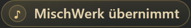
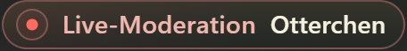

# MischWerk – aktueller Prüfbericht 0.1.146

Stand: 03.11.2026. Die Nachprüfung fand eine tatsächliche Lücke in 0.1.145: MischWerk übernimmt bedeutete bislang nur fehlende Studioanmeldung, unabhängig vom Anbieter-Sendemodus. 0.1.146 bindet die Anzeige an die vorhandenen bestätigten Übertragungs-/Modusdaten. Aktueller Desktopstand einschließlich der Änderungen beider Chats aus 0.1.144/145 vollständig erhalten. Ausschließlich lokale Bereitstellung.

## Korrigiertes Verhalten

| Bestätigter Zustand | Anzeige |
| --- | --- |
| Laufende Übertragung und AutoDJ | MischWerk übernimmt, warmgold; kein Moderatorname |
| Laufende Übertragung und LIVE, bestätigte Studioanmeldung | Live-Moderation, korallrot; vollständiger Studioname in Creme |
| Laufende Übertragung und LIVE, keine bestätigte Studioidentität | Live-Moderation ohne erfundenen Namen |
| Modus unbekannt, bestätigte Studioanmeldung | Neutrale Moderation mit Studioname |
| Modus unbekannt, keine Anmeldung | Neutrales Radio MischWerk |
| Sender gestoppt | Neutrale Sendepause |

Eine noch bestehende Studioanmeldung überschreibt bestätigten AutoDJ nicht. Fehlende oder abgelaufene Channelbestätigung verbirgt den alten Namen. Frühes Markup beginnt neutral; es behauptet vor der ersten Anbieterantwort keinen AutoDJ.

provider übergibt Status, Modus und Prüfzeiten über das interne broadcast-status-Signal an presentation. Bestehende Anbieterabfragen werden wiederverwendet: Modus mit Metadaten regulär alle fünf Sekunden, Status alle 30 Sekunden. Keine zusätzliche Abfrage oder Plattformmethode. Fehler, Stopp und Senderwechsel verwerfen die Modusbestätigung; Befunde ab 90 Sekunden werden neutral. Unsichtbare Darstellung und Rückkehr verwenden keine abgelaufene Bestätigung. Der letzte Musiktitel bleibt bei Abruffehlern nach bisheriger Regel erhalten.

## Darstellung

Matte Kapseln, statische runde 18-px-Symbole und Farben bleiben erhalten: Standard #E4D5AF, Live #F0B8AE, Name #F6F0DF. Die früheren an die reine Studioanmeldung gebundenen roten Punkt-/Textregeln entfallen, damit unbestätigte Übertragung neutral bleibt.

Aktuelle Leistenbilder mit lokalem Testtitel und bestätigtem synthetischem AutoDJ-Profil: [Hörer, 2290 px](oberflaeche/appleiste-2290.png), [Inhaber, 2290 px](oberflaeche/appleiste-inhaber-2290.png), [700 px](oberflaeche/appleiste-700.png), [320 px](oberflaeche/appleiste-320.png). Kein echter Radioton gestartet.

## Nachweise

- Öffentliche Quellen am 03.11.2026 tatsächlich lesend geprüft: [whoIsLive.php](https://mischwerk.sp.radio.fm/scripts/whoIsLive.php) antwortet HTTP 200 mit autodj; [SPCast-Statistik](https://mischwerk.sp.radio.fm/statistics?json=1) bestätigt Stream-ID 1, /stream, passende Senderidentität und streamstatus=1. Beide erlauben CORS *. Das ist ein aktueller AutoDJ-Nachweis. Der echte Sender wurde für keine Prüfung umgeschaltet oder gestoppt; LIVE-/Stopp-/Fehlerwechsel sind lokale Simulationen.
- Vollständiger Browserlauf aller fünf Suiten: **197/197 bestanden**, ohne übersprungene Fälle. Bestehenden Anzeigefall durch Anbieter-/Studiomatrix erweitert und Frische-/Generationsfall ergänzt: verzögerte Erstprüfung, AutoDJ und noch angemeldete Moderation, LIVE mit/ohne Name, relay/autodj_live/leer/HTTP-Fehler, Stopp/Rückkehr, alter Senderbefund und abgelaufene Hintergrunddaten.
- Zusätzlich **24/24 direkte Emulatorfälle**: K3-/STAPP-Modell, AutoDJ-/LIVE-Anzeige, 320/390/700/1100/1600/2290 px. Gültiger synthetischer Anbietermodus und echte Studioaktion gemeinsam verwendet. Text, Farbe, Nick, runde Symbole, Rückwechsel und fehlender horizontaler Überlauf bestätigt. Keine Laufzeitfehler oder externen Anfragen im Labor. Aktuelle breite/schmale Bilder und beide Kapseln visuell geprüft.
- **199/199 Nodefälle**, Architektur, Syntax, Plattformsignaturen, UI-IDs und Backendgleichheit bestanden.
- Rhino 1.7.7.2 und 1.9.1: je **787 Prüfungen, 125 Wünsche und zwölf abgewiesene Links** bestanden.
- Vollständiger lokaler Paketbau und anschließender tatsächlicher UPLOAD-/Manifestabgleich nach Version, Inventar, Bytes und SHA-256 bestanden. 101 Laufzeitdateien, 98 Texte, 31 Backendmodule, 68 Browserdateien, 44 Komponenten, 18 Stylesheets. Alle Laufzeittexte und fünf Manifeste strikt unter 9500 Zeichen; Laufzeitmaximum 9288.

## Erhaltung und Übergabe

Gegenüber 0.1.145 ändern sich im Produkt radio/markup, radio/presentation, radio/provider, die beiden überholten Studio-Farbregeln in radio-actions.css sowie Versionsangaben. Die vorhandenen Prüferwartungen wurden an neutrale Zustände ohne Anbieterbestätigung angepasst. radio/api, Audioplayer, Rollen, Backend-Fachlogik, gemeinsamer Fensterweg, Historienzugriff, volle Leistenbreite und 100-%-Warnsymbol bleiben erhalten. Geschützte Wunschdateien einschließlich Backend-Laufzeitkopie, beide Originalbilder und MP3 sind bytegleich.

**Gemeinsamer endgültiger lokaler Uploadstand: 0.1.146** unter C:/Users/Yves/Desktop/MischWerk/UPLOAD/MischWerk. Die Desktopquelle ist vollständig gespeichert; alle fünf Manifeste und tatsächlichen Uploaddateien entsprechen derselben Version. Fertig für den vom anderen Chat koordinierten gemeinsamen GitHub-Commit. Aus diesem Auftrag stehen keine weiteren Dateiänderungen aus; hier wurde kein Commit, Push oder Rebase ausgeführt.

Zuletzt bestätigtes LIVE bleibt 0.1.132. Kein FTP-Upload, Knuddels-Update oder Neustart ausgeführt. Native Abnahme nach separat autorisierter Veröffentlichung weiterhin offen. [Betrieb](../betrieb/INBETRIEBNAHME.md) · [Native Abnahme](../betrieb/LIVE-ABNAHME.md) · [API-Nachweis](../api/API-NACHWEIS.md).
