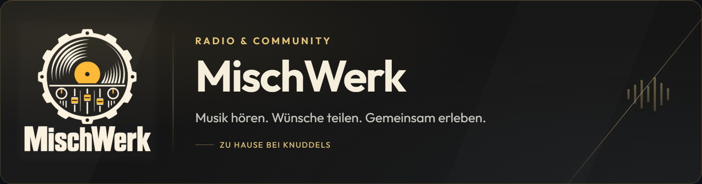
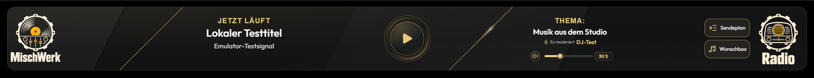
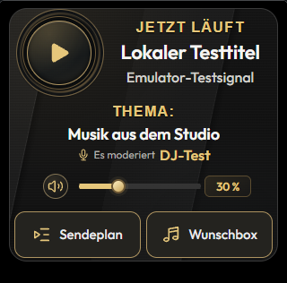
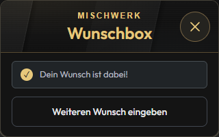
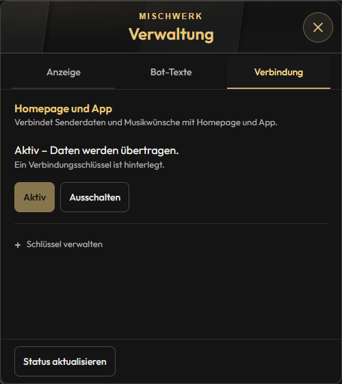

<picture>
  <source media="(max-width: 600px)" srcset=".github/mischwerk-header-schmal.png">
  
</picture>

# MischWerk · Radio & Community

[](https://github.com/YvesBerlin1990/MischWerk/actions/workflows/pruefung.yml)


Radio-App für den Knuddels-MyChannel **MischWerk** mit Musikwünschen, Sendungsanzeige und Tagesplan. Version und Build führt das [App-Paket](project/userapp/package.json).

„Prüfung“ zeigt das Ergebnis des Workflows für `main` (Struktur-, Syntax- und API-Prüfung sowie Node-Suite); Browser-, Rhino- und Paketprüfungen laufen lokal.



| Schmale Radioleiste | Wunschbox | Verwaltung |
| --- | --- | --- |
|  |  |  |

Aufnahmestände und weitere Ansichten stehen im [App-Prüfbericht](project/docs/pruefung/PRUEFBERICHT.md#prüfbilder).

## Funktionen

- **Radioleiste:** Livestream von Radio MischWerk per Play-Taste, aktueller Titel und Interpret, Lautstärke und Stummschaltung.
- **Sendung:** Thema und Moderation einer bestätigten Live-Sendung aus dem MischWerk Live Studio; bei bestätigtem AutoDJ „MischWerk am Pult“.
- **Wunschbox:** Während einer freigegebenen Live-Sendung einen Musikwunsch bis 300 Zeichen senden; Platz und Status des eigenen Wunschs erscheinen in der Radioleiste.
- **Sendeplan:** Tagesansicht der geplanten Sendungen, drei Wochen navigierbar.
- **Lauftext:** Optionale Laufzeile mit Informationen von Radio MischWerk unter der Radioleiste.
- **Verwaltung:** `/mw admin` mit Anzeige, Bot-Texten und Verbindung für den Channelinhaber und eine ausdrücklich freigegebene Person.

## Zugang für Hörer

Im Knuddels-MyChannel **MischWerk** öffnet sich die Radioleiste beim Betreten automatisch; das Radio startet erst nach einem Klick auf Play. `/mw` zeigt die verfügbaren Befehle. Die Website von Radio MischWerk ist unter [radio-mischwerk.web.app](https://radio-mischwerk.web.app/) erreichbar.

## Komponenten

| Komponente | Ort | Einstieg |
| --- | --- | --- |
| Knuddels-App | [project/userapp/](project/userapp) | [Technische Übersicht](project/docs/ENTWICKLUNG.md) |
| Originalmedien | [project/assets/](project/assets) | MyChannel-Hintergründe und Übergabemedien |
| Dokumentation | [project/docs/](project/docs) | Architektur, API-Nachweise, Betrieb, Prüfberichte |

Sendung, Wunschregie und freigegebene Nicks liegen im MischWerk Live Studio (Firebase); die App gleicht sich darüber per signiertem Abgleich ab. Die Website von Radio MischWerk läuft ebenfalls über Firebase und ist nicht Teil dieses Repositorys.

## Lokal starten

Mit Git, Node.js 24 und pnpm 11.25.0 aus der Repositorywurzel:

```powershell
pnpm --dir project/userapp install --frozen-lockfile
pnpm --dir project/userapp run emulator
```

Der Emulator ist unter `127.0.0.1:3105` erreichbar. Er kommt als privates Git-Submodul; der Klon benötigt Lesezugriff auf `PolaroidK/Windows-K-UserAppEmulator`. Für die Werkzeuge, Prüfungen und die Windows-Einrichtung siehe die [technische Übersicht](project/docs/ENTWICKLUNG.md).

## Verantwortliche

| Person | Zuständigkeit |
| --- | --- |
| Yves ([YvesBerlin1990](https://github.com/YvesBerlin1990)) | Knuddels-App |
| Alex ([PolaroidK](https://github.com/PolaroidK)) | Website, Android-App, Live Studio, Musikredaktion und Verwaltung |

## Lizenz

© 2026 Radio MischWerk (YvesBerlin1990). Alle Rechte vorbehalten; das gilt auch für alle eigenen Bilder und Medien. Einzelheiten in der [LICENSE](LICENSE), fremde Bestandteile in den [Drittanbieterhinweisen](THIRD_PARTY_NOTICES.md).

## Dokumentation

[Projektregeln](agent-rules.json) · [Installation und Betrieb](project/docs/betrieb/INBETRIEBNAHME.md) · [Native Abnahme](project/docs/betrieb/LIVE-ABNAHME.md) · [Drittanbieterhinweise](THIRD_PARTY_NOTICES.md)
