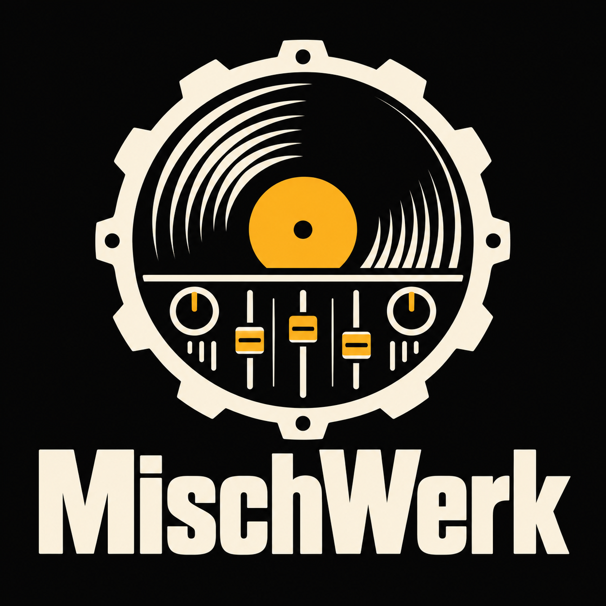
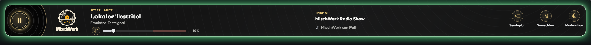
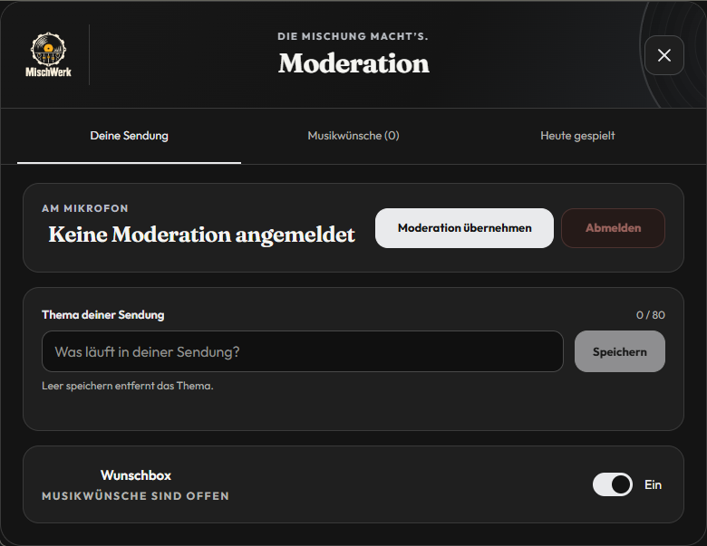
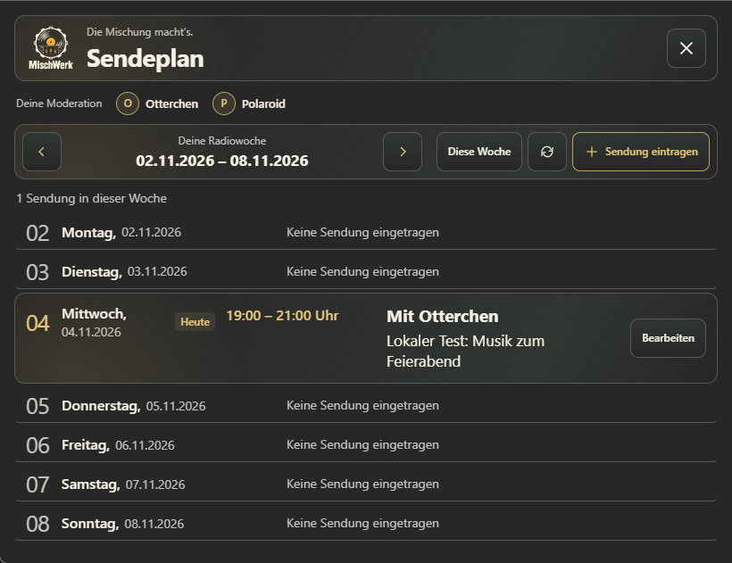
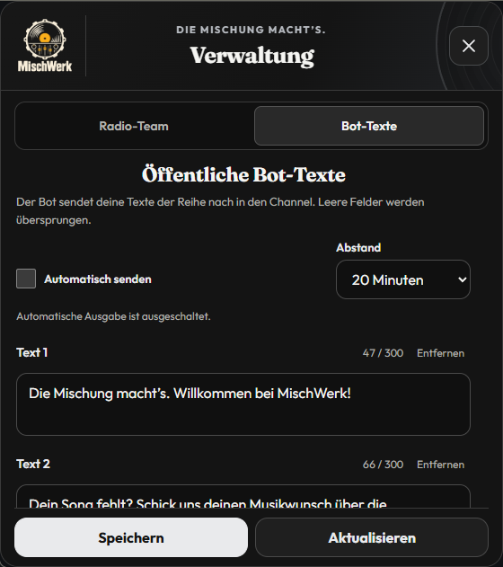
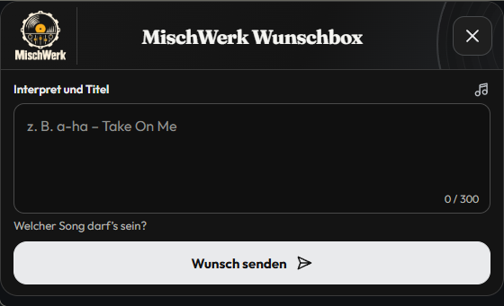
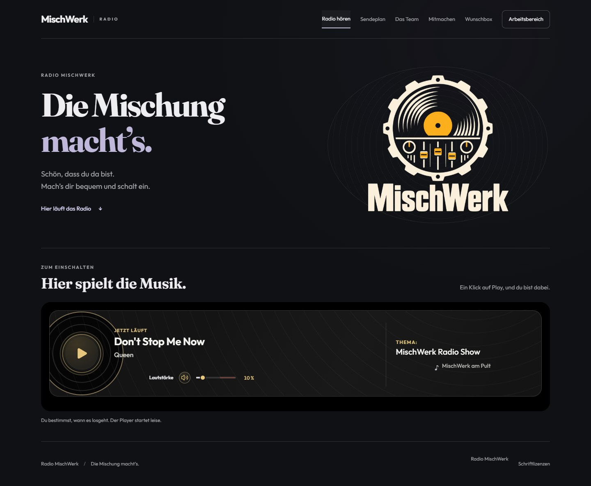

# MischWerk

Radio-App für den Knuddels-MyChannel **MischWerk** – mit Musikwünschen, Moderation, Sendeplan und eigener Homepage.

**App 0.1.239 · Build 239 · Website 0.2.0** — Stand: 6. November 2026.

Die Übergabe wurde vollständig geprüft und bei Größenwechseln, kleinen Rahmen sowie verlorenen Bestätigungen korrigiert. Otterchen ist als tatsächlicher Channelinhaber automatisch berechtigt; andere Empfänger müssen im Radio-Team eingetragen sein.

Sendeplan, Wunschbox und Moderation sind in Symbolgröße, Schrift, Tastenhöhe und Abstand einheitlich ausgerichtet. Aktivieren oder Deaktivieren der Wunschbox verschiebt keine Hauptbeschriftung.

Otterchen erhält als tatsächlicher Channelinhaber automatisch sämtliche Apprechte, Moderationsbutton und Übergabeempfang. Für ihn ist keine Radio-Team-Eintragung erforderlich. Andere Radiomoderatoren werden weiterhin unter Verwaltung eingetragen.

**/MW Verwaltung** öffnet die Verwaltung ausschließlich für den anwesenden Channelinhaber **Otterchen**. Der frühere Knopf in der Appleiste ist entfernt.

Build 230 bereitet `/mischwerk-relay einrichten` als private Eingabe für den anwesenden Channelinhaber vor. Schlüssel werden ausschließlich serverseitig gespeichert und nie zurück an das Formular gesendet; die Verbindung bleibt bei jeder Speicherung ausgeschaltet. Der native Build-229-Nachweis für Serverinformationen, Domainrechte und WebHook-API bleibt gültig. Build 230 ist lokal vorbereitet; tatsächliche Einrichtung und vollständiger Relaybetrieb stehen aus. [Einrichtung](PROJEKT/docs/betrieb/INBETRIEBNAHME.md#private-android-einrichtung-ab-build-230) · [Nachweis](PROJEKT/docs/api/API-NACHWEIS.md#private-betreibereinrichtung-230).



*Die Bilder zeigen den aktuellen lokalen Appcode mit Beispieldaten. Sie belegen keinen auf Knuddels veröffentlichten Stand.*

## Was die App bietet

| Bereich | Funktionen |
| --- | --- |
| Radio | Direkter HTTPS-Stream, Play/Stop, Lautstärke, Stummschaltung, Titel und Interpret. Goldener Playbutton und RGB-Lichthof zeigen tatsächliche Wiedergabe. |
| Wunschbox | Ein Textfeld mit bis zu 300 Zeichen. Eigener Song, Platz und Bearbeitungsstatus erscheinen privat in der Appleiste. |
| Moderation | Anmeldung, feste Endzeit oder Open End, Sendungsthema, manuelle Wunschregie, bestätigte Übergabe und private Notizen. |
| Heute gespielt | Titelmeldungen des aktuellen Tages, ausschließlich für die Moderation; vollständige Texte mit chronologischer Seitennavigation. |
| Sendeplan | Wochenübersicht mit Live, AutoDJ, Ganztags und Open End. Alle dürfen lesen, der Channelinhaber darf bearbeiten. |
| Verwaltung | Radiomoderatoren ernennen und entfernen. Bis zu sechs öffentliche Bot-Texte mit 20, 30, 40 oder 50 Minuten Abstand. |
| Vorhang | Roter Theatervorhang mit Freigabe per Chat; eigene Werbewiedergabe erst nach bewusstem Klick. |

Studiozugriff haben der tatsächliche Channelinhaber und ausdrücklich ernannte Radiomoderatoren. Channelmoderation und Appmanagerrechte allein reichen nicht. Offene Musikwünsche sind bewusst flüchtig und werden bei einem tatsächlichen App-Neustart geleert.

## Neu seit dem letzten GitHub-Stand

- **Android-Wunschbox lokal vorbereitet:** Gemeinsame Queue, private technische Statusmarker, Bearbeitungsstufen und Heartbeat sind isoliert geprüft. Der native postURL-Adapter überträgt den vereinbarten payload-String an Firebase Hosting. Der produktive Anschluss bleibt bis zu geschützter Einrichtung und echter AppServer-/Firebase-Abnahme ausgeschaltet. [Vertrag und Voraussetzungen](PROJEKT/docs/api/API-NACHWEIS.md#android-wunschbox--lokale-vorbereitung-225).

- **Erneuerter Audioverbindungsweg:** Ein einziges natives Audioelement und ein zuständiger Verbindungscontroller. Kurze Engpässe erhalten Quelle und Puffer; echte Abbrüche werden bei bestehendem Hörwunsch automatisch neu verbunden. Titel- und Statusabfragen stoppen das Audio nicht. Stop beendet auch weitere Versuche.
- **Ursache der Knuddels-Trennung eingegrenzt:** Im kontrollierten Windows-Test führte das Aussetzen von `/confirm` nach rund zehn Minuten zum Schließen der Headerbar, während Audio noch lief. Der alte Code konnte diese Bestätigung durch wiederholtes Zurücksetzen bei kurzen Nachladephasen verhindern. Build 223 erhält den Bestätigungstermin; tatsächlicher Audiofortschritt und eine passende frische Channelantwort bleiben Voraussetzung. [Messungen und Grenzen](PROJEKT/docs/pruefung/PRUEFBERICHT.md).
- **Überarbeitete Bedienung:** Goldene Vinyl-Tasten, leuchtender Playbutton, vollständig erreichbare Lautstärketaste, hervorgehobene Überschriften und mehr Luft für Texte.
- **Sendeplan und Studio:** AutoDJ-Lücken, Ganztags und Open End im Plan sowie frei wählbare eigene Moderations-Endzeit.
- **Menüs:** Größere Logos, zum Channel passende Außenflächen und ein gemeinsamer Scrollbereich für Bot-Texte.
- **Homepage:** Getrennte öffentliche Bereiche und geschützter Arbeitsbereich; Appanschluss lokal vorbereitet und standardmäßig ausgeschaltet.

Der Knuddels-Ursachentest lief mit dem noch alten Live-Code. Die native Langzeitabnahme des neuen Builds bleibt offen. Ein GitHub-Push installiert die App nicht in Knuddels und veröffentlicht die Homepage nicht.

## Einblicke

| Moderation | Sendeplan |
| --- | --- |
|  |  |

| Verwaltung | Wunschbox |
| --- | --- |
|  |  |

[Schmale Appleiste](PROJEKT/docs/pruefung/oberflaeche/vinyl-glow-mobil.png) · [Sendeplan auf 320 px](PROJEKT/docs/pruefung/oberflaeche/sendeplan-320.png) · [Theatervorhang](PROJEKT/docs/pruefung/oberflaeche/vorhang-1920.png)

## Lokal starten

Für die Appwerkzeuge: **Node.js ab 20**, **pnpm 11.25.0**, Microsoft Edge für Browserprüfungen und Java 11+ für Rhino. Die eigenständige Website benötigt **Node.js ab 22**.

Aus dem MischWerk-Hauptordner:

```powershell
pnpm --dir PROJEKT install --frozen-lockfile
pnpm --dir PROJEKT run emulator
```

Das integrierte Testlabor läuft unter **http://127.0.0.1:8776**. Es verwendet den echten lokalen Appcode in getrennten Frames für Radio und Overlays. Rollen, mehrere Testnutzer, verzögerte Nachrichten, Ressourcenfehler und lokale Anbieterantworten lassen sich prüfen. Testdaten liegen im System-Tempordner; Radio startet erst nach Play.

[Bedienhilfe](PROJEKT/tools/emulator/www/help.html) · [Technische Übersicht und Befehle](PROJEKT/README.md) · [Codex-Einstieg](PROJEKT/AGENTS.md#codex-zugriff-auf-den-integrierten-emulator)

## Prüfstand und Bereitstellung

```powershell
pnpm --dir PROJEKT test
pnpm --dir PROJEKT run test:browser
pnpm --dir PROJEKT run check
pnpm --dir PROJEKT run check:rhino
pnpm --dir PROJEKT run prepare:upload
pnpm --dir PROJEKT run check:upload
pnpm --dir PROJEKT/website test
```

Für die erste Rhino-Prüfung: `node PROJEKT/tools/checks/rhino.cjs --download`.

Der dokumentierte App-Prüfstand umfasst **351 Nodefälle**, **294 Browserfälle** und **je 1012 Prüfungen** in Rhino 1.7.7.2 und 1.9.1. Die Website hat **22 eigene Prüfungen**. Ergebnis, Wiederholungsläufe und Grenzen stehen im [App-Prüfbericht](PROJEKT/docs/pruefung/PRUEFBERICHT.md) und [Website-Prüfbericht](PROJEKT/website/docs/PRUEFUNG.md). Lokale K3-/STAPP-Modelle ersetzen keine native Abnahme.

Das vollständige Paket enthält **132 Laufzeitdateien**, darunter **125 Textdateien**, und wird durch **fünf Manifeste** geprüft. Jede ausgelieferte Textdatei und jedes Manifest bleibt unter **9500 Zeichen**. Ganze Quellmodule werden ausschließlich für die Auslieferung reproduzierbar gebündelt, ohne Minifizierung.

Der fest konfigurierte lokale Ausgabeordner ist **C:/Users/Yves/Desktop/MischWerk/UPLOAD/MischWerk/**. Er ist per Gitignore ausgeschlossen. Der Paketbau führt keinen FTP-Upload und keinen Knuddels-Neustart aus. Zur Installation gehören alle Dateien und Unterordner gemeinsam. [Installation und Betrieb](PROJEKT/docs/betrieb/INBETRIEBNAHME.md#installation-und-upload) · [Native Abnahme](PROJEKT/docs/betrieb/LIVE-ABNAHME.md).

## Homepage

Die [Website 0.2.0](PROJEKT/website/README.md) bietet Start/Radio, Sendeplan, Team, Mitmachen und Wunschbox unter eigenen Adressen. Im Arbeitsbereich stehen Moderation, Sendeplanung und Besitzerverwaltung bereit. Die Kopplung verwendet bestätigte Channelkonten und bestehende Appdaten.



Appanschluss und Mailversand sind standardmäßig ausgeschaltet. Hosting, HTTPS und echte Appanbindung sind noch gesondert abzunehmen. [Einrichtung und Grenzen](PROJEKT/website/docs/ANBINDUNG.md).

## Projekt und Dokumentation

| Bereich | Ablage |
| --- | --- |
| App-Laufzeit und Frontend | [PROJEKT/app](PROJEKT/app) |
| Gepflegte Backendquellen | [PROJEKT/src/backend](PROJEKT/src/backend) |
| Integriertes Testlabor | [PROJEKT/tools/emulator](PROJEKT/tools/emulator) |
| Build und Prüfungen | [PROJEKT/tools](PROJEKT/tools) · [PROJEKT/tests](PROJEKT/tests) |
| Originalmedien | [PROJEKT/medien](PROJEKT/medien) |
| Projektregeln | [PROJEKT/AGENTS.md](PROJEKT/AGENTS.md) |
| Aufbau und Gestaltung | [Architektur](PROJEKT/docs/architektur/ARCHITEKTUR.md) · [Frontend](PROJEKT/docs/architektur/ARCHITEKTUR-FRONTEND.md) · [Design](PROJEKT/docs/architektur/DESIGN.md) |
| Schnittstellen | [API-Nachweis](PROJEKT/docs/api/API-NACHWEIS.md) |

Private `.env`-Dateien, Zugangsdaten, Entwicklungsabhängigkeiten und lokale Auslieferungen gehören nicht ins Repository.
