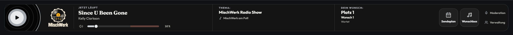

# MischWerk

Radio-App für den Knuddels-MyChannel **MischWerk**. Aktueller Quellstand: **0.1.202 · Build 202**.

Die App verbindet Radiohören, Musikwünsche, Moderation und Sendeplanung. Die Appleiste und die vier nativen Channel-Overlays verwenden ein gemeinsames Vinyl-Deck-Design mit lokal eingebundenen Outfit-/Fraunces-Schriften. Der äußere Leistenhintergrund **#0F1114** ist auf das vorhandene Channelbild abgestimmt.



*Vorschau aus dem integrierten Testlabor mit lokalen Beispieldaten; kein Nachweis des aktuellen Live-Stands in Knuddels.*

## Funktionen

- **Radio:** Play/Stop, Lautstärke, Mute, Titel und Interpret sowie bestätigte Moderation und Sendungsthema. Ein bestätigter Senderstopp beendet die Wiedergabe; die Rückkehr startet keinen Ton automatisch.
- **Wunschbox:** ein Textfeld mit bis zu 300 Zeichen. Titel, Platz und Bearbeitungsstatus eigener offener Wünsche stehen im privaten Wunschbereich der Appleiste. Nach dem Absenden erscheinen eine kurze Bestätigung und „Weiteren Wunsch eingeben“.
- **Moderation:** die Reiter „Deine Sendung“, „Musikwünsche“ und „Heute gespielt“; Studioanmeldung, Thema, manuelle Wunschregie und bestätigte Übergabe mit privaten Notizen.
- **Historie:** heutige Titelmeldungen mit Senderzeit und vollständigen Textseiten. Älteste Titel stehen auf Seite 1, neueste auf der letzten Seite; beim Öffnen werden die neuesten angezeigt. „Zurück“ führt zu älteren, „Weiter“ zu neueren Titeln.
- **Verwaltung:** Radiomoderatoren ernennen und ihren Zugriff entziehen, ausschließlich für den tatsächlichen Channelinhaber.
- **Sendeplan:** Wochenplan für alle zum Lesen; Eintragen und Bearbeiten für den Channelinhaber. Leere Wochen nutzen den vorhandenen Platz gleichmäßig.
- **Vorhang:** globale Steuerung über die freigegebenen Chatbefehle; getrennte Werbewiedergabe erst nach eigenem Klick.

Studiozugriff haben der tatsächliche Channelinhaber und ausdrücklich ernannte Radiomoderatoren. Channelmoderatoren und Appmanager erhalten dadurch keine zusätzlichen Radiorechte. Offene Musikwünsche sind bewusst flüchtig und werden bei einem tatsächlichen App-Neustart geleert.

## Aktueller Stand

- Responsive Appleiste für **320–3840 px** mit gleichmäßiger Platzverteilung für Musik, Sendungsinformationen und eigenen Wunsch. Ohne offenen Wunsch nutzen die beiden übrigen Bereiche den Platz.
- Mittige Menüüberschriften und Original-Logos ohne abgesetzten schwarzen Hintergrund; alle Aktionen bleiben über vorhandene Tasten, Bereichs- oder Textseiten erreichbar.
- Wunschbox-Abgleich gebündelt und identische Darstellungen dedupliziert; Schließaufträge auf aktuelle Sitzungen begrenzt. Der dokumentierte Schreibvergleich sank von **108 auf 18 Servernachrichten**.
- Frühe Startfehler werden sichtbar gemeldet. Ein vollständiger, zusammengehöriger Dateistand ist für die Bereitstellung erforderlich.

Die vollständigen Ursachenbefunde, Grenzen und aktuellen Ergebnisse stehen im [Prüfbericht](PROJEKT/docs/pruefung/PRUEFBERICHT.md).

## Lokal starten

Entwicklungsumgebung: **Node.js ab 20**, **pnpm 11.25.0**, Microsoft Edge für Browserprüfungen und Java 11+ für Rhino.

Aus dem MischWerk-Hauptordner:

```powershell
pnpm --dir PROJEKT install --frozen-lockfile
pnpm --dir PROJEKT run emulator
```

Das integrierte Testlabor öffnet unter **http://127.0.0.1:8776**. Es verwendet den echten lokalen Appcode in getrennten Frames für Radioleiste und Overlays. Mehrere Testnutzer, Rollenwechsel, verzögerte oder doppelte Nachrichten, Ressourcenfehler und lokale Anbieterantworten lassen sich gezielt prüfen. Testdaten bleiben im System-Tempordner; Radio startet erst nach Play.

Eine separate Emulator-ZIP oder ein zweiter Projektordner ist nicht erforderlich. Die [Bedienhilfe](PROJEKT/tools/emulator/www/help.html) und der [Codex-Einstieg](PROJEKT/AGENTS.md#codex-zugriff-auf-den-integrierten-emulator) beschreiben Betrieb und Grenzen.

## Prüfen und lokal bereitstellen

```powershell
pnpm --dir PROJEKT test
pnpm --dir PROJEKT run test:browser
pnpm --dir PROJEKT run check
pnpm --dir PROJEKT run check:rhino
pnpm --dir PROJEKT run prepare:upload
pnpm --dir PROJEKT run check:upload
```

Für die erste Rhino-Prüfung können die geprüften JARs mit `node PROJEKT/tools/checks/rhino.cjs --download` im lokalen Temp-Cache bereitgestellt werden.

Der aktuelle Paketbau umfasst **236 Nodefälle**, beide Rhino-Engines mit **je 802 Prüfungen** sowie Architektur-, Syntax-, Kennungs-, Längen- und Uploadkontrollen. Die vollständige Browserabnahme von Build 201 umfasst **234 Fälle**. Für die Hintergrundanpassung in Build 202 wurden **14 relevante Browserfälle** einschließlich der **456 Geometriefälle** und der frühen Ladewege erneut geprüft. Die lokalen Modelle ersetzen keine native Knuddels-Abnahme.

Der Paketbau erzeugt **106 Laufzeitdateien** und fünf konsistente Dateimanifeste. Jede ausgelieferte Textdatei und jedes Manifest bleibt strikt unter **9500 Zeichen**. Vollständige Quellmodule werden ausschließlich für die Auslieferung reproduzierbar gebündelt.

Das feste lokale Ziel ist **C:/Users/Yves/Desktop/MischWerk/UPLOAD/MischWerk/**, konfiguriert in [deployment/live.json](PROJEKT/deployment/live.json). Dieser erzeugte Ordner ist per Gitignore vom Repository ausgeschlossen. Der Build führt keinen FTP-Upload, kein Knuddels-Update und keinen Neustart aus. Für eine spätere Knuddels-Bereitstellung alle Dateien einschließlich Unterordnern gemeinsam übertragen; siehe [Betriebsanleitung](PROJEKT/docs/betrieb/INBETRIEBNAHME.md#installation-und-upload).

## Projektaufbau und Dokumentation

| Bereich | Ablage |
| --- | --- |
| Laufzeit der Knuddels-App | [PROJEKT/app](PROJEKT/app) |
| Gepflegte Backendquellen | [PROJEKT/src/backend](PROJEKT/src/backend) |
| Integriertes Testlabor | [PROJEKT/tools/emulator](PROJEKT/tools/emulator) |
| Build, Prüfungen und Tests | [PROJEKT/tools](PROJEKT/tools) · [PROJEKT/tests](PROJEKT/tests) |
| Originalmedien und Channelbild | [PROJEKT/medien](PROJEKT/medien) |
| Technischer Einstieg | [Projektübersicht](PROJEKT/README.md) |
| Verbindliche Projektregeln | [PROJEKT/AGENTS.md](PROJEKT/AGENTS.md) |
| Architektur und Gestaltung | [Architektur](PROJEKT/docs/architektur/ARCHITEKTUR.md) · [Frontend](PROJEKT/docs/architektur/ARCHITEKTUR-FRONTEND.md) · [Design](PROJEKT/docs/architektur/DESIGN.md) |
| API, Betrieb und Abnahme | [API-Nachweis](PROJEKT/docs/api/API-NACHWEIS.md) · [Betrieb](PROJEKT/docs/betrieb/INBETRIEBNAHME.md) · [Native Abnahme](PROJEKT/docs/betrieb/LIVE-ABNAHME.md) |

Der eigenständige [Websiteentwurf](PROJEKT/website/README.md) ist **pausiert**. Er gehört weder zur aktiven App noch zum Upload; normaler Start, Mailversand und Appanbindung bleiben deaktiviert. Private Konfigurationen, Zugangsdaten und Entwicklungsabhängigkeiten werden nicht in Git aufgenommen.
